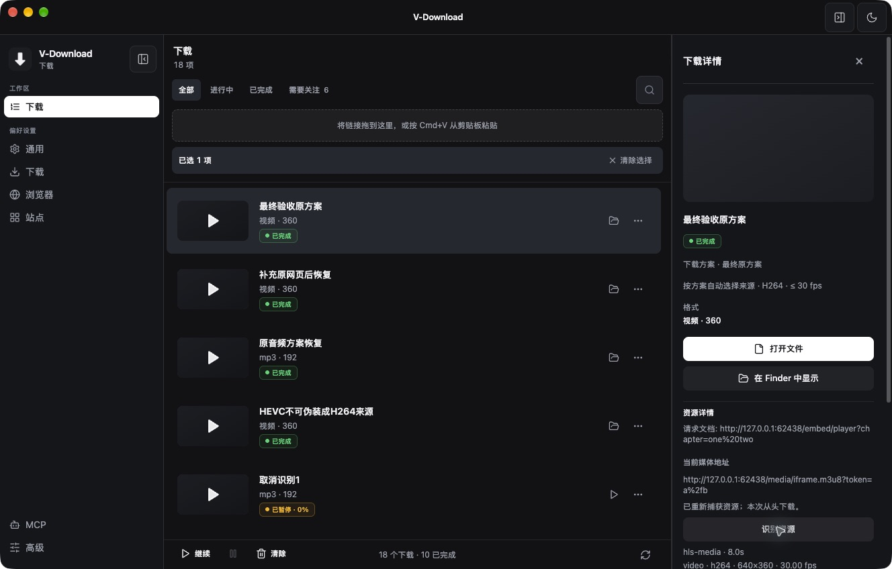
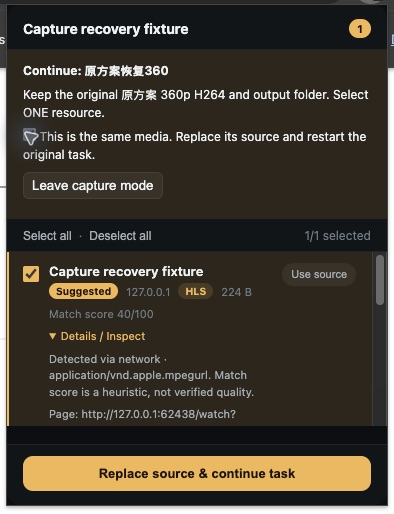

# 浏览器候选详情、按需识别与原任务恢复

> 历史记录，已归档。本文保留当时的基线、观察和验收范围；当前桌面状态见 [DESKTOP_STATUS](../../DESKTOP_STATUS.md)，网页版执行计划见 [web-download](../../plans/web-download.md)。旧优先级建议不自动成为当前待办。

> 2026-10-16 整理：独立研究目录已删除，仍被报告引用的证据已归档。正文中的原测试路径保留为历史条件；详见 [归档说明](research-archive-2026-10-16.md)。

> 后续审查与安装：已补修任务切换时来源输入串用的问题，完成 `/Applications` 安装及既有 Chrome 扩展重载后的真实端到端验证，见 [详细审查与安装记录](capture-review-install-2026-10-15.md)。本报告下面的“日常安装未替换”描述保留为上一轮测试的历史条件。

日期：2026-10-15（America/Los_Angeles）。基于 `a3d0bfbb444045e034b0fdfc611e4f2a9888c464` 的现有工作区继续实现，保留此前下载正确性、下载方案、来源上下文和扩展捕获修复。本批没有提交或推送。

本记录对应 [Downie 对比报告](downie-comparison-2026-10-15.md) 的 R7/R8 部分建议。交付复用 Chrome 扩展和下载详情，没有新增独立浏览器或侧栏工作区。

## 1. 交付结果

| 能力 | 当前行为 |
|---|---|
| 候选详情 | 扩展的每项资源可展开来源页面、请求文档、原始媒体 URL、捕获方式和 MIME。推荐标签改为 Suggested，说明评分是启发式，不冒充成功概率或已验证画质。 |
| 按需识别 | 用户点击后读取媒体信息，不创建下载任务。显示视频编码、分辨率、FPS、音频、字幕流、语言及可用时长；缺少的事实保持未知。 |
| 清单关系 | 从 HLS 清单读取实际声明的变体、外置音频/字幕资源及属性。普通媒体分片不会变成独立下载候选。DASH 显示 ffprobe 所识别的流，不推断 Representation 之间的关系。 |
| 原任务重新捕获 | 在失败、暂停、中断或取消的任务详情中打开 Chrome；播放后从扩展选择一个替换资源并明确确认，继续原任务。 |
| 保留下载意图 | 保留任务 ID、原始请求 URL、原下载方案快照、方案名称/版本、文件命名和实际输出目录。当前默认方案改变或原方案删除，不影响这次恢复。 |
| 只有 CDN 直链的任务 | 可在任务详情明确补充一个来源网页，再进入重新捕获；原任务 URL 仍保留。 |
| 恢复语义 | 替换来源后进度从零开始，详情明确显示“本次从头下载”。新的捕获使用独立临时子目录，避免拼接旧源的部分文件。 |
| 403 | 通用 HTTP 403 / Forbidden / Access denied 归为 `ACCESS_DENIED`；只有 401 或明确登录要求才归为 `AUTH_REQUIRED`。桌面、解析提示与 Remote API 复用同一分类。 |

用户操作：

1. 普通发现：打开扩展 → `Details / Inspect` → `Inspect media`；原来的单项/批量下载及方案选择继续使用。
2. 恢复任务：打开下载详情 → 必要时展开“重新捕获的来源页面”补充网页 → “在 Chrome 重新捕获” → 播放媒体 → 打开扩展 → 选一个资源并确认 → `Replace source & continue task`。
3. 恢复模式显示原任务及原方案，隐藏普通方案选择，避免误把当前扩展偏好套到旧任务。该标签页的普通浮层下载会提示用户去扩展确认，避免意外创建新任务。
4. 可以从桌面取消捕获，也可以在扩展退出捕获模式。取消或开启新的捕获后，旧回调不能修改任务。

## 2. 关键实现与边界

### 识别事实由主进程产生

- [媒体识别服务](../../../src/main/mediaInspection.ts#L21) 共用下载引擎的 `directMediaHeaders`，沿用完整 Referer。任务详情的识别还使用该任务的代理覆盖。
- [清单和流事实解析](../../../src/main/mediaInspectionModel.ts#L17) 分别处理 HLS 属性列表和 ffprobe JSON。HLS 的带引号逗号、相对 URI、原始查询编码和外置轨道均有覆盖；不会根据“另一个 m3u8”就声称它是当前资源的变体。
- 全局最多两个同时识别；清单最多读取 512 KiB，最多展示 128 个关联资源、64 条流。HTTP 有读超时；ffprobe 复用既有 15 秒期限、64 KiB 输出限制和进程家族清理。
- 识别只由用户操作触发，不后台遍历全部候选，不缓存签名链接或把浏览器登录等同于引擎可访问。取消操作会终止所属探测；任务列表与原下载状态不受影响。
- 媒体和来源 URL 仍保留调用者原始字符串。新增网页输入按浏览器实际导航语义解析；不重写已保存的任务 URL 或媒体传输 URL。

入口：[扩展详情](../../../extension/popup.js#L304)、[任务详情](../../../src/renderer/src/components/CapturedMediaDetails.tsx#L6)。

### 捕获会话与任务分别拥有状态

- [捕获会话 owner](../../../src/main/mediaCapture.ts#L19) 使用随机会话 ID、10 分钟期限、最多 64 个会话；绑定任务和提出请求的扩展 Origin。
- 所有新回调继续要求现有扩展 Origin/allowlist 与安装级 capability。来源网页不获得任务修改接口；提交必须来自扩展弹窗、当前文档中的有效候选，并有显式确认。
- 扩展持久化标签页与会话的绑定，Worker 重启后可恢复。重新播放产生的新请求仍可捕获；不承诺重载后恢复所有历史资源。
- [任务替换边界](../../../src/main/downloadManager.ts#L3613) 等待旧运行清理完，再检查会话是否仍有效、任务是否仍为可恢复状态以及原请求是否改变。原输出意图从主进程读取，扩展不能提供新方案或目录覆盖。
- 数据库的任务 `url` 保持原请求；`metadata.candidate.url` 保存当前执行源，`sourceContext` / Referer 保存该源的新观测。新增 `recaptureRevision` 和 `recaptureAt` 进入现有 extras。
- 新源使用 `.vdl-staging/<task>/capture-N`；旧源的临时内容不作为新源的续传依据。原任务输出目录由既有 writer owner 解析并冻结。已有发布产物、图集、原生整合集和 Remote Job 不接受这种单资源替换，避免破坏其输出所有权或多产物语义。
- 重复提交同一已接受回调可得到成功响应，不新增任务。取消、替代或过期会话在等待旧运行后还会再次检查，防止迟到提交。

### 原选择继续严格执行

真实 iframe HLS 补测发现：ffprobe 能识别 H.264，但 yt-dlp 的该格式不包含 `vcodec`、height、fps。原编码筛选会提前拒绝这个合规源。

共享选择现在允许未知 provider 编码进入候选筛选，已知不符的编码仍被排除；发布前仍必须由 `sourceVideoMatches` 和实际流验证原约束。验证发生在兼容转换之前，因此不能先把 HEVC 转成 H.264 再冒充满足 H.264 来源要求。所用未知值语法也核对了 [yt-dlp 官方筛选实现](https://github.com/yt-dlp/yt-dlp/blob/master/yt_dlp/YoutubeDL.py)，并在本机固定引擎上实测。

**精确 provider 格式 ID 不会静默放宽。** 如果原任务锁定的 `sourceUrl` 与新资源不符，替换被拒绝，原任务及原选择保留；用户需要对新来源重新确认格式。目前没有在捕获弹窗中编辑该精确 ID 的入口。

### 403 的共同解释

[下载错误分类](../../../src/main/downloadError.ts)、解析提示和 API 失败映射复用同一分类结果；解析层不再把所有 403 当登录需求。新媒体接口把来源拒绝作为业务失败返回，不与本地配对的 403 混淆。

Remote API 新增 `access_denied`，应用层不会对这个永久拒绝反复自动重试，见 [API 文档](../../REMOTE_JOB_API.md#retries)。既有 404/410、真实引擎启动缺失分类保持原语义。

## 3. 兼容性

- **设置与方案**：不增加新的方案库版本，不重新读取默认方案来覆盖旧任务。恢复使用原 `DownloadRequestSnapshot`。
- **数据库**：新增事实保存在既有 extras，无新增迁移。旧记录缺少字段时没有新的事实声明；已有历史错误码不批量重写，新尝试使用新分类。
- **IPC**：增加识别、取消识别、开始/取消捕获接口；状态事件添加可选 `mediaUrl` / `recaptureAt`，仍只在语义变化发送，普通字节 tick 保持精简。
- **扩展**：新增鉴权 POST `/media-inspect`、`/media-capture-command`、`/media-capture-complete`、`/media-capture-cancel`，以及专用 landing 页。manifest 增加该本地页面的内容脚本，没有增加权限。旧 `/download` 和方案接口保留；旧客户端请求继续通过既有回归。
- **HTTP/MCP**：下载创建合同未扩大为方案管理接口；新增失败码为 `access_denied`，错误结构仍为字符串 code/message。消费者应保留未知错误码的通用展示。
- **认证**：不扩大 Cookie 同步域名，不读取未选择的个人浏览器配置，不增加认证头持久化；已有过滤规则仍阻止 Cookie/Authorization 落入任务 extras。

## 4. 端到端验证

### 条件与隔离

本机 macOS arm64，Chrome for Testing **151.0.7922.34**，独立浏览器配置、扩展副本、用户数据、session、临时目录与输出目录。yt-dlp **2026.07.04**，FFmpeg/ffprobe **8.1.2**，只读使用已安装引擎。

先运行开发构建，再运行 **`app.isPackaged === true` 的隔离测试 .app**。测试包包含最终编译文件、共享包和扩展；84 个对应产物与当前工作区逐文件比对一致。测试包使用单独 bundle ID 和临时 ad-hoc 签名，`codesign --verify --deep --strict` 通过。

测试 bootstrap 只负责隔离路径/端口、把浏览器启动定向到独立 Chrome，以及在 loopback 暴露受随机 token 保护的既有 IPC handler 供测试调用。没有注入 renderer API、替换下载引擎或跳过输出验证。Chrome 的页面播放、真实扩展弹窗、确认替换，以及任务详情由真实 UI 操作验证。

这是隔离打包版验证，**不是正式签名、公证、安装器或发布渠道验收**。日常 `/Applications/V-Download.app` 未被替换。

### 结果

| 场景 | 结果 |
|---|---|
| 实际扩展候选列表 | 同页 3 条独立 HLS、1 条 DASH、1 条 MP4 全部可见。 |
| HLS 主清单识别 | 读取 360p/720p、30 fps、H.264/AAC 与实际清单关联，8 秒时长。 |
| DASH / MP4 识别 | 实际音视频流、编码、分辨率和时长可读；DASH 未知关联没有被猜测。 |
| iframe 上下文 | 完整 `/embed/player?chapter=one%20two` Referer 通过受控服务端检查，识别与下载均完成。 |
| 原方案与目录 | 删除已选方案、修改默认方案和目录后，恢复仍保留原 360p/H.264/30 fps、原命名与原目录。 |
| 文件碰撞 | 同名既有文件哈希保持不变，输出发布到另一个安全文件名。 |
| 原任务关联 | 原 ID 和原 URL 保留；重复回调不新增任务；无关历史失败任务不被恢复。 |
| 解析占位任务恢复 | 解析 403 的原记录转入正常下载队列并完成，未建立第二条替代任务。 |
| 错误分类 | 直接下载与解析的普通 403 为 `ACCESS_DENIED`；401 为 `AUTH_REQUIRED`；404 为 `UNSUPPORTED`。 |
| 不合规来源 | 720p 不满足 360p 方案；HEVC 不满足 H.264 来源约束；失败时没有成功主文件交付。换回合规源后同一任务完成。 |
| MP3 | 替换源后仍执行原音频意图；输出只有 MP3 音轨，没有视频。 |
| 精确来源锁定 | 不兼容的新 URL 被拒绝，原选择和原记录保留。 |
| 会话与鉴权 | 错误页面、无确认、方案注入、外站 Origin、缺 capability、无效来源、取消/替代会话均被拒绝；Worker 重启后绑定保留。 |
| 应用重开 | 已完成任务与新媒体来源从数据库正确载入；重开前的捕获会话回调失效，返回 410，要求重新开始。 |
| 识别取消和容量 | 两个并发识别可取消，第三个被明确拒绝；取消后未遗留所属 ffprobe，暂停任务状态不变。 |
| 最终输出 | 总计 10 个独立成功产物全部经过 ffprobe 与 FFmpeg 完整解码；均来自 8 秒自有音视频样本，含一份仅音频 MP3。 |

最终构建另有 13 项明确检查，覆盖完整 iframe 恢复、方案删除/默认变更、幂等回调、取消、来源上下文、原目录和安装包保持不变。此前的 39 项接口/引擎检查、补充 7 项选择/音频/来源检查保留各自结果，**不是互相独立的成功率样本**。

## 5. 自审与补修

| 发现 | 结构修正 | 验证 |
|---|---|---|
| 已证实 H.264 的单清单被 provider 未知编码过早排除 | 在共享筛选边界允许未知编码，保留最终来源验证；没有为恢复入口另造放宽策略 | 真实 iframe 成功；未知元数据的 HEVC 负例拒绝发布；共享选择回归 |
| 等待旧运行清理期间，会话可能被取消或替代 | 在真正修改任务之前再次向会话 owner 确认授权仍有效 | 取消/替代回调回归；最终包 HTTP 取消后提交拒绝 |
| 退出扩展捕获模式仅清本地绑定会留下主进程会话 | 退出动作同时取消主进程会话；失败时保留可重试状态 | 生产 Worker 测试与真实 HTTP endpoint 验证 |
| 候选详情放入整行 label，导致复选框朗读整个详情、交互目标混杂 | checkbox 只绑定标题 label，详情和识别按钮独立 | 最终 Chrome AX 与实际选择/确认验证 |
| 更换媒体源后旧识别结果可能迟到 | 资源变化/组件退出时取消所属识别并使旧响应失效 | 取消回归、任务状态/界面确认 |

最终全量 `npm test`、`npm run typecheck`、`npm run build`、`git diff --check`，以及新增持久化、扩展捕获和媒体识别检查通过。未发现本批已实现范围内尚未处理的阻塞问题。

## 6. 证据与剩余范围

仓库内证据：[最终构建检查](assets/browser-capture-recovery-2026-10-15/final-build-verification.json)、[最终任务](assets/browser-capture-recovery-2026-10-15/final-build-task.json)、[输出与完整解码](assets/browser-capture-recovery-2026-10-15/output-verification.json)、[补充负例与 MP3](assets/browser-capture-recovery-2026-10-15/extra-verification.json)、[接口场景](assets/browser-capture-recovery-2026-10-15/api-verification.json)、[识别取消](assets/browser-capture-recovery-2026-10-15/inspection-cancellation.json)、[重开检查](assets/browser-capture-recovery-2026-10-15/restart-verification.json)、[代码/产物/引擎身份](assets/browser-capture-recovery-2026-10-15/final-code-identity.json)、[原安装与数据保持](assets/browser-capture-recovery-2026-10-15/data-preservation.json)。

完整本地测试脚本、日志、fixture 生成器和分轮结果位于 `/Users/mingjie/Documents/github/personal-projects/v-download-research/browser-recovery-2026-10-15/`。原安装的 app.asar、settings、Cookie、配对 secret 和 remote job 文件与测试前的哈希一致。

明确边界：

- **已实现/已验证**：候选来源详情、用户触发识别、HLS 声明关系、同任务重新捕获、方案/目录保留、403 区分，以及上述受控端到端场景。
- **部分覆盖**：DASH 只提供实际流事实；没有完整 Representation 分组。精确 provider ID 无法移植到新 URL 时拒绝，未增加新来源的精确格式重选 UI。
- **未验证**：真实站点登录/付费会话、过期公网签名的站点专用刷新、DRM、所有广告识别规则、直播长期运行、Windows/Linux、Safari/Firefox及独立的 10 分钟真实等待到期实验。
- **恢复范围**：会话在主进程内存中，应用重启后应从原任务重新开始捕获；不把重新下载宣称为字节续传。旧源临时文件被隔离，跟随任务既有删除清理流程。
- **本批以外**：外置字幕下载、公共 API/MCP 方案管理、原生账号有效性仪表板、正式扩展分发与应用更新渠道。

测试用浏览器配置、隔离应用和大体积构建/媒体材料已清理，按逻辑大小计约 818.4 MiB；测试 HTTP/IPC/fixture 端口全部关闭，原安装及上述数据文件哈希不变。见 [清理回执](assets/browser-capture-recovery-2026-10-15/cleanup.json)。
