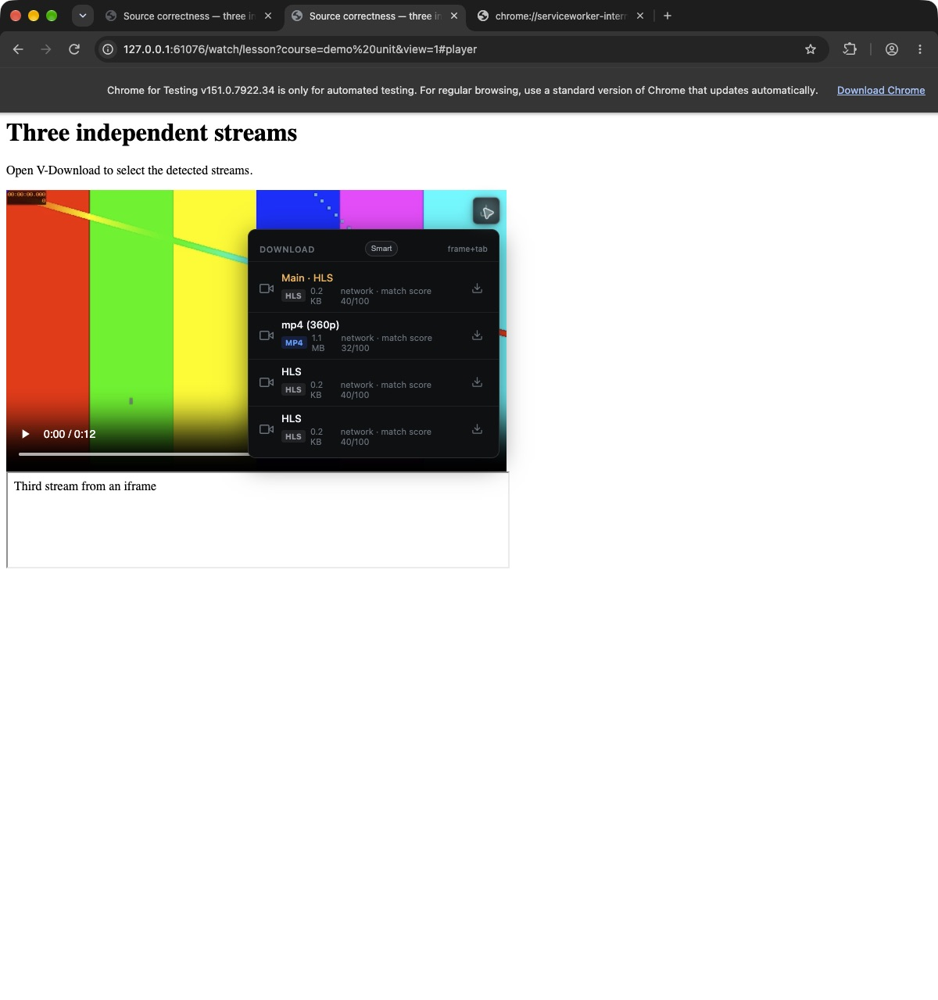

# 浏览器候选第一批数据正确性修复

> 历史记录，已归档。本文保留当时的基线、观察和验收范围；当前桌面状态见 [DESKTOP_STATUS](../../DESKTOP_STATUS.md)，网页版执行计划见 [web-download](../../plans/web-download.md)。旧优先级建议不自动成为当前待办。

> 2026-10-16 整理：独立研究目录已删除，仍被报告引用的证据已归档。正文中的原测试路径保留为历史条件；详见 [归档说明](research-archive-2026-10-16.md)。

日期：2026-10-15（America/Los_Angeles）。范围：原始 URL、完整 Referer 与来源上下文、重复评分、独立候选可见性。基于 `a3d0bfbb444045e034b0fdfc611e4f2a9888c464` 的现有工作区，保留此前的下载正确性和下载方案改动；本批未提交、发布或替换已安装应用。

## 1. 修复结果

| 问题 | 原因与修正 | 验收结果 |
|---|---|---|
| 原始 URL 被改写 | 原先把用于去重的 URL 重新作为传输 URL。现在归一化只用于身份比较，候选、提交和下载保留捕获的原字符串；URL 与上下文取自同一次观测。 | `%2f`、`%20`、参数顺序及 `utm_source` 保留；严格检查原始查询串的服务端接受实际下载。 |
| Referer 只有 origin，iframe 来源丢失 | 增加共享 `MediaSourceContext v1`；捕获顶层页面、请求文档、tab/frame/document ID、导航 epoch 和时间。弹窗与浮层共用提交来源逻辑。 | iframe 下载使用 iframe 完整路径与查询串；754 字符 Referer 在引擎实际请求中完整出现。 |
| 评分重复上涨 | 原来上次评分又进入下一次评分公式。现在仅由类型、来源、大小、协议和原有噪声特征计算。界面改称匹配评分，避免暗示概率。 | 同一输入连续合并：修复前 `39 → 78 → 100 → 100`；修复后 `39 → 39 → 39 → 39`。 |
| 独立候选被隐藏 | 移除“其他清单都是 variant”、页面有 HLS 就把小 MP4 当 preview、按类型截断候选等规则；未建立关系的候选保留为 Detected。 | 3 条独立 HLS 和 1 条小 MP4 在 Smart 中同时可见；同 URL 的不同 frame 不再被扁平 URL 去重吞掉。 |

基线与修复后运行同一候选策略的结果：[baseline-comparison.json](assets/research-archive-2026-10-16/browser-data-correctness-2026-10-15/baseline-comparison.json)。同一四候选输入，Smart 可见数量从 2 增至 4。这是自有样本的确定性对照，不是全站发现率测量。

## 2. 数据链路与兼容性

### URL、来源与身份分别保存

- `url` 始终为浏览器捕获或用户提交的传输字符串。规范化 URL 只用于比较。
- `sourceContext.pageUrl` 是顶层页面；`documentUrl` 是实际请求文档。iframe URL 来自请求事件或 `webNavigation.getFrame`，缺少证据时保留未知。
- Referer 使用 `documentUrl → pageUrl → initiator` 的顺序，移除 fragment，保留路径和查询串的原始编码。
- 候选身份包含来源作用域。下载准入身份包含稳定的来源 URL/Referer 与原有下载选择，不包含每次变化的捕获时间和浏览器 document ID。同 URL、不同来源文档不复用错误的旧 Referer；同来源重复观测仍复用对应任务。

主要生产者：[共享来源模型](../../../packages/shared/src/media-source-context.ts)、[候选策略](../../../extension/media-patterns.js#L144)、[扩展来源提交](../../../extension/background.js#L146)、[任务准入身份](../../../src/main/downloadRequestSnapshot.ts#L37)。

### 跨边界保留

来源经过网络候选、frame 缓存、Worker 恢复、浮层/弹窗提交、本地服务校验、任务 metadata、数据库 extras 和 renderer 事件保留。详情的来源入口使用原页面，而不是 CDN 地址；原始媒体地址仍可查看和复制。

- `sourceContext` 是可选、版本化字段。旧扩展不传该字段仍可下载，已实测。
- 未知版本、额外字段、非 HTTP(S) 来源和无效标识拒绝；坏候选的批量提交会返回结果，不再挂起。
- URL/Referer 按现有 8192 字符边界校验，不通过截断制造一个看似有效的地址。来源上下文不承载 Cookie、认证头或登录授权。
- 数据库存入现有 `extras`，准入键使用前一批下载方案已加入的 `selection_key`；本批没有新增数据库迁移。旧记录不伪造来源，未带来源的新请求维持原有准入行为。
- manifest 新增 `webNavigation`，用于读取 iframe 文档及导航失效通知。发布后需按 Chrome 的正常扩展更新/权限流程生效。本次只在独立测试配置加载开发扩展。

## 3. 端到端验证

测试使用独立 Chrome for Testing 151.0.7922.34、独立 Electron profile、临时端口和专用输出目录。引擎只读使用已安装资源：yt-dlp 2026.07.04、FFmpeg/ffprobe 8.1.2。源码、构建和引擎 SHA-256 见 [final-code-identity.json](assets/research-archive-2026-10-16/browser-data-correctness-2026-10-15/final-code-identity.json)。

自有页面包含顶层 MP4、两条顶层 HLS，以及来自 iframe 的第三条 HLS。媒体均为 12 秒合成音视频；“独立”指独立 URL 和请求来源，不代表四段不同的真实站点内容。

受控服务端要求原始查询串 `?token=a%2fb&label=hello%20world&utm_source=capture`，并分别要求完整顶层或 iframe Referer。错误查询串或错误 Referer 返回 403。

| 验证 | 实际结果与证据 |
|---|---|
| 真实浮层提交 iframe HLS | 完成；任务保存顶层页、iframe 文档、frame/document ID 和 iframe Referer。[任务记录](assets/research-archive-2026-10-16/browser-data-correctness-2026-10-15/e2e-browser-tasks.json) |
| 真实弹窗全选 4 项 | 可见 4/4，提交反馈全部接受；3 HLS + MP4 均完成，先前已完成的同来源任务被复用。[截图](assets/browser-data-correctness-2026-10-15/popup-independent-sources.png) |
| 相同 URL、不同来源 | 两个真实 HTTP 请求进入生产本地服务并产生不同任务；顶层/iframe Referer 分别正确；随后同来源的新观测仍为原任务，共 2 项。[验证脚本与结果](assets/research-archive-2026-10-16/browser-data-correctness-2026-10-15/source-admission-e2e.json) |
| 长 Referer、坏上下文、旧客户端 | 754 字符 Referer 出现在实际引擎请求；3 类坏上下文返回 HTTP 400；无 sourceContext 的旧形状完成下载。[结果](assets/research-archive-2026-10-16/browser-data-correctness-2026-10-15/long-context-e2e.json) |
| 真实 Worker 停止/唤醒 | 通过 Chrome 自带 Worker 页面停止本扩展，返回未刷新的媒体页唤醒。4 候选仍在，HLS 40/100、MP4 32/100 没有上涨。[截图](assets/browser-data-correctness-2026-10-15/worker-restored-scores.png) |
| 应用退出重开 | 9 条记录逐项比较 URL、metadata、文件路径和状态；8 条 complete 及 1 条实测途中留下的错误对照均保持。[结果](assets/research-archive-2026-10-16/browser-data-correctness-2026-10-15/restart-verification.json) |
| 输出可用性 | 8 个成功任务、8 个独立文件路径，均通过 ffprobe 和 FFmpeg 完整解码；均含 12 秒音视频。[完整输出检查](assets/research-archive-2026-10-16/browser-data-correctness-2026-10-15/full-output-verification.json) |

原始请求证据：[带完整 URL/Referer 的日志](assets/research-archive-2026-10-16/browser-data-correctness-2026-10-15/fixtures/source-requests.jsonl)、[状态/字节日志](assets/research-archive-2026-10-16/browser-data-correctness-2026-10-15/fixtures/server-requests.jsonl)、[fixture 服务代码](assets/research-archive-2026-10-16/browser-data-correctness-2026-10-15/fixtures/server.py)。

## 4. 自审与补修

自审以本批开始前复制的工作区为基线，没有把此前未提交的功能算成本批改动。[本批差异](assets/research-archive-2026-10-16/browser-data-correctness-2026-10-15/task-diff.patch)。

1. **浮层点击仍丢上下文。** 首次真实 iframe 下载得到 403，检查后发现展示行虽有来源，点击时只投影了 URL/type/initiator。改成共享 `mediaItemForDownload`，随后真实任务完成。
2. **候选去重放开后 DOM/网络重复。** 改成只有原始 URL、类型和请求文档确实匹配时共享同一候选；最终 Smart 为 4 行。跨 iframe 的相同 URL 不能借此合并。
3. **错误兜底可能换源。** 删除按同类型寻找其他网络 URL 的浮层兜底；下载失败留在所选候选上，不自动切换独立来源。
4. **恢复与导航竞争。** iframe 导航使旧候选失效；异步 frame 查询检查 revision/document ID；缓存 hydration 不复活已失效 frame；恢复的在途请求重新核对 frame URL。顶层文档提交先建立来源，迟到的相同 URL 标签通知不重复清空候选。
5. **补齐字段不能借错文档。** 顶层浮层提交 iframe 候选时，不用顶层 sender 的 document ID 补 iframe 的未知字段。DOM 自己的文档可由对应 sender 补齐。
6. **后台不能只按 URL 复用旧错误上下文。** 将稳定来源加入现有准入身份；同媒体不同请求文档隔离，同来源重复观测去重。

上述边界已有回归覆盖：[扩展生产 Worker 测试](../../../scripts/test-extension-source-data.cjs)、[下载选择/准入测试](../../../scripts/test-download-selection.ts)、[安全校验](../../../scripts/test-security.ts)、[持久化](../../../scripts/test-persisted-extras.ts)、[事件消费者](../../../scripts/test-download-progress.ts)。

## 5. 检查与边界

- `npm test`、`npm run test:extension`、`npm run typecheck`、`npm run build`、`git diff --check` 通过。最终的导航时序改动另外复跑扩展检查。日志保留在外部研究目录。
- 真实浏览器验证了捕获、浮层/弹窗提交、Worker 重启；iframe SPA/hydration 的细分竞争通过生产 Worker 的浏览器边界测试覆盖，没有宣称逐一完成真实浏览器竞态重现。
- 第一批曾观察到开发扩展 Reload 后立即导航遗漏早期 HLS；当时没有资源补报能力。[原始时序记录](assets/research-archive-2026-10-16/browser-data-correctness-2026-10-15/fixtures/debug-trace.jsonl)。**后续已修复**，当前实现与端到端验证见[扩展首轮捕获与方案鉴权修复](extension-startup-auth-2026-10-15.md)。
- 第一批强制鉴权研究实例的方案列表 GET 曾显示授权错误。**后续已修复**：采用保持原鉴权边界的只读 POST，并实测凭据失效恢复；详见上述后续报告。
- 保留现有噪声过滤、缓存资源边界和 All 模式 120 行上限。没有据此承诺所有页面的所有媒体都会被发现，也未测 DRM、登录站点、直播过期签名或新增性能指标。
- 研究进程退出、研究端口关闭，原用户 V-Download PID 29928 与 18765/18766 监听仍在。[清理回执](assets/research-archive-2026-10-16/browser-data-correctness-2026-10-15/cleanup.json)

完成清单：原始 URL **已回答/通过**；完整 Referer 与来源上下文 **已回答/通过**；评分幂等 **已回答/通过**；独立候选可见性 **已回答/通过**；受控样本端到端 **通过**；本批自审 **已完成并补修**。
