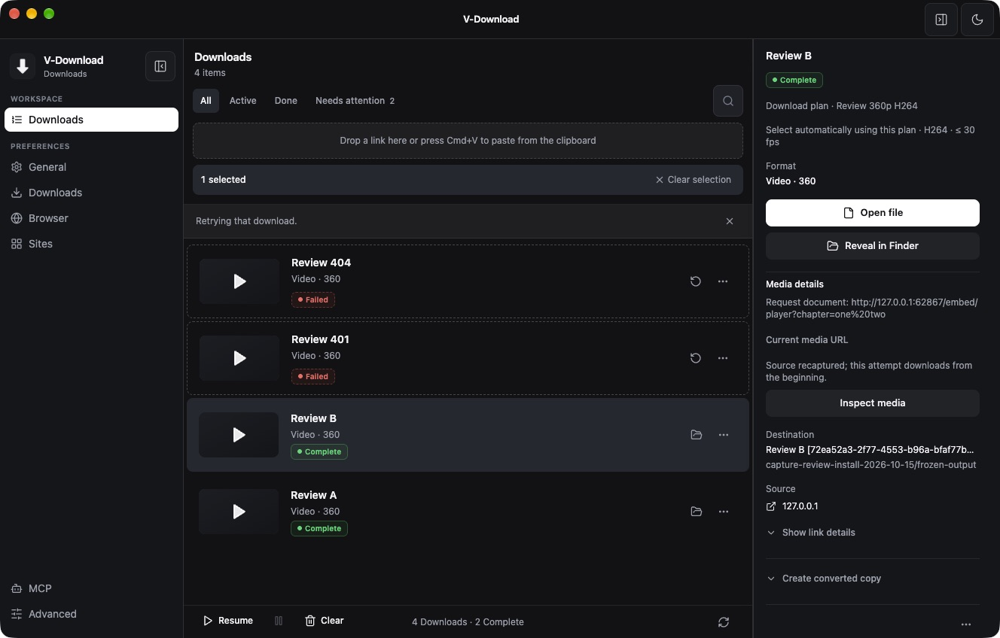
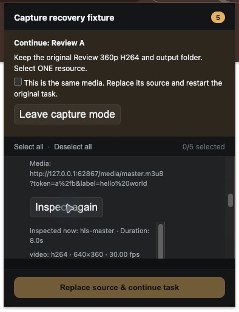

# 浏览器捕获功能详细审查与本机安装

> 历史记录，已归档。本文保留当时的基线、观察和验收范围；当前桌面状态见 [DESKTOP_STATUS](../../DESKTOP_STATUS.md)，网页版执行计划见 [web-download](../../plans/web-download.md)。旧优先级建议不自动成为当前待办。

日期：2026-10-15（America/Los_Angeles）。基于当前 `a3d0bfbb` 工作区，审查此前已完成的候选详情、按需识别、原任务重新捕获和 403 分类。保留此前所有未提交改动；本轮没有提交、推送或发布版本。

**结论：修复一个 P2 任务切换状态问题后，可以用于本机。** 最终应用已安装并用原有用户数据启动；Chrome 扩展由用户确认重新加载，随后通过真实弹窗完成两次原任务恢复。未发现仍需阻止本机安装的 P0/P1 问题。以下结论只覆盖本机和所测受控样本。

## 1. 审查发现与补修

### P2：任务切换时复用上一条任务的来源输入和捕获提示（已修复）

- **触发**：打开 A 的详情，编辑“重新捕获的来源页面”或启动捕获，再选择 B。
- **根因**：`DownloadInspector` 随选择切换 `download`，其子组件 `CapturedMediaDetails` 没有任务身份 key。React 复用同一实例；`useState(download.sourceContext?.pageUrl || download.url)` 只初始化一次，`capture`、`opening` 和错误提示也可能来自 A。检查用的 generation 只保护识别结果，不能重置其他任务状态。
- **影响**：B 可能打开 A 的来源页面；旧捕获提示也可能显示在 B 的详情中。主进程仍有会话/任务校验，但这不能修复错误的用户入口。
- **结构修复**：在拥有任务切换的 [组件边界](../../../src/renderer/src/components/DownloadInspector.tsx#L215) 使用 `<CapturedMediaDetails key={id} download={download} />`。任务身份变化会销毁旧实例、执行原有取消识别清理，并为新任务重新初始化全部局部状态。没有再添加多套字段同步 effect。
- **回归**：安装版中把 A 输入改为 `review=EDITED_A`，选择 B 并展开输入，实际为 B 的 `review=SECOND`；随后 B 的独立会话成功完成恢复。[AX 证据](assets/capture-review-install-2026-10-15/task-switch.ax.txt)、[核验记录](assets/capture-review-install-2026-10-15/task-switch-verification.json)、[本轮增量补丁](assets/capture-review-install-2026-10-15/review-fix.patch)。
- **兼容性**：无数据库、设置、IPC、扩展或 MCP 契约变更。仅隔离详情组件状态；离开任务不会取消主进程中已明确发起的捕获。

### 环境观察：所选 FFprobe 影响 DASH 流识别（保留用户设置）

本机配置使用 `/opt/homebrew/bin/ffmpeg`。其同目录 FFprobe 对本轮 DASH 样本报 `Invalid data found when processing input`；应用如实显示清单类型和探测警告，未伪造流信息。同一输入用包内 FFprobe 能读取 H.264 360p 和 AAC。隔离配置切到包内引擎后，安装版 DASH 识别通过。

这证明**当前两个引擎对这个样本的行为不同**；未把失败扩大推断为该 Homebrew 构建不支持所有 DASH。日常配置的引擎路径未改动。[同输入对照](assets/capture-review-install-2026-10-15/dash-engine-comparison.json)。后续可在引擎诊断中展示探测能力和所用路径；本轮没有自动替换用户引擎。

## 2. 详细审查范围

| 检查项 | 生产边界与检查结果 | 验证范围 |
|---|---|---|
| 捕获权限 | [本地服务](../../../src/main/localServer.ts#L458) 要求已有扩展 Origin 和安装级 capability；媒体字段白名单不允许注入方案/目录。Landing 只提供连接页面。 | 安装版无 capability、外部 Origin、选择字段注入均拒绝。 |
| 会话所有者 | [mediaCapture](../../../src/main/mediaCapture.ts#L19) 拥有随机 ID、期限、任务版本及 Origin；同任务新会话替代旧会话。 | 静态复核；真实桌面取消后迟到请求返回 409，B 未改变。 |
| 异步取消竞态 | [recaptureTask](../../../src/main/downloadManager.ts#L3629) 等旧执行清理后再次验证会话和任务版本，校验与 DB 写入之间没有额外异步等待。 | 本轮静态审查；上一轮取消/替代竞态证据继续有效，未冒充本轮重跑。 |
| 原意图保留 | 原 URL、任务 ID、selection、方案名称/版本和命名快照不从扩展重建。有效输出目录由主进程取得并绑定。 | 两次真实恢复后逐字段比较原始 URL 与整个 `downloadRequest`；输出均在原方案目录。 |
| 临时文件 | 新来源进入 `.vdl-staging/<task>/capture-N`；旧源 partial 不被当作新源续传。已发布产物、多产物集合和 Remote Job 不接受单资源替换。 | 本轮静态复核；两次恢复均 `recaptureRevision=1`，实际输出完整。旧 partial 专项隔离见上一轮记录。 |
| 精确格式与严格质量 | provider ID 的 exact 选择仍限定原 URL。未知 provider 编码允许进入筛选，但实际源事实必须满足约束，不能靠后续转换掩盖。 | 本轮 master 和缺少 provider 编码的 iframe HLS 均按 360p/H.264/30fps 原策略完成；不符来源的负例沿用上一轮已记录实测。 |
| 来源上下文 | [扩展候选检查](../../../extension/background.js#L27) 验证当前文档候选；完整请求文档 Referer 与顶层页面分别保留。 | iframe 样本要求完整 `.../embed/player?chapter=one%20two`，识别和最终下载均成功；媒体 URL 的 `%2f`、`%20` 未改写。 |
| 候选交互 | 详情/识别按钮不再放在复选框的 label 中；识别事实不等于自动选择或成功概率。 | 真实弹窗显示 5 项；展开和识别后仍是 0/5，用户明确选一项并确认才能替换。 |
| 识别资源边界 | [识别服务](../../../src/main/mediaInspection.ts#L21) 并发 2，清单 512 KiB/8 秒；probe 15 秒/64 KiB，64 流、128 关系。继承进程家族取消。 | 本轮检查生产代码与全量测试；HTTP 断开和并发取消的真实进程清理见上一轮专项证据。 |
| 清单解释 | HLS 由 [清单 owner](../../../src/main/mediaInspectionModel.ts#L17) 解析声明，其他候选不会被当成其变体。DASH 关系保持未知。 | 真实 HLS 返回 360p/720p 两个变体及音视频流；DASH 包内 probe 读取两个流。 |
| 错误分类 | [共享分类](../../../src/main/downloadError.ts#L3) 区分 HTTP 拒绝、登录要求和引擎启动缺失；解析/API 使用同一解释。 | 安装版 403→ACCESS_DENIED、401→AUTH_REQUIRED、404→UNSUPPORTED；全量 API/分类测试通过。 |
| 普通扩展流程 | 恢复成功移除当前 tab 的绑定，普通方案列表仍使用鉴权 POST；未改扩展权限。 | 成功后重新打开弹窗显示普通 Download 按钮；列表含三个内建方案及隔离自定义方案，未修改用户选择偏好。 |
| 版本兼容 | 新事实在现有 extras；新 IPC/HTTP 为增量接口。旧任务没有伪造识别事实，历史错误码不批量重写。 | 原用户数据直接启动，两个历史任务所有 DB 字段保持一致。 |

## 3. 安装版端到端结果

运行的是 `/Applications/V-Download.app/Contents/MacOS/V-Download`，主入口为正式 `app.asar/out/main/index.js`，**没有测试 bootstrap、调试端口或替代 IPC handler**。使用 `--user-data-dir` 指向独立研究配置；回调走正式 18765 服务，下载与后处理使用真实包内引擎。Chrome 使用既有扩展 ID，用户手动重载后测试。

| 场景 | 结果 |
|---|---|
| 生产 API / 引擎边界 | 13 项通过，包括四条任务准入/错误分类、HLS/DASH、鉴权和字段注入拒绝。[结果](assets/capture-review-install-2026-10-15/installed-api.json) |
| A：失效 HLS→master 清单 | 原任务完成；原 URL、整个请求快照及目录保持一致；从两个画质变体选择 360p，输出 H.264/AAC。[结果与 FFprobe](assets/capture-review-install-2026-10-15/installed-chrome-recovery.json) |
| 桌面取消 | 主进程撤销会话；迟到提交 409；B 的状态和来源未改变。[结果](assets/capture-review-install-2026-10-15/installed-cancel.json) |
| B：新会话→iframe HLS | 完整 iframe Referer 通过服务器检查；原方案和目录保持；最终 360p H.264/AAC。[结果与 FFprobe](assets/capture-review-install-2026-10-15/installed-iframe-recovery.json) |
| 成品有效性 | 两个文件均约 8 秒、各一条视频和音频；均通过 `ffmpeg -v error -i ... -f null -` 完整解码。 |
| 原配置启动 | 完成测试后退出隔离实例，正常启动新安装版；历史数量及字段、设置和凭据文件均核对。 |

浏览器测试中也观察到：取消或替代后，在旧标签页提交会得到“会话过期”，原任务保持不变；重新从任务开启有效会话后成功。当前过期状态主要在提交时反馈。可以后续前置展示失效并提供回到任务的入口；此轮不放宽标签页或会话绑定。

## 4. 构建、签名与安装身份

- 应用版本 **1.1.7**，本地构建号 **1.1.10**，arm64，bundle ID `com.ytdownload.app`。
- 安装：`/Applications/V-Download.app`，测试结束后已使用正常 userData 运行。
- 安装包：`/Users/mingjie/Downloads/V-Download-1.1.7-local-20261015-r3-arm64.dmg`。
- 沿用此前 Apple Development 证书和 hardened runtime，`codesign --verify --deep --strict` 通过；本地开发包未公证，未作为正式发布上传。
- 安装包经 `hdiutil verify` 校验；59 个运行时编译文件、共享 JS 和扩展文件与工作区构建逐文件一致。类型声明不属于打包运行时核对集合。
- 引擎输入先经 `prepare-release` 验证。安装包内三项引擎、`app.asar` 和 DMG 的 SHA-256 见 [包身份](assets/capture-review-install-2026-10-15/package-identity.json)；[文件一致性](assets/capture-review-install-2026-10-15/package-files.json)、[签名](assets/capture-review-install-2026-10-15/signature.txt)、[打包日志](assets/capture-review-install-2026-10-15/package.log)。
- 官方打包配置未改。仅本机打包命令覆盖本地构建号、签名回调和开发包 Gatekeeper assessment；最终严格签名校验独立执行。未绕过运行时身份或浏览器接口鉴权。

构建过程先纠正了本地签名回调的参数名，最终成功日志与实际签名才作为交付证据；未把中间未签名包安装为最终产物。

## 5. 数据保留、验证与清理

安装前离线备份到 `/Users/mingjie/Documents/V-Download Backups/2026-10-15-capture-review-install/`（0700），包含原 app 和完整 userData。替换应用前先完成新包复制和签名校验，保留可回滚原包。

- 原数据库 **2 条历史记录逐字段一致**，`PRAGMA integrity_check=ok`，正式数据没有测试任务。
- `settings.json`、`cookies.txt`、`extension-pairing.secret`、`remote-jobs.json` SHA-256 完全一致。
- 浏览器分区、Cookies、Cloak 配置及界面存储共比较 262 个原有文件：261 个字节一致，只有 Chromium 的 `Local Storage/leveldb/LOG` 诊断日志随启动改变；未发现凭据或设置差异。见 [数据核验](assets/capture-review-install-2026-10-15/data-preservation.json)。
- Chrome 只关闭本轮测试的来源与连接页，未关闭用户已有页面；未更改方案偏好、扩展 ID 或配对 secret。
- 已清理约 **1151.0 MiB（逻辑大小）**，范围为本轮测试配置/缓存、合成媒体、输出、打包 staging 和构建目录；保留最终 DMG、回滚备份及小体积研究证据。实际路径、逻辑大小和进程/端口回执见 [清理记录](assets/capture-review-install-2026-10-15/cleanup.json)。

验证命令：`npm test`、`npm run typecheck`、`npm run sync:extension-constants`、`npm run build`、`RELEASE_ARCH=arm64 node scripts/prepare-release.mjs`、`git diff --check` 全部通过。[测试日志](assets/capture-review-install-2026-10-15/tests.log)、[类型检查](assets/capture-review-install-2026-10-15/typecheck.log)、[构建](assets/capture-review-install-2026-10-15/build.log)。

## 6. 尚未验证及后续范围

- 本轮没有重测全部真实登录站点、付费内容、DRM、直播、Windows/Linux，也不把受控样本成功率当成全站成功率。
- exact provider 格式跨 URL 仍要求重新确认格式，目前没有原任务内的格式重选 UI；不静默放宽。
- DASH representation 层级关系未实现，探测结果也受所选 FFprobe 能力影响。
- 实际十分钟到期等待、应用崩溃与所有旧 partial 组合未在本轮重复；上一轮覆盖范围见 [原实现与测试报告](browser-capture-recovery-2026-10-15.md)。
- 此轮不属于性能优化，未进行新的冷/热启动、CPU 或进程家族峰值内存基准。

本轮新增 P2 已补修并完成真实 UI 回归；其余明确范围限制留在报告中，没有把未验证内容标为通过。
