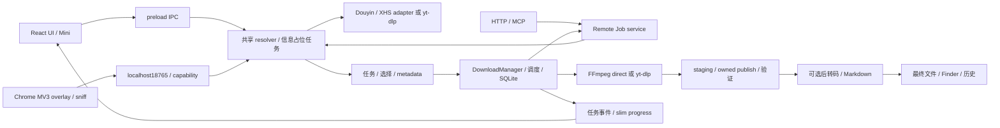
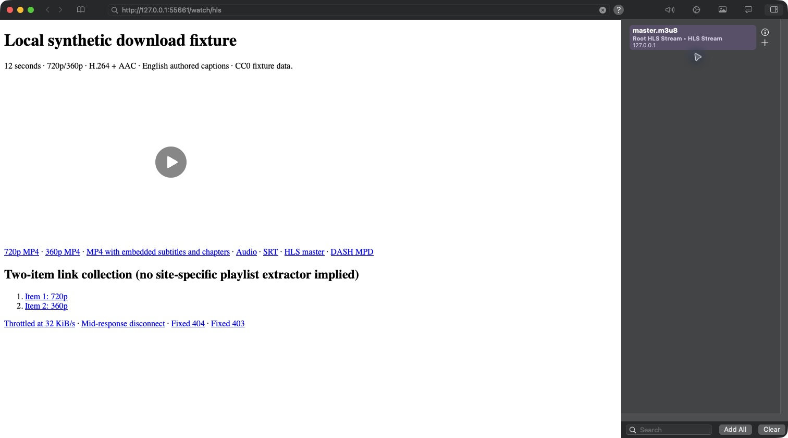
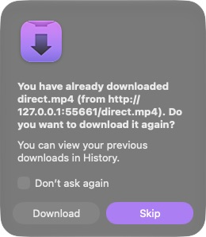
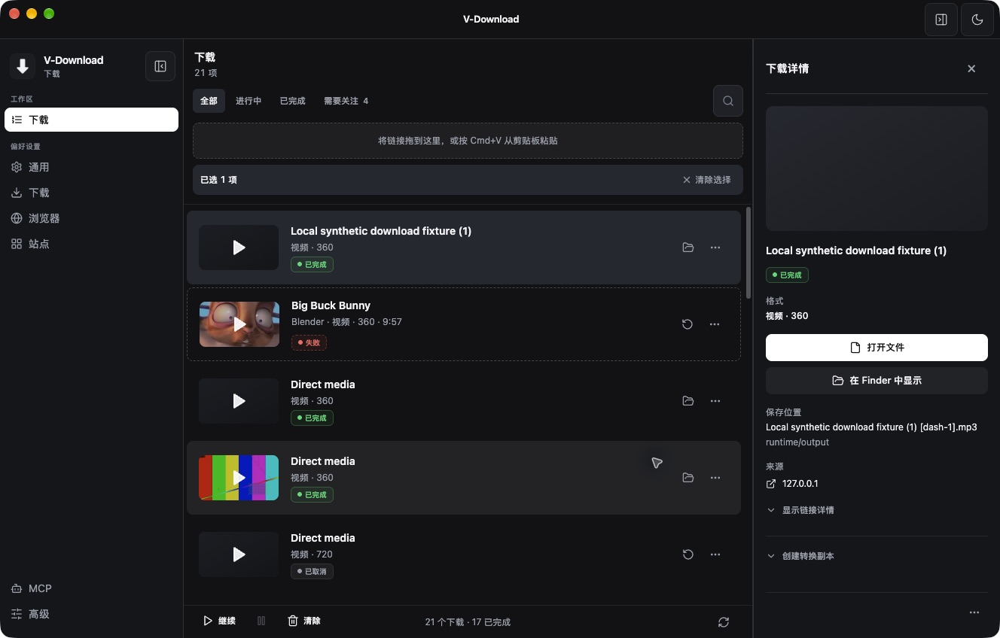
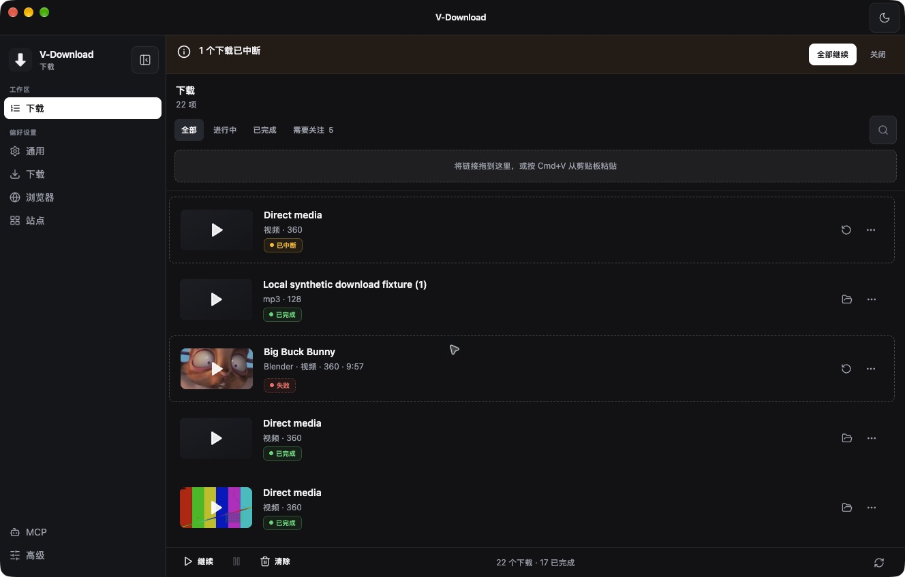

# Downie 深度拆解与 v-download 改进研究

> 历史记录，已归档。本文保留当时的基线、观察和验收范围；当前桌面状态见 [DESKTOP_STATUS](../../DESKTOP_STATUS.md)，网页版执行计划见 [web-download](../../plans/web-download.md)。旧优先级建议不自动成为当前待办。

> 2026-10-16 整理：独立研究目录已删除，仍被报告引用的证据已归档。正文中的原测试路径保留为历史条件；详见 [归档说明](research-archive-2026-10-16.md)。

> 最新本机交付：候选详情、按需识别和原任务重新捕获已完成详细审查并安装；新增任务切换补修、Chrome 实测、签名与数据保留核验见 [审查与安装记录](capture-review-install-2026-10-15.md)。

> 后续实现：本报告保持研究时的基线；「精确选择 + 可保存下载方案」的工作区实现、端到端验证与自查见 [实现与验收记录](download-plans-2026-10-15.md)。

> 后续状态：本报告记录原始 `a3d0bfbb` 基线；360p、MP3 状态、已有内嵌字幕、恢复横幅作用域的后续修复和验证见 [修复记录](v-download-fixes-2026-10-15.md)。精确 codec/fps 等选择已纳入上述下载方案实现；外置字幕仍另计。资源候选详情、按需识别、原任务重新捕获与 403 分类的后续实现见 [浏览器辅助下载验收记录](browser-capture-recovery-2026-10-15.md)。

研究日：2026-10-15（America/Los_Angeles）。范围：本机 Downie 4.7.27 / build 4787、官网 4.13.2 的单独补充，以及 v-download 1.1.7 / `a3d0bfbb444045e034b0fdfc611e4f2a9888c464`。本次交付研究、证据、比较与实施路线图；**没有修改产品实现，也没有更新双方应用或下载引擎来改变基线**。

阅读入口：[主要结论](#1-最重要的判断) · [基线与证据](#2-基线方法与证据怎么读) · [Downie拆解](#3-downie-到底由什么组成) · [V结构与体验](#4-v-download-的实际结构与差距类型) · [实测](#5-实测结果与典型任务对照) · [53项矩阵](#6-逐项功能与体验矩阵) · [路线图](#7-可实施路线图) · [完成清单](#8-完成清单与保留问题) · [证据索引](#9-可复查证据索引)。

## 1. 最重要的判断

**v-download 最值得学习的是 Downie 把“发现资源、作出选择、执行任务、失败后继续处理”连起来的产品方式；近期最有价值的工作是兑现我们已有的选择、状态和输出承诺。** 核心下载能力已经存在，继续增加入口、格式名称或站点数量，不能解决本次实测发现的问题。

本轮最强的五组证据是：

1. **选择没有完整兑现。** 同一份具有 720p/360p 两个变体的 HLS，设置 360p 后，Downie 输出 360p，V 输出 720p。V 本次走 yt-dlp 直链分支的 `best`；另外，格式弹窗本来就没有把选中的 `format_id` 传到下载请求。这是两个生产边界，必须分别修复。[V 选择实现](https://github.com/wangm12/v-download/blob/a3d0bfbb444045e034b0fdfc611e4f2a9888c464/src/main/ytdlp.ts#L955)、[格式提交](https://github.com/wangm12/v-download/blob/a3d0bfbb444045e034b0fdfc611e4f2a9888c464/src/renderer/src/components/FormatDialog.tsx#L214)
2. **“完成”需要检查所承诺的产物。** 对同一个内含英文字幕和 3 个章节的 MP4，Downie 最终文件与源 SHA-256 完全相同；V 保留章节，却丢失 `mov_text` 字幕，仍显示完成。普通 MP4/HLS/DASH 的两边各 9 个最终文件都能完整解码，因此字幕问题不能被“视频能播”掩盖。[独立输出审计](assets/research-archive-2026-10-16/downie-2026-10-15/runtime/downie-runtime-audit.md)
3. **任务事实与界面缓存会分离。** V 音频任务的 DB 和文件已经是 MP3/128，列表和 Inspector 仍稳定显示“视频·360”；重开后才显示正确格式。main promotion 更新了真实任务，但进度 IPC 与 renderer patch 都没有同步格式字段。这需要修状态转变的合同。[V 运行及根因证据](v-download-code-evidence-2026-10-15.md)
4. **可靠性各有强项。** 持续在 128 KiB 截断的 MP4，V 通过 23 次连续 Range 请求完整完成；Downie 本次报网络错误，人工重试仍失败。另一方面，双方在本轮涉及的暂停/重开路径中，都不能据“任务重新出现”宣称复用了已下载字节。V 的中断恢复入口还有一次操作覆盖到其他失败任务的范围问题。
5. **V 有值得保留的基础。** MV3 嗅探、候选页面归属、引擎事务更新、已有 Mac 菜单/托盘/Mini、HTTP/MCP 控制、中文站点多类型 adapter，以及带所有权的文件发布/清理都已存在。它们不应在比较时被误列为“待新增”；其中未运行覆盖的能力仍只是源码事实。[V 六条链路证据](v-download-code-evidence-2026-10-15.md)

这些结果只描述本机、这些输入与这些链路；**没有建立全站成功率、最新版 Downie 表现、全平台性能或产品综合分数**。

### 建议如何分配下一轮投入

| 判断 | 建议 | 原因 |
|---|---|---|
| 值得借鉴 | 资源发现后的明确下一步、可解释质量选择、逐任务后处理、多链接捕获、字幕/来源归档、浏览器安装与故障恢复 | 能减少用户在解析失败、选错源和输出不符合要求时的反复尝试；本轮有文档、代码和部分真实交互支撑 |
| 值得继续强化 | 跨平台共享核心、中文视频/图集/笔记、现有扩展嗅探、HTTP/MCP、引擎更新、文件安全发布 | 是已经有实现的产品方向，后续价值来自贯通和验收，不是另造并行系统 |
| 暂不优先 | 重写 Electron、先建 integration marketplace/AI wizard、媒体资料库、复制排行榜、一次补齐所有 Mac 入口 | 本轮证据没有表明这些能优先解决现有失败；维护面大，且部分 Downie 旧文档能力已被新版删除 |

## 2. 基线、方法与证据怎么读

### 2.1 三种版本必须分开

| 对象 | 本次固定身份 | 能说明什么 / 不能说明什么 |
|---|---|---|
| Downie 本机 | 4.7.27 / 4787；主程序仅 x86_64；DownieCore 为 universal | 本机 UI、输出、包内帮助与反编译属于此版本。`sample` 实际报告 `X86-64 (translated)`，不是仅从 CPU 架构推测 Rosetta |
| Downie 官网 | 访问日显示 4.13.2，发布说明日期 2026-09-29 | 新版文档补充，未安装运行。不能用新版修复替旧版结果背书，也不能用旧版故障断言新版仍失败。[官网](https://software.charliemonroe.net/downie/)、[发布说明](https://software.charliemonroe.net/trial/downie/v4/rnotes.html) |
| V 源码 | 1.1.7 / `a3d0bfbb444045e034b0fdfc611e4f2a9888c464` | 所有源码行号以此基线检查；工作区产品源码未修改 |
| V 安装/构建产物 | installed app.asar = dist app.asar；包内全部 7 个 out 文件 = 当前 out | 没有 `buildCommit/gitHead`，所以不能仅凭相同版本号及字节相等证明 out 由固定 HEAD 构建；缺少构建溯源印章 |
| V 运行 | 安装包真实 main/preload/renderer，通过匹配 Electron 43.7.5 加载，独立研究 profile | `app.isPackaged=false`。实际解析/队列/引擎/DB/API/UI 在运行；没有验证 packaged updater、协议注册及正式扩展安装集成 |

官网另声明 iOS/iPadOS 的欧盟分发渠道；本研究只检查 Downie 的 macOS 包，没有把“本机 Mac app”扩大成“整个产品没有其他平台”。官网价格、许可及平台信息会变化，本报告不据此计算商业竞争优势。[官方产品页](https://software.charliemonroe.net/downie/)

关键 SHA-256（完整身份、大小与签名回执保存在 [target-identities.json](assets/research-archive-2026-10-16/downie-2026-10-15/evidence/target-identities.json)）：

| 文件 | SHA-256 |
|---|---|
| Downie 主程序 | `6eb6e6582f8bb47e3e0d6ba0fabeabbbfbf72b6e4c4795a95d3ab1b3b4ed1b61` |
| 原始 DownieCore universal | `1931e01249a987a7bd4ecb4f4c0cd2cbdfe2757a183b4420f1eea71d078240cd` |
| 由原件提取的 x86_64 薄片 | `f0fde2019c1b3ea6bc391fd7cc3861a92e671409f869833cb4bf795967c0bb16` |
| V installed / dist app.asar | `2b436fae61184fb4f1a265a9a82f6af835b10a5b8a5b96dddf8cfaf9d1991a61` |
| 本轮 yt-dlp 2026.07.04 | `e0ded0a3ca3c9633519578dc44adaa53003df86d1126bd4bf233ae9dc6da992b` |
| 本轮 FFmpeg 8.1.2 | `4a9b309ffe7204d9791df8d96697b18f255c5cffcd826df55f085044d930d201` |
| 本轮 ffprobe 8.1.2 | `0558a2fa04d4cb7085e3275cacd50cacb1d6ff4e41d44fb25653500c469071e5` |

### 2.2 证据级别

- **实际观察**：真实 UI、任务状态、进程、请求日志和最终文件。说明具体条件、样本与次数。
- **静态事实**：源码、脚本、元数据、声明和已恢复的机器码。声明一个入口不等于入口真实执行成功。
- **官方说明**：包内帮助与官方网页；帮助书可以过时，须附版本边界。
- **推断**：由上述事实形成的机制判断、风险或改进建议，不能写成已经复现。
- **未知**：没有取得足够证据。搜索未命中、函数名和依赖库出现均不能证明能力不存在或完整实现。

附录保留自己的细分标签：D 的 L/W 为本机/网站来源，N 为 native REA 记录，V 的 C/D/T/R/A/M 为源码/推导/测试源码/宣称/产物/运行复核。矩阵使用这些索引，不以命名相似代替行为证明。

### 2.3 隔离与实际归属

本机为 Apple M4 Max、64 GiB、16 logical CPU、macOS 27.0.1 / 26A434。合成媒体由本地 FFmpeg 生成：12 秒、H.264/AAC、720p/360p、英文 SRT/VTT、含字幕章节的 MP4、双变体 HLS、DASH；所有 fixture 是本研究自有内容。

| 资源 | 实际使用方式 |
|---|---|
| fixture 服务 | `127.0.0.1:55661`，独立 Python stdlib 服务；支持 Range、限速、持续截断、固定 403/404。请求及文件 hash 可复查 |
| V 数据/浏览器 session/temp/log/output | 全部指向 external `runtime/` 下的研究目录；没有覆盖原用户实例。原实例 PID 29928 / 18765 保留，研究 API 使用 56322 |
| V 凭据 | 未同步用户真实 Cookie；YouTube 样本使用研究配置。`cookiesFromBrowser` 用显式不存在的研究 profile，不能把“空 app profile”一般化为匿名环境；中文 adapter 的隐式浏览器来源因此作为未完成验证项 |
| Downie | 后续成功打开，使用既有 profile，队列起初为空；只进行自有 loopback 任务，暂时改研究输出目录、并发、连接数及质量，之后恢复。没有清空既有 Cookie/私人历史，未建立匿名公网基线 |
| Downie 数据/临时文件 | `lsof` 观察到目标专属 Cache、HTTPStorages、Application Support/History.db；本轮 `.downiepart` 位于研究目标目录内。历史只按本研究 loopback URL 过滤读取，未导出其他记录 |
| 浏览器扩展 | 未操作用户原浏览器配置。固定扩展端口被原 V 实例占用，未对正式 MV3/Safari/Firefox 做端到端成功声明 |

Downie 最初 LaunchServices `-10669`，签名验证通过而 `spctl` rejected；用户表示将手动打开后，本任务观察到它已正常运行，随后成功绑定UI并实测。没有单独建立先前失败原因与恢复原因的因果证明。研究没有关闭 Gatekeeper、更改 quarantine 或改动应用字节。后续结论按已运行的结果更新，早期受阻不是最终状态。

V 研究实例出现的固定端口冲突及未翻译提示来自“同时保留原实例”的条件，不能当作所有新装必现；它确实暴露了这一错误路径的体验问题。双方都没有自动提交错误报告或向外发送诊断包。

## 3. Downie 到底由什么组成

### 3.1 产品地图与组件关系

```mermaid
flowchart LR
    Input[粘贴 / 拖入 / 扩展 / 系统入口 / URL scheme] --> Center[下载入口与 downloader 分派]
    Center --> Native[站点 handler / 通用解析]
    Native --> Selection[质量 / 音轨 / 字幕 / 多候选]
    Native -->|需用户辅助| UGE[UGE WebView + 页面请求上下文]
    UGE --> Candidate[文件 / Root HLS / 字幕 / 图片候选]
    Candidate --> Selection
    Rule[Resource Detection / JavaScript integration] --> Native
    Rule -->|embedded download| Center
    Selection --> Queue[任务配置快照 / 队列 / 未完成任务持久化]
    Queue --> Transfer[原始文件 / HLS / DASH 传输]
    Transfer --> Assemble[必要的片段与音视频组装]
    Assemble --> Post[None / MP4 / Audio / Custom / Permute]
    Post --> Deliver[最终文件 / metadata / 历史 / Finder / 通知]
    Queue --> Recovery[Retry / UGE / 浏览器 / Report]
```

这是文档、符号及运行结果合成的**职责图**，不是完整调用图。DownieCore 是重点：能看到 downloader registry、UGE controller、质量类型、任务/队列 controller、integration 执行等职责。Downmute、WKCompatibility、XUCore/UI、Sparkle、Licensing、Paddle 等组件的存在只建立依赖事实，不能由此恢复完整线程、网络协议、授权或隐私行为。

它的产品核心是一条“自动解析 → 多候选/质量选择 → 任务 → 必需组装/可选后处理”的链。UGE 与 integration 把失败链接送回这条链，而不是另建一套下载器。Permute 负责部分高级转换、字幕合并及独立 multipart stitching；不能把 Permute 的所有能力算成 Downie 内置能力。[本机产品与组件证据](downie-product-evidence-2026-10-15.md)

### 3.2 六条关键链路

**输入与解析。** 本机帮助、sdef、Intents、Safari 脚本和 URL scheme 建立了粘贴/拖放、多 URL 文本、系统分享/Services、Automator/Shortcuts 等入口的不同证据层级。真实测试使用官方文档的 `open -a` + `downie://XUOpenURL`，明确指定已存在的研究 destination；普通 direct、HLS、DASH 都完成。重复 URL 显示 Download/Skip，不默默吸收请求。自动化模式/系统入口的完整运行仍未覆盖。[Automation 官方契约](https://software.charliemonroe.net/help/downie/?article=automation)

**站点适配与 UGE。** 静态上存在专门 handler、通用探测、UGE 和可复用 integration。真实 `/watch/hls` 在 UGE 中得到一个 Root HLS Stream，点击 `+` 后成功形成 360p 文件，沿用页面标题。Options 中能看到 compatibility layer 与 Merge related HLS Streams；本轮没有验证其所有合并条件。原生代码显示候选可携带 referer/title 的 BrowserContext，并区分字幕/图片/视频，但没有恢复完整 Cookie/Authorization 传播。V 早已有网络嗅探，应该学习的是候选解释和失败闭环。[UGE 运行证据](downie-runtime-evidence-2026-10-15.md)

**质量与内容选择。** Downie 将默认质量、Prefer MP4、Force MP4、音轨/字幕偏好及逐项后处理分开。Prefer MP4 在同分辨率可能牺牲 fps/bitrate；Force MP4 可能降低分辨率。设置的 Limit 也不是绝对禁止上浮：只剩更高清晰度时会选择最小可用项。本轮仅证明双变体 HLS 正确选 360p。字幕/音轨偏好按显示 label 匹配的设计比较脆弱，V 应用稳定 track ID、语言、角色与原 label 建模。[本机质量/字幕契约](downie-product-evidence-2026-10-15.md)

**队列与可靠性。** native 已恢复到未完成任务的 write path：嵌套字典、UserDefaults、Queues.save、synchronize；调度入口则还有 closure/lock，不能由 wrapper 推出准确并发和优先级算法。运行证明：暂停状态可见；正常退出后未完成任务恢复并再次执行；这次 slow MP4 从 0 重下，且退出提示明确说不能 resume。持续截断样本未完成。队列恢复、活动连接重连、暂停重下、跨进程续传是四种不同能力。[native 附录](downie-native-evidence-2026-10-15.md)

**下载后处理。** None 仍可能需要 HLS/DASH 组装；MP4 容器和 H.264 转码也应分开解释。本轮 direct MP4→MP3 真正完成，UI 观察到 Converting 中间阶段；同网页 `/watch/dash` 的多个候选中选择 DASH+Audio 则报 Cannot find download URL。通用页面候选显示 8 项，初始逐项后处理仍为 Default–None，不能假设 scheme 覆写已贯穿嵌套解析。已有字幕 MP4 的原样保留是本轮正面结果，外置字幕抓取与 Permute merge 尚未实测。

**Mac 集成与维护。** 菜单栏、Dock、Finder、通知、原生菜单和窄小脚本接口构成低摩擦捕获；本轮运行观察了原生偏好、菜单及队列，未宣称所有系统入口通过。新版迭代主要持续修站点、流协议、字幕、WebView 兼容和恢复；这说明维护链是下载器的核心投入。官网和旧帮助有漂移，Top Downloads 已移除，旧 Safari Cookie 传递已弃用，不值得作为新增需求照搬。[发布说明](https://software.charliemonroe.net/trial/downie/v4/rnotes.html)、[Safari 官方帮助](https://software.charliemonroe.net/help/downie/?article=extensions_safari)

### 3.3 定向反编译到底证明了什么

使用官方签名的 Hopper 6.6.0-demo，安装于 `/Users/mingjie/Applications/Hopper Disassembler.app`；先展示 REA setup dry-run，再按既有授权安装。没有安装/升级 Node、Java、Ghidra 等无关软件，没有修改 Codex 配置或目标程序。试用通过正常入口使用，未绕过时间/导出限制。[Hopper 官方说明](https://www.hopperapp.com/download)

REA 生产 CLI/MCP 对 x86_64 薄片保留了 **17 条 native Evidence（12 次函数分析、5 次过程搜索）**，另有包分派与 UI archive 证据。主要结论如下；完整 ID、地址、slice 来源与输出 hash 在附录。

| 已回答的机制 | 已取得证据 | 保留未知 |
|---|---|---|
| integration URL 匹配 | `0x604dd0`：延迟缓存 regex，对 `URL.absoluteString` 匹配 | 完整规则优先级、冲突处理 |
| integration 结果分派 | `_processResult` `0x384fd0` 恢复 enum 分支入口 | 没有恢复全部 message case，不能声称已逐项证明 native 校验 |
| UGE 候选与质量 | response `0x2e5c0`、grouping `0x2d540`；HLS quality membership `0x2bd80` | 具体去重 predicate、所有父子关系与认证重放 |
| downloader 分派 | find downloader `0x5b6520`：registry/fallback response facts | probe 内部全部实现及真实站点覆盖 |
| 未完成任务保存 | save body `0x4a5cb0` 写 UserDefaults/queue | 全字段 schema、原子性、损坏恢复及 durable write 保证 |
| 恢复与调度 | restore `0x4a52f0`、restore body `0x4a67f0`、scheduler `0x50e740` | 完整 restore thunk、精确优先级/并发/取消语义 |

UI 研究用保留原件 hash 的派生资源集合，解析 48 个 NIB archive（6,663 nodes / 3,020 edges）。这不是当前窗口的几何/交互测试。初始有限 dispatcher 和过程搜索的边界保留，零命中不作不存在证明。原件、派生薄片、UI 资源和 Evidence bundle 均放外部研究目录，不作为产品源码提交。

## 4. v-download 的实际结构与差距类型

图中的边界正是本次发现问题的地方：解析已经认识一项事实，UI 展示它，提交或进度合同却没有保留它。本次差距集中在同一信息跨层后的失真。

| 差距类别 | 现状实例 | 正确的改进方向 |
|---|---|---|
| 已有但难用 | 扩展安装、认证来源、引擎更新、错误日志与 Mac 捕获 | 简化安装/连接、显示实际来源、提供可理解恢复动作 |
| 已有但链路不完整 | format_id 未提交、HLS quality 未执行、MP3 状态未同步、恢复 banner 丢作用域、已存 headers 不能完整恢复 | 修 producing boundary 与全部消费者，补端到端合同 |
| 缺少产品入口 | 引擎可取的字幕/音轨/HDR/fps 信息、精确 API 单任务选择、可解释 sniff workspace | 先建立正确事实模型，再提供渐进披露入口 |
| 本轮搜索未发现同等能力 | 用户可编辑 extraction rule、CSV/XML 元数据导入、Safari/Firefox/Shortcuts 专用桥 | 根据需求验证投入，不将代码搜索未命中写成绝对不存在 |
| 已有优势基础 | 网络断连恢复、文件碰撞/所有权保护、事务引擎更新、HTTP/MCP、中文内容类型 | 保持现有实现，补真实故障与平台验收 |

**特别要保留三种不同的 quality 边界。** UI 不传精确 format selection；yt-dlp direct 分支忽略已传高度；FFmpeg direct options 没有 quality 字段。修其中一个不能使其他两个自动正确。音频的 kbps 展示也是源候选信息与输出编码策略混在一起：当前 `--audio-quality 0` 是 VBR 策略，不能把实测平均约 73 kbps 直接判为“128 kbps 音质不达标”。

### 4.1 Mac体验具体学习什么

以下是所测界面的观察与设计判断，不是打分，也没有把native/Electron当作体验结论。

| 用户阶段 | Downie本轮可见交互 | V本轮可见交互 | 建议 |
|---|---|---|---|
| 第一次使用 | 既有profile进入空队列，未做全新用户onboarding | 4步设置工具、可选浏览器、保存路径、可选网络 | 保留可跳过步骤；先确保首次可完成自有样本。不能由既有Downie窗口推测它没有onboarding |
| 管理下载 | 单列任务、逐项操作、历史/清理/UGE入口；详细偏好另开原生窗口 | 左侧工作区/偏好、全部/进行中/已完成/需要关注、搜索、Inspector | V信息架构已有优势基础；学习的是常用操作就地完成，不是照抄旧版大行高或图标 |
| 选择目标 | 全局quality/后处理分开，多候选可逐项覆写；部分条目仍有manifest尺寸/类型解释不足 | 弹窗已有codec/size信息，但选择与实际执行、源码率与输出目标混在一起 | 先改用户承诺：实际会得到什么、是否转换、哪些选择不能满足 |
| 遇到问题 | 行上Retry/Report，Actions可到UGE或浏览器；403/404仍显示粗网络错误 | 需要关注过滤、重试/暂停及详情存在；本例403行动指向登录错误 | 学明确下一步，同时让错误事实比竞品更准确 |
| 离开再回来 | 退出提示解释不能resume，重开自动重跑未完成项 | 明确提示已中断、由用户继续；但按钮越界重试历史错误 | 让文案、范围、字节行为一致，保留V明确中断状态 |
| 快速捕获与完成 | 多个系统入口有文档/声明，scheme实测，其他入口未逐项验证 | 现有Cmd+V、tray、Mini、Dock、通知/Reveal与MV3，多数仍待完整动作验收 | 完成一个完整路径比增加多个未贯通入口更有价值 |

最先提升“精品感”的是让这次操作的事实处处一致：选了音频就显示音频、暂停后重下就说明重下、只继续那一项就只处理那一项。截图中的布局与细节可作为后续设计评审材料，当前证据不足以给两个产品整体美观/可访问性评分。

### 4.2 维护成本与架构取舍

| 投入面 | Downie事实 / 推断 | V事实 / 推断 | 取舍 |
|---|---|---|---|
| 站点兼容 | 自有handler、UGE/compatibility layer、integration和持续站点修复 | 借助yt-dlp上游，另有中文adapter、PO token及浏览器路径 | V继续共享上游能力，自有代码聚焦差异与恢复；不为模仿Downie重写全部extractor |
| 浏览器变化 | 系统WebView/OS版本与兼容层构成维护面；新旧扩展迁移可见 | Chromium/Electron、MV3、配对、Cookie/Playwright/provider也构成维护面 | 两边都不能用“浏览器能播”保证产品一定能完成；诊断应记录实际网页引擎和来源 |
| 数据/跨入口 | native快照有静态和运行证据，但完整schema未知 | UI、扩展、HTTP/MCP、DB与多adapter已出现信息损失 | V最直接的维护收益来自统一owner/契约，减少显示文案反解析与重复默认值 |
| 后处理/输出 | Permute承担部分外部能力，安装/版本是用户路径的一部分 | 自带FFmpeg及多预设，拥有更深的publish/cleanup保护 | 保持现有安全发布，再扩展多产物；不要以任意脚本掩盖正式输出模型的缺口 |
| 平台与分发 | 本研究为macOS旧版本，新版系统要求和其他平台单独说明 | macOS/Linux发布路径已有；Windows与真实分发仍需验证 | 跨平台本身有成本；Mac专属入口放边缘适配，核心下载事实和请求语义共享 |

这些是结构与风险判断，不是两边团队人数、开发效率或维护工时的实测。当前没有证据支持“原生一定更易维护”或“上游引擎覆盖就不需要产品维护”。

## 5. 实测结果与典型任务对照

### 5.1 相同媒体与最终输出

fixture 的 manifest、生成命令、source probe、请求日志、所有逐轮结果及解码回执在 external runtime。默认比较目标为 720p、视频+音频、并发 1、每下载连接/fragment 1；双边输入内容相同。每轮强制生成新产物，真实服务端请求排除了旧文件/去重捷径。

| 场景 | Downie 4.7.27 | V 1.1.7 | 能得出的结论 |
|---|---|---|---|
| direct MP4，3 次 | 3/3；12.000s、720p H.264/AAC，360 帧完整解码；源 hash 原样保留 | 3/3；相同可播放 AV，容器 hash 与源不同 | 基本直链均完成；不能以容器 hash 不同判损坏 |
| HLS，3 次 | 3/3 最终产物；12.032s、720p H.264/AAC，完整解码 | 3/3；12.032s、720p H.264/AAC，完整解码 | 本自有短 VOD 有效；不覆盖加密/live/discontinuity/真实 CDN |
| DASH，3 次 | 3/3；12.032s、720p H.264/AAC，完整解码 | 3/3；约12.021s、720p H.264/AAC，完整解码 | 轻微 mux 时间边界不同不等于失败 |
| 改为 360p，双变体 HLS | 640×360 / 12.032s | 1280×720 / 12.032s，仍 complete | V 选择未兑现；不把 Downie 的 Limit 推广为永不允许 fallback |
| 已内嵌字幕/章节 MP4 | 源 hash 相同；eng `mov_text`、3 chapters 都保留 | 字幕 0；3 chapters 保留，仍 complete | 要校验预期轨道，不只是 AV 能播 |
| UGE `/watch/hls` | Root HLS 候选→`+`→360p完整产物 | 没对正式 extension 做相同 E2E | 证明 Downie 这条发现闭环；不证明其整体发现率更高 |
| generic `/watch/dash` 音频 | 8 候选，手选 DASH+Audio 后 Cannot find download URL | 格式弹窗选 MP3，12.010667s 音频产物 | 本次 V 这条路径完成；不能泛化 Downie 缺音频功能 |
| direct MP4→MP3 | 成功，12.010667s；观察到 Converting 阶段 | 上项已验证 MP3 链路，但未用这条 direct 输入做同条件音频基准 | 双方有实际音频能力，音频性能不排名 |
| generic 两链接页面 | 与任意网站合集不是同一合同；没有完成平台合集遍历测试 | `/playlist` 得到 1 个视频 | 只验证 generic 页面行为，不能冒充短合集成功率 |

独立审计不仅运行 ffprobe，还完整解码最终文件。Downie annotated SHA-256 为 `037ec6dd3df74fb1118a6a492b543eed49672025ed62a482f9b3779e94b4c260`，与 source 完全相同。[完整审计及逐文件结果](assets/research-archive-2026-10-16/downie-2026-10-15/runtime/downie-runtime-audit.json)

### 5.2 失败、暂停、重启与重复输入

| 场景 / 次数 | Downie 实际观察 | V 实际观察 | 解释与限制 |
|---|---|---|---|
| 重复 direct | 每次明确 Download / Skip，可选择不再询问；本轮未改该偏好 | 生产源码按 URL identity 复用/聚焦，API 基准 forceNew；普通 UI 的不同输出意图冲突未实测 | V 应区分媒体相同与输出请求相同；不要用 API 强制新建结果证明普通 UI 去重体验 |
| 每请求截断 128 KiB | 网络错误；人工 Retry 仍失败 | 23 个连续 Range 请求覆盖 2,908,122 bytes，完整完成 | V 活动任务内重连是实测强项；不是断点持久化或全站恢复率 |
| 固定 403 / 404 | 都显示 generic network error | 403 终态 `auth_required` 并提示登录；404 为 `download_failed` | 两边分类都不够具体；该403由fixture固定拒绝，不能证明需要登录 |
| 取消限速任务 | 本轮没单独完成“取消后重试”链 | API 约3s取消，无最终文件，连接结束 | V 此场景取消有效；不覆盖所有解析/合集/转码取消 |
| 暂停 / 恢复 | UI Paused；随后合并进正常退出/重开试验 | FFmpeg pause18%后 resume，从 Range0重下并最终完成 | V 124.8744s含操作者暂停等待；不能拿来计算下载速度 |
| 正常退出 / 重开 | 显示不能 resume 的退出提示；新进程恢复未完成任务并自动重跑。slow 从0传2MB，再取剩余908,122bytes，最终完整 | 恢复为“已中断”，显示“1个下载已中断 / 全部继续”；API同时返回 queued。点击 banner 还把其他历史 error 一并重新排队；slow最终完整，但从Range0重下 | 正常重开不是强退恢复证明。V 已有明确恢复入口，但作用域及跨接口状态有缺陷 |
| 无写入权限的研究目录 | UI Finished，但指定目录在0555期间及恢复后均空；未确认是否 fallback 到其他位置 | 提交即HTTP500 `download_failed / Internal error`，未建立job、无输出 | Downie交付位置未证实，不能仅由UI宣称完成；V识别为失败但没有给可执行的路径权限信息 |
| “下载前询问”关闭 | 未做同条件偏好测试 | 保存false、粘贴全新URL，仍弹格式框 | V设置消费者未接上，真实复现 |
| MP3格式状态 | 未观测同等错位 | DB/文件MP3，row/Inspector仍视频360；重开纠正 | 修IPC语义事件和缓存owner，不按文件后缀猜格式 |

V 匿名公网单样本使用 yt-dlp 项目当前测试样本 Big Buck Bunny（`https://www.youtube.com/watch?v=YE7VzlLtp-4`）：标题/封面解析成功，下载 HTTP403，终态 `auth_required`，约3.386s，无产物。本轮不把它解释为所有 YouTube 失效、PO token 必然有错或更新引擎必然修复。安装引擎为2026.07.04，访问日官方较新发布为2026.08.19，更新是可验证的下一步实验，不是既成修复结论。[官方样本替换](https://github.com/yt-dlp/yt-dlp/pull/17061)、[官方引擎发布](https://github.com/yt-dlp/yt-dlp/releases/tag/2026.08.19)

Downie 未建立隔离的公网认证基线，因此没有用既有用户 Cookie 做同样的公网/中文站测试。中文视频、图集、纯文本、主页与真实短合集的公平成功率均未建立；本报告对应优势首先是已存在的代码和产品方向。

### 5.3 耗时、资源与请求成本

**不发布双方速度倍数或整产品内存排名。** V 以 API POST→终态每100ms轮询；Downie 经 scheme 启动，重复输入含人工确认，观察脚本还曾抓到 `.downiepart` 内的稳定临时片段。Downie HLS第1轮及slow重开原测量已作废；最终产物由独立审计重新验证，原始记录保留。这是测量器的覆盖问题，不是把临时文件当 Downie 已宣告完成。

V 已运行研究实例的暖态数据（秒；小文件、loopback，**不是公网吞吐量**）：

| 任务，n=3 | API→终态耗时 | 观察到的进程家族峰值RSS | 备注 |
|---|---|---|---|
| direct | 0.234 / 0.111 / 0.111 | 470.12–473.70 MiB | 约0.11s已接近轮询分辨率，不能精确解释吞吐 |
| HLS | 0.870 / 0.737 / 0.745 | 576.36–606.41 MiB | 包含引擎准备、解析/下载/组装；未完全分离内部阶段 |
| DASH | 0.115 / 0.112 / 0.114 | 493.14–513.98 MiB | 相同小样本与测量分辨率限制 |

Downie有效资源观察为 direct139.98–158.50MiB、HLS160.68–180.64MiB（仅2轮覆盖最终交付）、DASH159.96–161.66MiB。V是arm64研究Electron宿主，Downie是2024版x86翻译运行；两边进程结构、入口、profile和完成边界不同。RSS每100ms采样、相加会重复计算共享页，短命子进程/峰值可能漏掉；Downie系统管理、被reparent的WebKit服务也可能不在后代树中。CPU为采样累计估计，逐轮值保留在JSON，未测的部分不按0处理。

网络成本可以提供更直接的调查方向：

| 每轮服务端日志 | V | Downie | 只能怎样解释 |
|---|---|---|---|
| direct | 1请求；2,908,122 body bytes | 5请求；5,005,274–7,454,644 body bytes | Downie含probe/HEAD/Range及中断读取；socket已写字节不等于客户端实际消费，不能直接当浪费流量 |
| HLS | 20请求；6,062,830 bytes | 12请求；3,022,004 bytes | V前一组读取初段，后一组完成选中流；额外成本高置信关联提前抓缩略图，见下文，不是“解析完整下载两遍” |
| DASH | 18请求；3,061,150 bytes | 18请求；2,910,329 bytes | 具体请求/变体/解析方式不同；仍不代表所有DASH性能 |

HLS额外读取的归因进一步核对了请求顺序、进程样本和生产者：第一轮前10请求为3,041,132bytes，包含两个variant初段及720p初段重复，并没有读720p最后三段；后10请求为正式选中720p的全部六段。前段采样出现应用派生FFmpeg，正式阶段为yt-dlp；子ffprobe在全部请求后才被观察到。代码在入队时先调度缩略图，再处理下载队列；缩略图另起 `-ss 2 -an -i URL -frames:v 1` 的FFmpeg。因此这是“提前取缩略图与正式下载两条读取链路”的**高置信推断**，不是ffprobe先完整拉流。请求没有客户端PID绑定，100ms进程采样也有遗漏。可优先从完成文件提图，或复用选中流和已有读取，重新量完整任务成本。[调度生产者](https://github.com/wangm12/v-download/blob/a3d0bfbb444045e034b0fdfc611e4f2a9888c464/src/main/downloadManager.ts#L1434)、[缩略图FFmpeg](https://github.com/wangm12/v-download/blob/a3d0bfbb444045e034b0fdfc611e4f2a9888c464/src/main/ffmpegDownload.ts#L545)

V 另做3次新进程、同既有研究profile的启动：exec spawn→renderer `did-finish-load` 为1.709 /1.545 /2.161s；观察峰值RSS433.28 /469.30 /429.45MiB，CPU估计1.19 /1.28 /1.44s。**这不是清空OS缓存的冷启动，也不是用户可操作就绪**，端口冲突modal可能仍在。重开试验另一次4b为1.616s，单独保留、不混入首组3次。Downie没有等价启动里程碑和完整进程家族测量，所以冷/热启动横向比较仍未验证。

逻辑安装体积（非symlink regular files之和）：Downie124,976,774bytes（约119.2MiB）；V620,883,017bytes（约592.1MiB）。这是包体维护线索，不等于DMG大小、运行内存或“Electron造成全部差值”。V的frameworks约290MB、resources约331MB，应先审计引擎/浏览器与重复资源，再讨论框架迁移。[体积清单](assets/research-archive-2026-10-16/downie-2026-10-15/evidence/app-size-inventory.json)

### 5.4 真实界面证据

以下为本次运行截图；附录另有明确标记的包内帮助插图，不能混用。

**Downie：浏览器辅助发现把 root manifest 作为可操作候选。**

**Downie：重复输入允许明确再次下载或跳过。**

**V：选择音频之后，已完成任务仍显示旧的视频标签。**

**V：正常重开后有明确中断提示；“全部继续”的范围仍需修。**

更多对照：[V首次使用](assets/downie-2026-10-15/v-onboarding.png)、[V固定403的登录指引](assets/downie-2026-10-15/v-auth-error.png)、[V关闭询问仍弹框](assets/downie-2026-10-15/v-dialog-despite-ask-off.png)、[Downie退出提示](assets/downie-2026-10-15/downie-quit-warning.png)、[Downie多候选逐项后处理](assets/downie-2026-10-15/downie-multiple-candidates.png)。

## 6. 逐项功能与体验矩阵

矩阵共53项；保留01–51编号，新增17a任务事实同步与40a权限交付，便于追踪研究记录。新版栏的“—”表示本次未核实增量，不代表没有变化。

来源前缀：

| 前缀 | 附录入口与编号 |
|---|---|
| **D:Lxx / D:Wxx** | [Downie 产品证据](downie-product-evidence-2026-10-15.md#L18)；L 是本机文档/资源，W 是官方网页，索引含原始绝对路径与关键行。 |
| **N:Nxx** | [Downie native 证据](downie-native-evidence-2026-10-15.md#L34)；N1–N17 对应真实 REA Evidence ID 与保存文件，地址仅属于 x86_64 薄片。 |
| **DR:01–13** | [Downie运行附录](downie-runtime-evidence-2026-10-15.md)：真实4.7.27运行及独立audit；新版仍单列D:W。 |
| **V:Axx–Fxx / V:Ixx** | [V 代码证据](v-download-code-evidence-2026-10-15.md#L17)；A–F 为现状，I 为改进候选；附录保留 C/D/T/R/A/M 证据类型。 |
| **V:§7.x** | [V运行复核](v-download-code-evidence-2026-10-15.md#L236)：§7.1–7.9含字幕/画质/重连/采样、暂停、ask-before、MP3缓存、权限与退出恢复。 |

### 6.1 输入 → 解析 → 保留用户意图（8 项）

| 维度 | Downie 4.7.27 证据 | 4.13.2 或在线文档差异 | V 1.1.7 | 实测状态与改进判断 |
|---|---|---|---|---|
| 01 多链接捕获 | 文档：Open URLs 可贴多个链接；主窗/Dock/菜单栏拖放、⌘V、剪贴板按钮。D:L02。 | — | 主窗粘贴已有，但返回第一条且优先 Douyin；URI drag 只取第一条。V:A01–A02。 | 现状有明确源码支撑；多链接端到端未测。值得学预览式 batch，保留顺序、逐条结果与忽略原因，而非再加一个输入按钮。 |
| 02 解析状态与并发 | 文档：解析中有 Loading/菜单栏状态，发现结果立即入队。D:L02。 | — | resolving 占位、最多 2 解析 worker；90 秒全局预算，Douyin fallback 另有预算。V:A03。 | V 已有异步解析，不能写“需新增队列解析”。待测慢站/取消后不出现迟到结果；比较首个结果而非 spinner 样式。 |
| 03 输入 URL 与 parser 分派 | native：显式 downloader registry；fallback 调用响应探测并返回 downloaderType、URL、可选名称/MIME。N:N8，探测函数内部未恢复。 | — | 直链、Douyin/XHS 专用解析与 yt-dlp fallback。V:A04。 | 两边都有组合管道。先统一解析结果事实与选择传递，勿因 Downie 原生实现就推断它更快/覆盖更广。 |
| 04 自动开始与询问偏好 | 文档可关闭自动开始；本轮未测Downie关闭行为。D:L03–L04。 | — | showFormatDialog已保存却未被决策消费者使用。V:A07/I02。 | **已复现**false后新/watch/dash仍弹格式框。V:§7.6；先修持久偏好消费者。 |
| 05 结构化批量导入 | 文档：CSV/XML 的 url/title，可选 path；限制直接支持链接。D:L11。 | [在线Import](https://software.charliemonroe.net/help/downie/?article=import)仍写直接支持限制，不能假设间接解析也保留覆写。 | 有批量队列与扩展 batch；本轮未发现同等 CSV/XML 导入合同。V:A02、B04、§6。 | 可学批次元数据；实现优先一套共享请求类型，避免专门导入分支丢标题/目录。不是仅为对齐添加 XML。 |
| 06 内容identity与重复请求 | 文档有内容ID；direct重复输入实际弹Download/Skip及Don't ask again。D:L10；DR:06。 | — | URL identity复用不含输出类型/画质/目录，forceNew已有。V:A06/E08/I06。 | Downie本例给再次下载明确选择，其他输出identity仍未知。V分离同媒体/同输出，避免吞掉新画质/音频目标。 |
| 07 入口覆写与元数据贯穿 | 文档有逐任务选项/context；watch/dash带audio scheme仍有多候选，主调查见初始Default None。D:L10–L12；DR:10。 | 在线automation承认间接提取丢title。D:W04。 | 各入口includeNote默认不同，API不接完整选择。V:C08/F06/I12。 | 两边均有传播边界。Downie本次手选DASH＋Audio失败，但direct＋audio成功；不泛化。V任务事实同步另见17a。 |
| 08 直接MP4/HLS/DASH | **audit事实**：各3最终文件均720p H.264＋AAC，完整解码360帧。DR:02。 | 4.13.2宣布本地HLS manifest，不能套到本机。D:W01。 | 三类同样各3个最终文件完整解码。V:A04/§7.4。 | 双方各9个有效产物，仅12秒自有fixture，不是网站成功率。Downie hls-1最终有效、原临时片段计时/资源作废。 |

- **我们已有优势基础**：专用 Douyin/XHS 图集、纯文本/主页选择器与共享引擎管道是差异候选（V:A05）；不能据 Downie 本轮未覆盖便断言它绝对不支持。
- **值得学**：多链接输入、逐任务意图、增量结果和失败后的明确下一步；先补现有 showFormatDialog 与 request contract。
- **不要照搬**：标题/目录在间接提取层丢失、把 URL 相同直接等同输出等价；网站数与 parser 数量都不是成功率。

### 6.2 发现失败 → 浏览器辅助 → 认证 / integration（8 项）

| 维度 | Downie 4.7.27 证据 | 4.13.2 或在线文档差异 | V 1.1.7 | 实测状态与改进判断 |
|---|---|---|---|---|
| 09 浏览器辅助兜底 | **运行**：UGE/watch/hls一个Root HLS Stream，点+得到完整360p。DR:05。 | 4.13.2称改进UGE Safari兼容层。D:W01。 | MV3/overlay/专用脚本/网络嗅探已有，无独立in-app Sniff workspace。V:B01/§4。 | V不是没有嗅探。学发现→候选→任务；未测V扩展对等流程，也不证明Downie任意页面root都正确。 |
| 10 候选的页面/标签归属 | native：BrowserContext 随候选传递，可见 referer/title getter；不证明完整认证携带。N:N2、N5。 | — | tab/frame、navigation epoch、完整 page URL 与旧回调排除。V:B02。 | V 现有 provenance 较具体。应保留它并测 SPA/iframe/跨导航迟到请求，不能为做 UGE 丢掉现有归属。 |
| 11 候选分类与折叠 | native有类型分流与HLS quality整理；UGE本例一个root，Merge related HLS=1未改。N:N2/N3/N7；DR:05。 | — | MIME/URL/尺寸、角色筛选；20分钟TTL、600条/3MiB边界。V:B01–B03。 | 学父子关系与解释，保留V页面归属；Downie完整等同性规则未知，不抄固定阈值。 |
| 12 请求上下文与 headers | 文档：direct quality 可带 headers、referer context；native候选接上下文，但 Cookie/Authorization 最终传播未知。D:L10、N:N2。 | online qualities 加 HLS key 请求 headers 字段；新版亦有 header 检测改进。D:W05、W01。 | batch候选缺原请求认证头；内存metadata可带headers，持久化会过滤认证头。V:B07、D06。 | V 需要显式 auth-source/reacquire 设计，不为“恢复”无差别保存秘密。Downie存在context不能证明它已解决会话重放。V:I04。 |
| 13 登录恢复与状态含义 | 文档：默认只收到 URL；需 Login Browser，失败可引导 UGE。D:L13。 | — | 有 6 类内建登录；connected仅由保存 Cookie 数>0推导。V:B06。 | V 改进“已保存”与“最近验证有效”的区别。不能以 Cookie 存在宣布登录成功；双方真实登录流程均未测。 |
| 14 Cookie 同步与用户选择 | 本机 Safari文档：实验性、默认关闭；script 构造 document.cookie 消息，宿主门控/保存未知。D:L12、L20。 | Safari帮助将 Pass Cookies 标为 deprecated，称问题多。D:W02。 | 用户触发同步；alarm轮询pending，不是持续全站导出；存在 native/扩展cookie文件及部分自动浏览器来源。V:B05、B07。 | V 的多来源是能力也是理解成本。让来源/站点范围可见；不要把 Downie 旧实验功能当应复制优势，也不声称所有V Cookie都加密。V:I04。 |
| 15 无代码资源规则与 JS | 文档：URL regex＋单资源 Resource Detection，或 JS 多质量/字幕/embedded delegation；显式 done/error/log。D:L10、L19；N:N1、N4补静态边界。 | — | 本轮未发现同等用户自定义 extraction rule 编辑/执行产品接口；已有专用adapter/通用嗅探。V:A04、B01、§6。 | 条件性机会：先让用户从真实候选固化单资源规则。不要先开放泛脚本就宣称完成长尾覆盖；需要超时、取消、调试、版本化。 |
| 16 integration 维护与生态 | 文档：可看源码、人工审查、提交更新；旧队列项重试仍用原代码。D:L10、L15。 | 官方固定registry仅5条（不是全应用生态统计）；新版有AI wizard beta。D:W10–W11、W01。 | 引擎可更新、自有adapter维护；没有本轮可证的用户规则market。V:F05。 | 学 identity/version/sample/debug，而非先造 marketplace 或AI按钮。需展示“原规则重试/更新后重解析”；不把5条registry说成大生态。 |

- **我们已有优势基础**：浏览器现场的 tab/frame/epoch 归属、缓存容量及配对/唤醒协议已有结构；应继续验证并改善展示，不另建能力较弱的孤立嗅探栈。
- **值得学**：失败到 UGE 的连续路径、候选类型关系、发现结果回流专用解析器、可调试的简单规则。
- **不要照搬**：显示所有响应、硬编码竞品阈值、以完整会话继承包装 Cookie 字符串，或把文档中的 sandbox 当已验证隔离保证。

### 6.3 质量 → 音轨 / 字幕 → 合集 / metadata（11 项）

| 维度 | Downie 4.7.27 证据 | 4.13.2 或在线文档差异 | V 1.1.7 | 实测状态与改进判断 |
|---|---|---|---|---|
| 17 精确 format 行选择 | 文档：下载前可换 resolution/format；integration qualities可列多源。真实native排序未测。D:L03–L04、L10。 | — | UI展示codec/container/size，但提交只传mp4/mp3及数值quality，丢format_id。V:C01、I01。 | P1先把选中行变成持久化输出合同；同分辨率不同codec不可被默默重算。本项是V静态合同缺口，不是Downie实测胜出。 |
| 17a 任务事实与UI缓存同步 | 未做Downie DB→UI合同审计，不能从原生界面推断没有缓存问题。 | — | **实测**DB/文件mp3/128，row/Inspector视频·360；slimProgress和renderer patch都漏format/quality。V:§7.7。 | 独立于17选择生产问题。typed task-change/快照更新同ID，保留精简tick；不按后缀修标签或加get-all兜底。 |
| 18 高度上限与best | **运行＋audit**：Limit360p后本双variant HLS出640×360；AX说明仅更高源时可选最小可用源。DR:04。 | — | direct HLS用best；页面有不限高度fallback，best回1080。V:C03/I01。 | V同样请求360p仍720p，实际yt-dlp direct；Downie本例兑现。选择未传与adapter未执行分开，不都归FFmpeg。 |
| 19 fps / HDR / language 事实 | 文档quality与多音轨可见，不足以确定全部技术属性模型。D:L04、L07、L10。 | — | mapper保留部分codec/tbr等，丢fps/HDR/language/audio track/subtitles/chapters。V:C02。 | P1先保留provider事实与未知，再提供筛选/锁定；不能仅据yt-dlp支持宣称产品可保证HDR/60fps。实际相关fixture未验证。 |
| 20 兼容性目标与画质取舍 | 文档：prefer MP4同分辨率可牺牲fps/码率；force MP4可降分辨率。D:L05。 | — | 偏向MP4+M4A，失败有宽fallback；UI未表达同等明确策略，容器/源选择混在format。V:C01、C03。 | 学“用户理解的目标”，不照搬静默降质。显示实际分辨率/codec与是否需转码；V:I01。 |
| 21 字幕与原轨保留 | 文档外置SRT/多字幕；本例annotated与源hash相同，eng mov_text＋3章保留。D:L06；DR:03。 | 4.13.1有SRT修复，不套到本机。D:W01。 | 没字幕选择合同；本例direct FFmpeg丢mov_text仍complete。V:C05/I03/§7.1。 | 先补原轨policy/校验。Downie本例不代表所有字幕支持；V三章保留，不能写metadata全丢。 |
| 22 字幕与音轨偏好 identity | 文档：字幕/音轨按label精确匹配。D:L06–L07。 | 在线YouTube强调匹配Downie显示label，未必等于YouTube本地化名。D:W08。 | 缺语言/track模型与选择合同。V:C02、C05。 | 新能力应保存source track ID/语言/原始label/unknown；别复制显示字符串当稳定identity。语言/多音轨未实测。 |
| 23 合集 identity 与顺序 | 文档：playlistName、1-based index/count、context。不能据此确认遍历完整。D:L10。 | — | picker有选择/范围，但显示folderName作为playlistId。V:C06、I05。 | V已有合集；修同名不同来源混组，分离batch/source identity、title、folder，并保留原始index。当前是静态确定合同问题。 |
| 24 合集整体选项 | 文档：可逐任务选择后处理；context能传合集信息；未确认统一合集音频preset。D:L03、L10、L17。 | — | picker入队写死video、全局默认质量。V:C06。 | 学统一每批意图，不假设Downie这点已完整。V合集应复用单条requested selection，不新建另一套音频/质量字段。 |
| 25 大列表覆盖与取消 | 文档称发现即入队；UGE文档承认逐链接操作成本。D:L02、L14。 | — | flat-playlist整体读取；180秒/64 MiB stdout界限；关picker只屏蔽UI，不取消子进程。V:C07、I05。 | V有资源界限但关闭未传播取消。先修生命周期；分页/增量按真实规模测，不把显示数量当已穷尽覆盖。Downie大列表未测。 |
| 26 章节、来源与metadata | 文档JSON/封面/归档；annotated实际3章且字节原样。D:L05；DR:03。 | — | Markdown已有；没章节产品接口，但本例三章保留。V:C02/C05/C08/§7.1。 | 区分UI接口、原有metadata保留、额外sidecar；学显式来源与产物合同。 |

- **我们已有优势基础**：合集选择/范围、Markdown笔记、归档模板和多种真实媒体路径已有；并非yt-dlp命令的空壳。实际暴露给用户的精确选择仍需补齐。
- **值得学**：下载前讲清目标、字幕作为正式产物、合集顺序与来源、JSON/封面/章节等可复用结果。
- **不要照搬**：精确label偏好、只用容器名承诺输出、盲目“列出全部源”。我们当前最先要修的是选择兑现与已有轨道保留。

### 6.4 调度 → 中断 → 重试 / 恢复（8 项）

| 维度 | Downie 4.7.27 证据 | 4.13.2 或在线文档差异 | V 1.1.7 | 实测状态与改进判断 |
|---|---|---|---|---|
| 27 并发、优先级与公平性 | 文档有并发数/高优先级先开始；native start-next捕获策略并进锁，主体排序未恢复。D:L03、L05；N:N11、N15。 | — | 独立单条池＋合集池；Balanced/Turbo理论最多12，Gentle 2；不是README的FIFO/1–10。V:D01。 | V调度有实质结构。比较须记总进程/片段与公平性；没有双方等价负载，不评分谁吞吐更高。 |
| 28 pause/resume语义 | slow显示Paused，Quit警告，relaunch恢复任务但从0重新获取完整文件。DR:08。 | — | FFmpeg暂停后从0重下，UI保留18%，API paused导出queued。V:D02/I08/§7.5。 | 两条已测流程均未接续旧字节；Downie含Quit/relaunch，V此例仅pause，非完全同条件；yt-dlp另计。 |
| 29 活动传输中断连 | 每131072bytes截断的fixture报network error；手点Retry再失败，窗口内无最终文件。DR:07。 | — | 同次FFmpeg任务23次连续Range完整获取、可解码，排除旧输出复用。V:§7.3。 | V本fixture恢复有效，Downie本次未完成；不泛化任意网络/CDN/live，也不与pause/relaunch混为一类。 |
| 30 重启持久化与恢复 | 正常Quit/relaunch恢复2个未完成任务，slow与源hash同、完整解码。DR:08；N:N13–N14。 | — | 正常重开提示1 interrupted/APIqueued；全部继续还重试3历史error；slow最终complete＋H264/AAC12秒probe，但从0重传。V:D03/D05/§7.9。 | 双方本例任务恢复完成、非byte resume；V这轮未做同9样本完整解码audit。resumeAll需限定提示IDs；正常Quit不等于崩溃/断电耐久性。 |
| 31 错误分类与重试 | 本次403/404均generic network error，Actions可恢复。D:L14；DR:09。 | 准备/下载间隔不等于退避。D:W01。 | 自有403创建202后auth_required；上游添加登录action，下游又解析文案。V:D04/I09；403.json。 | 两边分类可提高；V保留typed status/reason与独立action，403本身不证明登录。统一整体预算与退避。 |
| 32 配置快照与“重新解析” | 文档：队列项保留创建时proxy；改integration后重试旧项跑原code。D:L05、L10。 | 在线Settings仍写proxy不覆盖UGE/Login及创建时复制。D:W07。 | 请求/metadata/extras分散，重启重解析；部分认证头不落盘。V:D03、D06、I01、I04。 | 不复制隐式旧配置。区分原任务重试/用当前设置重解析；保留选择、可见auth-source，失效时明确重新取得。尚未测完整relaunch。 |
| 33 取消、迟到结果与清理 | 文档取消可能等待数秒；native取消链路未恢复。D:L03。 | — | 解析取消与任务进程取消已有；删除等待活动下载/转码，失败留记录。V:A03、E03。 | V已有取消/清理owner；验证范围不宜扩大到全部race通过。慢任务取消应核网络停止、无迟到ready和临时文件归属。 |
| 34 历史、原链接与输出identity | 文档history可Reveal、打开原链接、自动清理；.downiepart仅类型声明。D:L16、L01。 | — | SQLite任务/extras＋输出身份/发布journal；记录删除与文件删除分开。V:D05、E02–E03。 | V可见文件ownership基础应保留；不把.Downiepart命名当更强恢复证据，也不把ownership等于可播放性。V:I07。 |

- **我们已有优势基础**：SQLite/分组调度、显式interrupted、文件身份journal与真实活动下载重连都已有证据；不能再以“缺稳定队列”笼统概括。
- **值得学**：用户看得懂的阶段、错误动作、优先级，以及有边界的恢复选项。
- **不要照搬**：旧百分比冒充新进程进度、无提示保留旧proxy/脚本、把resume符号或HTTP参数名当可靠性结果。暂停/重开与活动下载重连必须分开。

### 6.5 组装 → 后处理 → 安全交付（9 项）

| 维度 | Downie 4.7.27 证据 | 4.13.2 或在线文档差异 | V 1.1.7 | 实测状态与改进判断 |
|---|---|---|---|---|
| 35 必需mux与可选transcode | 文档None仍需音视频/片段组装，但多统称conversion；具体argv未恢复。D:L17。 | 4.13.1修Opus识别、避免错误重编码。D:W01。 | direct FFmpeg的-c copy与完成后单独转码并存。V:E06；§7.1验证copy不等于全轨保留。 | 把“下载/合并/转码”分开解释；显示真实codec/流选择，不能把None叫绝不处理或MP4叫无损保证。 |
| 36 后处理输出能力 | watch/dash手选DASH＋Audio报Cannot find download URL；direct＋audio实际MP3成功。D:L17；DR:10。 | — | 8种内置转码预设/原件保留；watch/dash音频实际MP3成功。V:E06/§7.7。 | 双方有音频能力；V本页完成，Downie并非所有audio失败。入口/源/编码不同，不比音质、体积、性能。 |
| 37 阶段与长任务进度 | 文档有shell progress；direct→MP3观察95% Converting。D:L17；DR:10。 | — | 后转码只有0/100；普通进度节流已有。V:E07/D06/I08。 | 补真实阶段与中间进度；单次95%不证明Downie ETA准确；V旧百分比不应冒充重下进度。 |
| 38 成功输出判定 | 本例原轨/字节保留，主样本完整；内部validator未知。DR:02–03。 | — | 各引擎验收不同，字幕丢仍complete。V:E04–E05/E07/I07。 | 本次请求的轨道/语言/时长进入统一验收；可播不等于合同全兑现；Downie有效产物不证明内部验证policy。 |
| 39 发布、碰撞与安全删除 | 本轮native未覆盖原子发布/cleanup ownership。 | — | staging→exclusive publish，跟踪dev/ino/size/birthtime与journal；失败保留owner，记录/文件删除分开。V:E02–E03。 | V有较深入可见基础，不应为加sidecar绕开。故障注入/替换文件/权限与kill窗口仍待验证，不能当全部durability通过。 |
| 40 容量预算 | 未建立空间预估实现；无disk-full实验，权限另见40a。 | 4.12.13称改进磁盘不足识别。D:W01。 | 固定剩余>32MiB，statfs失败可继续。V:E08。 | 按最终＋并发/合并暂存预算；权限不等于磁盘满，双方真实disk-full均未测。 |
| 40a 输出权限与交付 | 0555＋显式destination，UI Finished但目标empty；fallback/交付未定位，不称已证丢文件。DR:11。 | — | create500 download_failed/Internal error，无job/输出，mkdir早于record。V:§7.8。 | 需要storage/permission语义。V不是下载后rollback；Downie本case交付未知不计成功，恢复权限不证明先前发布正确。 |
| 41 归档模板与多产物 | 文档网站/合集目录、filename format、JPEG/JSON/chapters。D:L05。 | — | title/id/author/date/time/site/ext模板与保护已有；Markdown随入口不一致，sidecar待扩。V:E01、C08。 | V归档不是缺失。新增字幕/封面/JSON要接ownedOutput发布/清理，并说明日期来源；别只拷一个文件到目标目录。 |
| 42 自定义动作与外部生态 | 文档Custom shell可回报进度；Permute处理字幕/部分multipart与高级格式。真实sandbox边界未知。D:L06、L08、L17。 | — | 本轮未发现用户shell hook/Permute专用集成；已提供内置预设及API。V:E06、F06、§6。 | 后置可选：先完成原件/衍生关系与失败可重做。不要以任意shell执行代替正式输出模型，也不因缺Permute就判定后处理弱。 |

- **我们已有优势基础**：多格式内置预设、安全发布/碰撞保护/清理保留，是能从生产代码看到的实质；Downie同等能力未知，不能做绝对领先判断。
- **值得学**：逐任务后处理、进度协定、来源metadata与外部工具交接；可先提高我们现有闭环的可靠性。
- **不要照搬**：把mux/transcode都含混叫conversion、把外部依赖隐藏成自带能力，或为增加格式绕过所有权链。

### 6.6 Mac捕获 → 自动化 → 更新维护（9 项）

| 维度 | Downie 4.7.27 证据 | 4.13.2 或在线文档差异 | V 1.1.7 | 实测状态与改进判断 |
|---|---|---|---|---|
| 43 菜单栏、Dock与紧凑操作 | 文档可仅菜单栏运行，popover相似主窗；通知声明存在。D:L02、L01。 | — | 原生菜单/accelerator、tray、通知、登录项、关闭隐藏、Dock进度/count及Mini均已有。V:F01–F03。 | **V Mac集成不是零**；Dock speed文案与实现不符。应比快捷键/焦点/通知动作一致性，不按Electron/native标签打分。 |
| 44 系统入口 | plist/SDEF/Intents声明Safari、Share、Services、Automator、Shortcuts相关入口；SDEF两个窄command。D:L01、L18、L21–L23。 | — | Chrome MV3与scheme桥接；本轮未找到同等Safari/Firefox、AppleScript/Shortcuts专用产品桥。V:F07、§6。 | Mac体验明确机会；先实测真实用户频率与安装价值，不承诺全部移植。Downie注册声明仍不是这些入口运行通过。 |
| 45 扩展安装、配对、冷启动 | 文档Safari随app启用，主要浏览器扩展入口；本机native配对细节未分析。D:L12、L21。 | online Chrome提供13+安装wizard；Safari格式迁移/旧选项有漂移。D:W02–W03。 | 用户需Developer mode＋Load unpacked；但origin/capability、唤醒重试、batch逐项结果已有。V:B04、F07、I11。 | 学正式分发、安装/连接可诊断恢复。不能写V“无配对/无唤醒”；真实已安装MV3全链尚未测。 |
| 46 反馈与恢复动作 | 文档有定向报告；主调查失败Actions读到Retry/Remove/UGE/Browser/CopyURL等，仅聊天AX，截图未拍popup。DR:09；D:L14。 | — | 403提示登录、权限generic500，已知原因未变可行动分类。V:I09–I10/§7.8。 | 学具体动作与可审阅诊断，不复制粗文案。V修producing boundary，不从显示文字重新推断错误。 |
| 47 app更新的用户控制 | plist有Sparkle feed/自动检查声明，帮助有更新偏好；实际运行未测。D:L01、L05。 | — | electron-updater存在，但需packaged＋HTTPS env feed；无手动检查菜单/设置合同。V:F04、I10。 | 不是“V没updater”。补可见检查/来源/安装时机及实际发布feed验收；scratch实测不覆盖packaged updater。 |
| 48 engine更新与维护证据 | 本机捆绑ffmpeg（本机历史路径：`/Applications/Downie 4.app/Contents/Resources/ffmpeg`；不随仓库保存），update声明存在；未证独立engine更新/回滚。D:L01，N未知边界。 | Top Downloads已移除；不应据旧帮助推荐复制该数据回路。D:W01、L25。 | engine检查、digest、可执行版本验证、备份/事务替换与设置失败回滚已有。V:F05、I10。 | V现有维护基础是优势候选；checksum不等于独立签名。用实际引擎source/path/version诊断，不能用更新文件存在宣称交付通过。 |
| 49 HTTP/MCP/agent工作流 | scheme本次实际使用；SDEF/Automator/Intents仍多为声明，未穷尽其他API。D:L18/L22–L23；DR:01。 | 新版抑制动作列表未测本机。D:W01。 | 有鉴权/写开关/confirm/6工具；只URL/include_note、全量list；paused导出queued。V:F06/I12/§7.5。 | V控制面是优势候选；补共享选择/inspect/分页/真实状态并保留授权。Downie多候选audio覆写本例未贯穿，不照搬。 |
| 50 跨平台与中文解析 | 本次仅macOS4.7.27，未逐项测中文站，不能概括全产品。 | [官方产品页](https://software.charliemonroe.net/downie/)另有EU经Onside的iOS/iPadOS，未测；4.13最低macOS13。D:W01/W09。 | macOS/Linux发布脚本、Douyin/XHS多类型adapter；Windows配置不等于验证。V:§1/A05。 | V定位是候选优势，按平台/类型验证；不写Downie只有Mac或不会中文站。 |
| 51 性能与完整任务成本 | 已运行并audit；hls-1临时窗口、slow partial/旧PID采样作废；scheme含人工确认，X86-64 translated。DR:12。 | — | warm fixture有效产物和100ms采样；短进程/共享RSS/轮询有误差。V:§7.4。 | 报有效CPU/RSS与网络观察，不排名。HLS本例V请求较多，direct反之；cold/统一UI耗时及agent tokens未测。 |

- **我们已有优势基础**：HTTP/MCP、Mac现有菜单/托盘/Mini、引擎事务更新，以及跨平台/中文adapter方向；它们是V已见能力与定位候选，不能通过未搜索到Downie对应项就宣布绝对独有。
- **值得学**：浏览器安装与连接恢复、自然系统入口、用户可理解的更新流程和具体错误反馈。
- **不要照搬**：先重写Electron、堆满系统入口、复制已移除榜单或未验证匿名遥测；先兑现V现有承诺，并把真实兼容性和维护成本量出来。

## 7. 可实施路线图

以下为研究建议与工程估计，**不是已实施变更或排期承诺**。工作量按熟悉仓库的一位工程师的有效开发日估算，包含相应生产边界验证，不含上游站点等待、商店审核或所有平台全面回归。各项有共享工作，不能简单相加。

### 7.1 排序与依赖

| 顺序 | 交付 | 估计 | 依赖 / 为什么现在做 |
|---|---|---|---|
| 近期 R1 | 统一单任务选择合同，兑现精确格式和quality | 4–7日 | 下载承诺的基础，先于增加更多格式入口 |
| 近期 R2 | 任务语义事件与设置消费者 | 2–3日 | 修MP3缓存、ask-before；避免继续扩散状态误读 |
| 近期 R3a | 保留已有字幕/元数据，统一输出验收 | 3–5日 | 当前已有内容静默丢失；接现有owned publish |
| 近期 R4 | typed错误与可行动恢复，统一重试owner | 3–6日 | 403误判、权限500、跨入口策略差异均已有证据 |
| 近期 R5 | 恢复能力/状态真实化，banner按ID恢复 | 3–5日 | 防止“继续”覆盖错误集合、假定字节续传 |
| 中期 R6 | 请求身份、合集身份与多链接批次 | 4–7日 | 依赖R1任务意图，避免URL/标题去重吞掉合法请求 |
| 中期 R3b | 字幕/音轨/HDR/fps产品选择 | 5–9日 | 依赖R1与R3a输出合同；先贯穿再扩大UI |
| 中期 R7 | 显式认证来源与重新获取上下文 | 5–8日 | 登录“已保存”不等于有效；扩展发现后仍可能无法重放 |
| 中期 R8 | 利用现有扩展做资源发现工作台 | 5–9日 | 候选解释、分组和失败继续处理；先不引入第二个完整浏览器 |
| 中期 R9 | 更新/诊断/构建溯源与回归样本库 | 3–6日 | 继承现有引擎事务机制，建立可维护性闭环 |
| 中期 R10 | Mac捕获/扩展安装与交互收尾 | 3–6日＋分发等待 | 基于核心链路稳定后的真实使用摩擦，不先重写宿主 |
| 持续 R11 | 完成等价性能与容量预算验证 | 3–5日建基准，后续持续 | 从已观察的重复请求、阶段耗时和包资源进入 |
| 长期 R12 | 可解释的简单规则与版本化integration | 约2–4周原型 | 需先证明真实长尾样本可由规则稳定修复；marketplace/AI后置 |

### R1 · 选择必须从UI一直保留到输出

**用户问题与证据。** 用户选某个编码/画质，以为锁定该候选；提交却只剩mp4/mp3与数值quality。HLS360→720已实测；普通格式ID丢失是确定源码合同缺口。[FormatDialog](https://github.com/wangm12/v-download/blob/a3d0bfbb444045e034b0fdfc611e4f2a9888c464/src/renderer/src/components/FormatDialog.tsx#L214)、[yt-dlp direct](https://github.com/wangm12/v-download/blob/a3d0bfbb444045e034b0fdfc611e4f2a9888c464/src/main/ytdlp.ts#L955)、[FFmpeg direct options](https://github.com/wangm12/v-download/blob/a3d0bfbb444045e034b0fdfc611e4f2a9888c464/src/main/ffmpegDownload.ts#L142)

**具体改法。** 在解析owner建立共享的媒体候选与 `DownloadSelection`：source format/track ID、媒体目标、容器偏好、质量约束、是否允许fallback及理由。任务持久化原选择与实际选源；每个adapter声明能执行的部分。对只能取单一文件的入口明确“原画质文件”，对有变体的HLS执行选择；无法满足时显式说明降级/上浮。音频区分源轨道码率与输出VBR/固定码率策略。

**模块/兼容性。** `videoInfoResolver`、`ytdlp` mapper/argv、`FormatDialog`、共享types、preload/IPC、`downloadManager`、API/MCP/extension请求。新增可选字段兼容旧请求；旧quality映射成明确legacy policy，不能伪造旧任务知道精确codec。精确选择/输出意图加入DB时做版本化迁移；MCP JSON Schema和实际handler同时更新，保留旧客户端默认行为。

**验收。** 同分辨率不同fps/codec、MP4低清与其他容器高清、分离音视频、双变体HLS、多音轨分别端到端；UI选项、argv/manifest选择、DB、最终probe一致。重试/扩展/API传入同一选择得到同一意图；fallback有可检查原因。把本轮360p fixture作为真实生产链回归。

### R2 · 修语义状态转变及偏好兑现

**用户问题与证据。** MP3完成后还显示视频360；关闭询问仍弹框。[main promotion](https://github.com/wangm12/v-download/blob/a3d0bfbb444045e034b0fdfc611e4f2a9888c464/src/main/downloadManager.ts#L1992)、[slim payload](https://github.com/wangm12/v-download/blob/a3d0bfbb444045e034b0fdfc611e4f2a9888c464/src/main/downloadManager.ts#L991)、[renderer patch](https://github.com/wangm12/v-download/blob/a3d0bfbb444045e034b0fdfc611e4f2a9888c464/src/renderer/src/hooks/useDownloads.ts#L40)、[决策函数](https://github.com/wangm12/v-download/blob/a3d0bfbb444045e034b0fdfc611e4f2a9888c464/src/renderer/src/components/formatDialogPresentation.ts#L81)

**具体改法。** 普通字节进度继续使用瘦payload；当占位任务升级、选择变更或后处理产生新事实时，发布带版本/任务revision的完整任务快照或明确semantic patch。renderer只消费owner事实，避免按文件后缀修显示、全列表轮询或让多个组件重算。把 `showFormatDialog` 接入唯一决策owner，明确per-request覆写与默认偏好的优先级。

**模块/兼容性。** `downloadManager`、IPC/preload、`useDownloads`、`App`、row/Inspector、偏好决策。事件新增字段/类型可加法演进；消费者支持旧进度。设置名可保留，无需为接线另造第二个开关。

**验收。** video占位→选择MP3后，列表、Inspector、DB、API与输出在不刷新/重开的情况下保持一致；快速连续事件不会倒退到旧revision。询问开/关、普通粘贴、显式autoStart、重试、API入口各自遵守定义的优先级。

### R3 · 输出验收与字幕分两步交付

**用户问题与证据。** 已有字幕被静默丢掉；“caption Markdown”其实是标题/描述/来源，不是字幕。不同引擎对成功的验收强度不同。[FFmpeg mapping](https://github.com/wangm12/v-download/blob/a3d0bfbb444045e034b0fdfc611e4f2a9888c464/src/main/ffmpegDownload.ts#L286)、[Markdown模型](https://github.com/wangm12/v-download/blob/a3d0bfbb444045e034b0fdfc611e4f2a9888c464/src/main/noteMarkdown.ts#L38)

**具体改法。** R3a先定义本任务 `ExpectedOutput` 与实际产物清单：AV、字幕、章节/metadata、封面、文件关系。合适容器下保留原有轨道；不能无损保留则显式sidecar/提示，而非默认静默丢弃。probe检查所承诺轨道、合理时长与可读性；完整解码用于代表性回归，不要求每次下载都二次完整解码。R3b再映射字幕/自动字幕、语言、source ID、音轨角色、fps/HDR等事实，UI展示未知并允许有意义的选择。

**模块/依赖/兼容性。** `ffmpegDownload`、`ytdlp`、`downloadManager`、`ownedOutput*`、后转码、task/output数据库及选择types，依赖R1。新增sidecar必须进入现有发布、碰撞、删除与失败保留owner，不能额外裸copy。老记录只标“未验证”，不根据后缀补造字幕事实；新输出模板和多产物API需要schema版本与旧主文件字段兼容。

**验收。** 本轮annotated源、无字幕源、双语言/自动字幕、外置SRT/VTT、不兼容容器、merge失败、重试与文件重名都覆盖。检查所选语言/轨道、章节与主文件对应；失败后原件可定位，重新后处理不强制重下。

### R4 · 错误事实与恢复动作有同一个owner

**用户问题与证据。** fixture403被判为需要登录；输出路径无写权限只返回Internal error。生产链先把403归auth，再拼接“Sign in”提示，API又解析人类提示来归类。[mediaResolver](https://github.com/wangm12/v-download/blob/a3d0bfbb444045e034b0fdfc611e4f2a9888c464/src/main/mediaResolver.ts#L106)、[task error产生](https://github.com/wangm12/v-download/blob/a3d0bfbb444045e034b0fdfc611e4f2a9888c464/src/main/downloadManager.ts#L2856)、[API再解释](https://github.com/wangm12/v-download/blob/a3d0bfbb444045e034b0fdfc611e4f2a9888c464/src/main/apiJobsModel.ts#L467)

**具体改法。** 在产生边界保留typed error：阶段、原始HTTP/系统code、已知reason、可重试性和可执行动作。认证未知就保持未知，不能把所有403或forbidden归登录。UI/HTTP/MCP从同一事实渲染提示，不再重解析文案。应用层与引擎内部retry合并预算：最大次数、elapsed budget、退避与Retry-After；取消停止所有层。

**模块/兼容性。** resolver、engine error、`downloadManager`、Remote Job service、API model及renderer。先新增details/action而保留v1 error code；改变既有code语义或枚举要说明版本影响。提交阶段mkdir失败与已有job执行失败分别表达，明确是否存在可重试任务。

**验收。** 401、无认证需求403、404、429+Retry-After、503后恢复、网络截断、无法写目录、磁盘不足、mux/transcode失败，通过桌面/API得到一致分类与恰当动作；永久失败不循环。诊断包能审阅来源、实际引擎版本、选择、阶段与尝试数，排除认证数据后由用户决定导出/提交。

### R5 · “继续”先说明能力，再限定操作范围

**用户问题与证据。** FFmpeg pause/reopen从0重下；UI初始还保留旧18%，API把paused/interrupted折成queued。重开banner知道1个中断ID，却调用无IDs的通用resumeAll，重新排队了历史error。[API状态](https://github.com/wangm12/v-download/blob/a3d0bfbb444045e034b0fdfc611e4f2a9888c464/src/main/remoteJobModel.ts#L129)、[banner handler](https://github.com/wangm12/v-download/blob/a3d0bfbb444045e034b0fdfc611e4f2a9888c464/src/renderer/src/App.tsx#L543)、[resumeAll集合](https://github.com/wangm12/v-download/blob/a3d0bfbb444045e034b0fdfc611e4f2a9888c464/src/main/downloadManager.ts#L4208)

**具体改法。** 引擎报告可恢复能力及实际起点：活动重连、byte resume、重新解析后重下、只重做后处理。UI阶段可为preparing/restarted/resuming/merging/transcoding，未知进度用indeterminate；重新下载时重置字节基线，避免用单调clamp掩盖重下。banner按既有中断IDs调用受限恢复，通用“全部恢复失败任务”作为另一个明确动作。快照保存选择与可重新取得的上下文，恢复前检查输出/会话有效性。

**模块/依赖/兼容性。** `downloadManager`、引擎、session recovery、renderer、IPC、Remote API。限定ID请求为新增接口或可选参数；状态enum扩展会影响严格客户端，应保留v1兼容映射并新增明确detail/v2合同，不能悄悄把queued定义改掉。认证恢复依赖R7。

**验收。** 每种引擎分别测pause、取消、正常退出、受控强退及签名URL过期；核对实际Range/字节、阶段与临时文件。只继续banner所列任务，不触碰其他error/paused；后处理失败原件保留；API调用者能辨识等待用户操作。保持本轮FFmpeg活动断连恢复的正面能力。

### R6 · 媒体身份、输出意图、合集与批次分开

**用户问题与证据。** 相同URL改下音频/高画质/新目录可能命中旧结果；多链接粘贴只取第一条；合集标题被作为标识会合并同名集合。[identity](https://github.com/wangm12/v-download/blob/a3d0bfbb444045e034b0fdfc611e4f2a9888c464/src/main/mediaIdentity.ts#L151)、[粘贴解析](https://github.com/wangm12/v-download/blob/a3d0bfbb444045e034b0fdfc611e4f2a9888c464/src/renderer/src/utils/youtube.ts#L63)

**具体改法。** 保留source media identity，另建规范化output intent和request ID；重复时显示已有结果与此次差异，提供打开/复用/再次下载。集合用站点稳定ID＋原始index，标题只作显示/模板；批次保留输入顺序、逐条状态、忽略原因和未知总数。关闭选择器要取消对应listing预算，不留下无主后台工作。

**模块/兼容性。** identity、DB、download/playlist manager、扩展batch、UI picker及HTTP/MCP，依赖R1。旧playlistId需迁移/legacy namespace，文件目录不因ID升级自动搬动；既有v1单URL接口保留，batch为新增合同。

**验收。** 同媒体不同质量/音频/字幕/目录不会静默复用；两个同名不同ID集合不混；去选/关闭picker后无迟到任务。三条混合URL能预览并按顺序产生逐项结果，重复/无效项都有解释。

### R7 · 认证来源和有效性可理解、可恢复

**用户问题与证据。** connected目前只由Cookie数量>0推导；原生登录、扩展文件、浏览器读取与内存headers是不同来源，重启后的可用性不同。[nativeAuth状态](https://github.com/wangm12/v-download/blob/a3d0bfbb444045e034b0fdfc611e4f2a9888c464/src/main/nativeAuth.ts#L216)、[来源分派](https://github.com/wangm12/v-download/blob/a3d0bfbb444045e034b0fdfc611e4f2a9888c464/src/main/ytdlp.ts#L332)

**具体改法。** 显示“已保存”“最近验证有效/失败/未验证”，每任务明确使用哪类auth source及站点范围。持久化可重获来源引用与必要非秘密上下文，不默认把所有认证headers塞入DB；过期时提示重新登录/重新捕获，并保留所选媒体。修浏览器profile路径配置的真实语义，不能校验失败后默默读默认个人profile。

**模块/兼容性。** `nativeAuth`、`browserCookies`、`cookiesBrowser`、extension/localServer、task metadata及resolver。schema需要标识来源版本和未知值，旧Cookie状态升级为“已保存/未验证”；不扩大现有授权域名、配对capability或默认启用行为。

**验收。** 独立浏览器profile下测匿名/有效/过期/错误账号、HttpOnly、referer依赖、签名URL刷新、重启重新取得上下文；能说明失败来自哪个来源，不访问未选用户profile。保存加密与引擎临时Netscape文件的实际边界按真实实现说明。

### R8 · 用现有嗅探做可解释的发现工作台

**用户问题与证据。** V已经有MIME/URL/尺寸/角色评分和tab/frame/navigation epoch；差距在用户如何判断候选、找到root、带上下文送入正确任务。Downie UGE的Root HLS单项是本轮可学习交互。

**具体改法。** 第一版优先用已有扩展+应用面板：页面来源、候选为何出现、root/variant/audio/subtitle关系、尺寸/时长/质量已知度、预览及下一步。保留既有TTL/600条/3MiB预算和旧导航回调隔离；失败任务可携原URL进入发现流程。先验证确有不能通过外部浏览器完成的需求，再评估内嵌WebView成本。

**模块/兼容性。** extension `background.js`、候选model、batch transport、IPC与资源面板。候选schema加法演进、保留origin/capability校验，旧扩展仍可按旧字段提交；新功能协商版本。依赖R1/R7完成选择/认证贯通。

**验收。** 同fixture HLS/DASH、iframe、SPA换页、广告/预览、音频与字幕都能解释；root不会与每个segment平铺成数百下载。候选→选择→完整产物的成功率和动作数可复查；明确范围有限，DRM/加密会话等不能假装万能支持。

### R9 · 更新与诊断变成用户能完成的流程

**具体改法。** 保留现有hash/可执行验证、备份与失败回滚；显示app buildCommit、实际engine path/source/version、最近检查/更新和可回退信息。补可见手动检查、发布feed/channel配置与安装时机，文案区分HTTPS+digest与独立签名。建立小规模公开/自有回归样本库，失败报告保留具体链接、选择和阶段。[引擎管理](https://github.com/wangm12/v-download/blob/a3d0bfbb444045e034b0fdfc611e4f2a9888c464/src/main/engineManager.ts#L222)、[updater](https://github.com/wangm12/v-download/blob/a3d0bfbb444045e034b0fdfc611e4f2a9888c464/src/main/updater.ts#L47)

**工作量/兼容性/验收。** 3–6日，主要触及build/release、settings、engine manager、updater与诊断UI。新增build manifest不破坏旧任务；feed/channel变更需迁移。真实packaged版本测无feed/离线/可更新/损坏摘要/不可执行/保存失败及回滚；诊断包可审阅，不自动提交，不用版本文件存在充当更新交付成功。

### R10 · Mac体验聚焦捕获、安装和一致动作

**具体改法。** 先兑现现有键盘/拖放、Mini、菜单栏、Dock、通知与Finder动作的一致性；正式扩展安装/配对/唤醒有诊断和恢复。把固定端口冲突显示成用户可理解的原因，补本轮暴露的i18n键。按使用需求再选Safari/Firefox或Share/Shortcuts一项贯通，避免一次铺满注册入口。

**模块/兼容性/验收。** 3–6日加渠道等待；renderer、native menus/tray、extension installer、protocol bridge。不先重写Electron；新系统桥复用同一请求合同和授权。独立浏览器profile测首次安装、app未启动、移动app、失效配对、端口占用、点击通知/Reveal和键盘焦点。跨平台保留等价核心，平台专属动作有明确能力声明。

### R11 · 优化从可测的链路成本开始

**具体改法。** 建立同输入/目标/入口、可分解析/传输/后处理的完成任务基准；进程家族涵盖browser/provider/yt-dlp/FFmpeg，保留birth identity与系统管理helper的归属方法。分新进程、暖态与真正冷缓存，若没做冷缓存就按未知。审计HLS提前取缩略图与正式下载的重复读取、包内browser/engine资源及启动必要工作。磁盘预算按预期最终大小、并行fragment、staging及转码空间算，未知时持续检查；替换固定32MiB门槛。[磁盘检查](https://github.com/wangm12/v-download/blob/a3d0bfbb444045e034b0fdfc611e4f2a9888c464/src/main/downloadManager.ts#L323)

**工作量/兼容性/验收。** 3–5日建立基准，后续随功能维护；变化涉及引擎探测/cache时，cache key必须覆盖URL有效期、认证来源、选择和result-affecting inputs。保留调用者路径/URL。报告完成率、波动、CPU与完整家族峰值，测量本身的轮询/采样成本独列；不要仅以包变小或进程数少证明更快。新容量策略不能把估计当确定总大小。

### R12 · 长尾规则先做可验证原型

**具体改法。** 从真实失败候选固化简单resource rule：稳定UUID、version、URL regex、样例、输出事实与命中解释，再逐步增加受限JS、embedded delegation与调试。明确旧任务重试原规则还是重新解析新规则，保留版本证据。Downie所查官方GitHub registry只有5条，不支持“必须先建庞大生态”的判断。[integration证据](downie-product-evidence-2026-10-15.md)

**依赖/兼容性/验收。** 约2–4周原型，依赖R1/R7/R8。规则是新执行/更新合同，需要权限、隔离、超时/取消、版本和回滚设计；不要默认执行任意网页给的代码。先用一批实际失败样本证明规则能稳定完成并报告不能覆盖的比例，再决定marketplace、自动更新审查和AI生成；初版不承诺任意shell或远端规则自动安装。

## 8. 完成清单与保留问题

“已回答”表示本研究取得足够证据回答该范围的问题；不表示该功能所有网站/平台都已通过。“部分回答”保留静态事实与已测子路径；“未验证”不作为缺失或劣势打分。

| 原计划项 | 结果 | 覆盖与剩余 |
|---|---|---|
| 双方版本/产物/引擎hash | 已回答 | V out→固定HEAD的构建溯源仍缺；新版Downie未运行 |
| Hopper官方安装/签名/正常试用 | 已回答 | 没有修改目标字节或安装无关依赖 |
| Downie六条链路与组件 | 已回答（有明确边界） | 包内文档、native重点函数及实际loopback运行；不是全二进制恢复 |
| 输入/URLscheme/重复输入 | 部分回答 | scheme及UI确认已测；拖入、Share、Services、AppleScript/Shortcuts逐项E2E未测 |
| UGE发现→任务→产物 | 已回答所测HLS | 真实Root候选＋最终360p；发现率、认证传播与复杂页面未验证 |
| integrations内部机制与生态 | 部分回答 | JS bridge、regex cache、metadata/registry及结果dispatch入口；native所有message case/执行沙箱未恢复 |
| 质量/编码/音轨/字幕 | 部分回答 | HLS360对照、MP3、内嵌字幕保留已测；多语言外置字幕/HDR/多音轨未做公网E2E |
| MP4/HLS/DASH代表任务各3次 | 已回答自有短VOD | 各9/9最终完整解码，不扩大到live/加密/真实站点 |
| 公网单视频 | 部分回答 | V单个YouTube下载403；Downie匿名可比基线未建立 |
| 中文站点/真实短合集 | 未验证公平运行结果 | 仅源码和generic页面；没有以私人Cookie或两个链接冒充平台合集 |
| 取消/重试/暂停/正常退出重开 | 部分回答 | V取消、双方网络错误/正常重开与Range已有；逐引擎强退、playlist取消等未验证 |
| 受控错误/权限失败 | 部分回答 | 固定403/404、截断、V权限500；Downie指定目录empty但fallback位置未证；disk-full未测 |
| 真实并发/优先级/大队列 | 部分回答 | 源码与native入口、测试并发1；没有实证完整调度公平性/优先级/大集合成本 |
| 下载后处理与文件交付 | 部分回答 | MP3、AV/subtitle/chapters/完整解码与所有权源码；高级转码失败/Permute/脚本E2E未测 |
| 历史/iCloud同步/文件管理 | 部分回答 | duplicate提示与自有URL历史记录、源码/官方说明；跨设备、真实删除/重命名竞态未测 |
| Mac与正式浏览器扩展 | 部分回答 | 真实UI、菜单、偏好及声明；独立profile正式扩展、通知动作、系统入口需继续验收 |
| 更新与反馈 | 部分回答 | 代码/官方发布契约；不更新基线，未验证真实packaged feed/提交反馈 |
| 冷/热启动与全家族性能 | 部分回答 | V同profile新进程3次＋暖态任务采样；Downie无等价启动和完整WebKit归属；不排名 |
| 解析/传输/后处理分阶段耗时 | 部分回答 | 原始请求及进程记录可复核；未恢复双方等价内部milestone，不能以total相减冒充独立阶段 |
| 比较矩阵/判断/兼容性路线图 | 已回答 | 所有建议区分现状、复现、推断、未知，产品实现留后续 |

后续验证应优先关闭会改变近期实现决定的缺口：精确选择跨入口、已有字幕保留、恢复作用域、403/权限typed error，然后才扩大真实站点/平台和性能矩阵。无需为了给所有格子打勾先做全站榜单或完整反编译。

## 9. 可复查证据索引

| 入口 | 内容 |
|---|---|
| [Downie产品证据](downie-product-evidence-2026-10-15.md) | 本机帮助、脚本、Intents、sdef、组件声明、官方网页L/W索引及版本漂移 |
| [Downie native证据](downie-native-evidence-2026-10-15.md) | 17条REA Evidence ID、函数地址、Hopper/目标hash、派生slice证明、未知 |
| [Downie运行证据](downie-runtime-evidence-2026-10-15.md) | 研究配置、真实UI、scheme/UGE、输出、错误、重开及测量作废说明 |
| [V代码与运行证据](v-download-code-evidence-2026-10-15.md) | 43项现状、问题生产链、源码行号、fixture运行复核及实施候选 |
| [独立runtime审计](assets/research-archive-2026-10-16/downie-2026-10-15/runtime/downie-runtime-audit.md) | 18个主要最终产物的独立decode、hash/probe、请求归因、原测量有效性 |
| [完整audit JSON](assets/research-archive-2026-10-16/downie-2026-10-15/runtime/downie-runtime-audit.json) | 每个最终文件、360帧解码、字幕/章节/质量和逐请求log行 |
| [V重开后独立最终解码](assets/research-archive-2026-10-16/downie-2026-10-15/runtime/v-relaunch-final-audit.json) | 后补的正常退出恢复样本：2,908,122bytes，完整解码360帧通过；不混入原9样本统计 |
| [fixture manifest](assets/research-archive-2026-10-16/downie-2026-10-15/runtime/fixtures/sample-manifest.json) | 自有样本、source SHA、流与时长；同目录README和生成命令可重建 |
| [服务器请求日志](assets/research-archive-2026-10-16/downie-2026-10-15/runtime/fixtures/server-requests.jsonl) | 全部自有请求的URL、Range、状态、发送字节与起止时间 |
| [逐轮benchmark目录](assets/research-archive-2026-10-16/downie-2026-10-15/runtime/bench-results) | 每轮job trace / process-family样本 / ffprobe；作废结果仍保留，按audit使用 |
| [REA完整bundle](assets/research-archive-2026-10-16/downie-2026-10-15/evidence/rea-native-bundle.json) | 1,750,867bytes；SHA `8e4e11f53a33a4600c711fb8bd101d1b1e6377851512ef50b92ef5498cad352f`；native会话已正常关闭 |
| [截图目录](assets/downie-2026-10-15) | 原生运行/V研究UI与明确命名的bundled-help图，避免混淆 |
| [清理与恢复回执](assets/research-archive-2026-10-16/downie-2026-10-15/runtime/cleanup-receipt.json) | 研究Electron/fixture已退出，55661/56322无监听；原V实例仍在；研究设置文件0600，报告未含其认证token |
| [结束时目标hash复核](assets/research-archive-2026-10-16/downie-2026-10-15/runtime/final-target-identities.json) | Downie主程序、DownieCore与V app.asar仍与初始身份一致 |

Evidence文件和源码不把材料中的指令当本任务授权。研究未导出私人浏览器/应用历史、认证token或环境变量全集。完整二进制、provider数据库和研究profile保留在外部本地目录，不加入产品源码；仓库只新增报告和截图。精确总agent token、全部工具等待CPU和OS冷缓存成本不可得，未估造成已测数字。

研究设置恢复结果：Downie并发3、每下载连接4、自动最佳质量、Downloads目标、None全局后处理；研究队列恢复为空，输出及新增的研究URL历史记录保留，没有批量清空用户历史。研究Electron和fixture已退出，研究端口已释放；原用户V实例仍运行。Hopper按授权安装后保留，原生分析会话已关闭。最终清理及目标hash复核回执已保存在external runtime。
