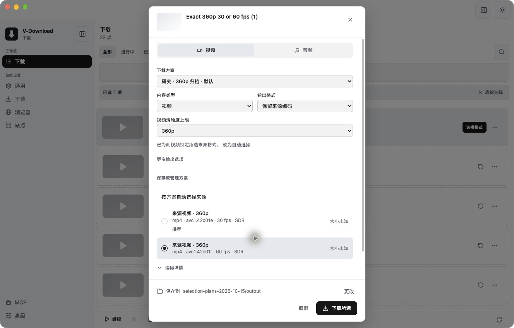
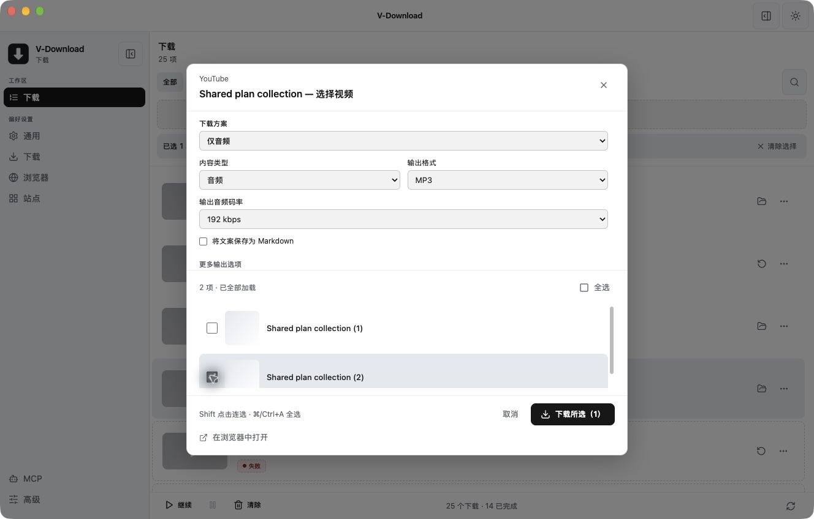
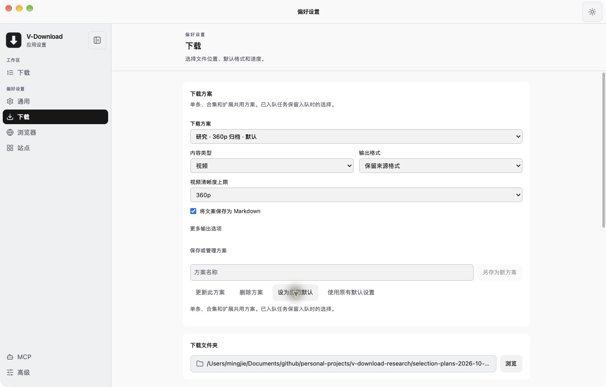

# 精确选择与可保存下载方案：实现、验证与自查

> 历史记录，已归档。本文保留当时的基线、观察和验收范围；当前桌面状态见 [DESKTOP_STATUS](../../DESKTOP_STATUS.md)，网页版执行计划见 [web-download](../../plans/web-download.md)。旧优先级建议不自动成为当前待办。

> 2026-10-16 整理：独立研究目录已删除，仍被报告引用的证据已归档。正文中的原测试路径保留为历史条件；详见 [归档说明](research-archive-2026-10-16.md)。

日期：2026-10-15。基于 Downie 比较报告中「精确 format 行选择」「统一合集选项」「明确输出目标」的建议实现。比较报告的 1.1.7 源码基线和竞品结论保持历史原义；本文记录之后的工作区实现。没有发布、提交 Git commit 或覆盖 `/Applications/V-Download.app`。

## 1. 已实现的使用流程

1. 粘贴单条视频，在选择窗口中选择下载方案，或按清晰度上限、来源编码、帧率上限、HDR 和音轨语言调整策略。
2. 「按方案自动选择来源」和逐条来源锁定明确分开。来源行显示编码、帧率、动态范围与大小；同分辨率的 30/60 fps 不再合并。分离音视频的来源可额外选择配对音频。
3. 展开「保存或管理方案」后可命名另存、更新及重命名、删除、设为默认，或者恢复为不指定默认方案。也可在偏好设置 → 下载中管理。
4. 合集和创作者列表复用同一个选项组件。选择整批的视频/音频、输出格式、质量与归档选项，保留原合集中的顺序和位置；只选第二项不会下载第一项。
5. 扩展弹窗加载桌面端方案，可选命名方案或跟随应用默认；支持刷新。扩展批量操作冻结本批所选方案与版本。后台、内容脚本入口使用统一发送流程。

内建方案：

| 方案 | 行为 |
|---|---|
| 原画归档 | 最佳可用高度，保留来源编码，保存 Markdown 文案 |
| 兼容 MP4 | 最高 1080p，明确转换为 H.264 / AAC 的 MP4，保存 Markdown 文案 |
| 仅音频 | MP3，目标码率 192 kbps，不保存文案 |

「保留来源编码」允许合并和重新封装，不承诺保留原容器或字节相同。音频另有 M4A / Opus / 保留来源编码；码率是编码器的目标值，VBR 不承诺固定瞬时码率。

## 2. 共同合同与处理链

`packages/shared/src/download-selection.ts` 是桌面、合集和扩展共同的版本化模型与校验器。扩展的 `download-selection.js` 由 `npm run sync:extension-constants` 生成，不手写第二套解析规则。

- `DownloadSelection v1` 保存媒体目标、高度上限或 best、来源编码、可选帧率上限、动态范围、音轨语言、输出编码/容器与转换目标。
- `exact` 保存来源 URL、provider format ID、分离视频的可选 audio format ID。它只用于单条请求；另存为方案时删除视频专属 ID。
- yt-dlp 精确来源使用 `all[format_id="ID"]` 的**字面字符串匹配**。数字 ID 仍以字符串比较，`best` 不会被解释成自动选择指令。不可用的 ID 不回落到另一个来源。
- `src/main/downloadPlans.ts` 是入队前的统一意图边界。显式请求 → 指定方案 → 已有任务快照 → 默认方案 → 旧请求；新请求的当前设置在此一次性冻结。
- 单条、解析占位任务的晋升、批量入队、扩展请求都经过这个边界。先验证整批方案，再写入任务，避免一部分任务已经入队才发现方案无效。
- `DownloadRequestSnapshot v1` 保存选择、方案身份/版本、输出目录、命名模板、文案与归档设置，以及原始合集位置。修改或删除方案不会改变已经入队的任务；暂停、重启、重试和「再次下载」保留快照。
- `selection_key` 由规范化后的输出意图产生。相同 URL、不同精确来源/输出要求可以分别下载；等价方案改名不改变下载意图。已有任务的去重仍按其原合同处理。
- Auto 的新选择走 yt-dlp；显式 FFmpeg 路径从 ffprobe 事实选择 rendition/音轨。FFmpeg 无法解释 provider format ID 时明确报错，提示使用 Auto / yt-dlp。
- `src/main/selectedOutput.ts` 在标记完成和正式交付前探测源文件，校验请求的高度、来源编码、帧率、动态范围、音频类型与语言；需要兼容 MP4 时再转换并检查媒体轨道。

部分 HLS / DASH 的 provider 元数据缺少高度或帧率。候选筛选允许这两项暂时未知，下载后必须由 ffprobe 验证；不符合或仍未知时不会交付为成功文件。这个语法来自 yt-dlp 的[官方格式过滤说明](https://github.com/yt-dlp/yt-dlp#filtering-formats)。已知超标候选仍会被筛掉，输出校验也覆盖直链。

语言匹配统一处理 UI 的 en/zh/ja 与媒体中的 eng/zho/chi/jpn，并保留地域约束；没有语言标签时不把它猜成所选语言。HDR 同样保留 unknown，不把未知 transfer 当成 SDR。

## 3. 兼容性与边界

| 边界 | 变化与兼容性 |
|---|---|
| 设置 | 新增 `downloadPlanLibrary`，内含版本、默认 ID、自定义方案与各方案 revision。旧设置没有该键时补空库，不自动指定方案。写入沿用原有设置持久化机制。 |
| 数据库 | schema 3 → 4，只增加 nullable `selection_key` 与索引。旧记录为 NULL；不从旧文件名或旧质量标签推导新选择。迁移可重复运行。 |
| IPC | `startDownload`、批量入队和解析晋升增加可选选择/方案字段；新增方案读取与带 revision 的 CRUD。通用 `updateSettings` 不允许直接覆盖方案库，避免丢失并发更新。 |
| 扩展 | `/download` 增加可选 selection / planId / planRevision；新增经过现有 Origin + capability 认证的 `/download-plans`。目录响应不传输出路径或凭据。旧请求仍接受；没有显式选择时可跟随应用默认。 |
| 扩展更新 | 桌面端和扩展文件都需要更新，已有 Chrome 扩展需要重新加载。旧桌面端不提供方案目录时，扩展显示无法加载方案。 |
| 公共 API / MCP | 本次没有扩展远程 API / MCP 的公开方案管理合同；既有 remote job 不自动套用桌面默认方案。完整现有契约测试仍运行。 |
| 原有任务 | 没有新快照的请求保持旧流程与原去重语义；新功能不会猜测或重写历史选择。 |
| 图片 / 笔记 | 归档目录与文案可复用；视频/音频约束不用于图片缩放。音频提取、精确视频 ID、转码及 codec/FPS/HDR 约束对图集会明确拒绝，建议使用原画归档。 |
| 抖音专用解析 | 无精确 ID、无音轨语言要求且不要求转码的视频方案保留专用 direct fallback，并在完成前验证输出。精确来源、音频与转码留在 yt-dlp 处理；不会通过专用 fallback 绕过选择约束。真实登录态站点本次未重测。 |

高度和 FPS 都是**上限**。只有更高源时失败，不静默放宽要求或自行降帧。H.264 兼容转换会重新编码；HDR 保留不能与该转换同时选择。不提供 HDR → SDR 色调映射。外置字幕下载和字幕语言方案不属于本次功能；已有嵌入字幕与章节的保留已验证。

## 4. 实测环境和证据

使用独立 Electron 43.7.5、研究 profile、session、temp、输出目录和临时 loopback 端口；应用代码来自本工作区构建。通过加载真正的主进程和原生产 IPC handler 进行入队与控制，未用模拟下载器替代引擎。

- 引擎只读使用本机已安装应用中的 yt-dlp 2026.07.04、FFmpeg / ffprobe 8.1.2。
- 样本都是本地生成的自有媒体：720/360p MP4、同高度 30/60 fps HLS、DASH、HEVC、嵌入字幕与章节的 MP4、慢速直链。
- 成功输出除 ffprobe 外，还使用 `ffmpeg -v error -xerror … -f null -` 完整解码。不是仅检查任务 complete 或文件存在。
- 研究实例本地服务强制校验独立扩展 ID 与 capability，未使用开发模式的免认证退路。
- 扩展生产 `background.js` 实际运行在浏览器 API 边界仿真中；网络、认证、本地服务、主进程、队列、数据库和下载引擎均为真实组件。**独立 Chrome 的弹窗 / 扩展安装 UI 没有自动验证**；自动化连接只能定位原用户配置，未切换到原配置测试。
- 没有读取私人浏览器 Cookie、替换安装版、修改原用户应用配置或控制其任务。研究 Electron、fixture 与独立 Chrome 已关闭，三个研究端口已释放；原用户 V-Download PID 29928 仍运行，回执为 `cleanup-receipt.json`。

| 验收场景 | 实测结果 | 证据文件（下方证据目录） |
|---|---|---|
| 同 URL 精确选择 360p / 30 与 60 fps | 分别得到对应帧率；同意图重复输入复用，不同来源分别入队 | `exact-results.json` |
| 真实 UI 选 60 fps | 锁定行、晋升原占位任务，最终 360p / 60 fps 且完整解码 | `ui-single-results.json`、截图 |
| 精确数字 ID 的分离视频 + 音频 | 选中 DASH video 1 + audio 2，得到 360p 视频与音频 | `literal-exact-results.json` |
| 名称 `best` 作为精确 ID | 按字面查找；不存在则失败，没有自动选择成功产物 | 同上 |
| 保存 / 默认 / 更新冲突 | 真实 UI 保存和设默认；版本冲突拒绝覆盖；内建方案不可改写 | `plan-saved-default.png`、自动测试 |
| 单条 MP3 | 音频文件实际为 MP3，无视频流，192 kbps 目标输出 | `plans-smoke-results.json` |
| HEVC → 兼容 MP4 | 实际 H.264 + AAC，完整解码通过 | 同上 |
| 合集方案快照 | 两个原始位置分别下载；入队后修改再删除方案，仍兑现 revision 1 的 360p / 30 fps | `collection-snapshot-results.json` |
| 原生多输出合集 | 两份兼容 MP4，逐份转换、交付与解码成功 | `native-collection-results.json` |
| 真实合集 UI 只选第二项 | 仅入队第二项，保存 entryIndex 2，输出 MP3 | `ui-collection-results.json`、截图 |
| 暂停 / 重开 / 删除方案 / 继续 | 重启后仍保留旧快照并完成 360p / 30 fps | `restart-results.json` |
| 扩展单条 + 批量 | MP3 单条与两份兼容 MP4；源文件验证及完整解码通过 | `extension-dispatch-results.json`、`extension-output-results.json` |
| 扩展失效方案 / 冷启动重试 | 永久错误原样反馈、不唤起应用；瞬时错误重试保留初次方案版本 | 同上、`scripts/test-extension-plans.cjs` |
| 显式 FFmpeg 路径 | 同一双 rendition HLS 兑现 360p / 30 fps | `negative-results.json` |
| 无方案 / 过期版本 / 错误 URL 的精确 ID | 入队前拒绝，没有新增任务 | 同上 |
| 超高分辨率 / 超 FPS / 不同 codec / 未知 HDR / 不存在的来源 ID | 错误结束，无最终文件交付 | 同上 |
| 转码中取消 | 保持 cancelled，无最终文件；下一任务正常完成 | 同上 |
| en → eng、字幕与章节 | 英文音轨、1 条字幕、3 章节经兼容转换保留，完整解码通过 | `language-subtitles-results.json` |

证据目录：[selection-plans-2026-10-15](assets/research-archive-2026-10-16/selection-plans-2026-10-15)。包括真实 handler 的隔离启动器、fixture、场景脚本、事件和输出；该目录保留本地，认证密钥不纳入仓库或报告。`task-source-manifest.json` 区分本期更改与之前四项修复，`task-diff.patch` 保留本期差异；`final-runtime-audit.json` 保留 **22 份成功媒体输出**的最终独立探测、完整解码与哈希；无最终文件的负例另记，不混入成功样本。

## 5. 自动验证与自查

已运行 `npm test` 全部现有测试和新增选择 / 扩展方案测试、`npm run typecheck`、`npm run build`、`git diff --check`。细节见证据目录中的 `full-tests-final.log`、`typecheck-final.log`、`build-final.log`。针对最后的契约修正重新验证真实引擎精确匹配与相关测试。

自查以**本任务开始时的工作区备份**为基线，保留此前四项修复，不把它们算成本期新增功能。检查了意图生产边界、全部入口、持久化、去重、两种引擎、输出交付、取消/恢复、扩展认证与 UI 状态；发现并修复：

1. **表达式与身份混淆**：直接把 provider ID 交给 `-f`，会把 `best` 等保留名称解释成策略；改为带引号的字面 `format_id` 匹配，并验证数字 ID 与分离音视频组合。
2. **合集位置与去重混淆**：同页面多个视频共用 pageUrl；单靠 URL 去重会漏项，过滤后索引也可能指向错误条目。保存原始位置，用 URL + 规范化意图识别任务，执行时传原始 `--playlist-items`。
3. **未知源事实过早排除**：部分 DASH / 单 rendition HLS 不提供 FPS / height。允许候选暂时未知，并把严格保证放在 ffprobe 输出事实边界；超标负例已测。
4. **扩展多套发送逻辑**：内容脚本的重复路径会对永久方案错误继续唤起与重试；统一为一条路径。重试冻结最初方案，刷新可显式接受更新 revision。
5. **类型与旧边界验证冲突**：旧字符串字段循环误覆盖新增对象与数字；恢复字段专属校验，增加实际 worker → HTTP → 主进程验证。
6. **旧专用路径绕过新选择**：抖音 direct fallback 现在只接受它能兑现的选择，并在完成前验证；不能验证的条件不会绕过新合同。
7. **UI 自动策略误表示已锁定**：增加独立自动选择行。入队失败保留选择窗口并显示错误；任务语义更新带上选择与方案，普通进度 tick 继续保持精简。
8. **事实标签处理**：统一 en/eng 等语言匹配，未知 transfer 不当作 SDR。输出不能证明语言或 HDR 时明确失败。

本轮自查后没有已知的阻塞问题。未验证：独立 Chrome 弹窗 UI、真实登录态网站、Windows/Linux 的运行行为、真实 HDR 正例与多地域音轨。这些不计为已通过；当前媒体与 macOS 测试结果不外推成全站或全平台保证。

## 6. 完成清单

- [x] 单条精确来源、FPS/codec/HDR/语言事实与约束。
- [x] 可复用方案、内建方案、CRUD / 重命名 / 默认 / revision。
- [x] 单条、合集、创作者选择器、扩展共用选择模型与主进程边界。
- [x] 持久化快照、选择相关去重、原始合集位置、重启与重试。
- [x] 真实引擎 / ffprobe / 完整解码验证，失败和取消场景。
- [x] 自查并修复上述契约问题，保留可复查证据。
- [ ] Chrome 弹窗 UI 与真实认证站点的额外手工验收，后续跨平台 / HDR 正例扩展。
