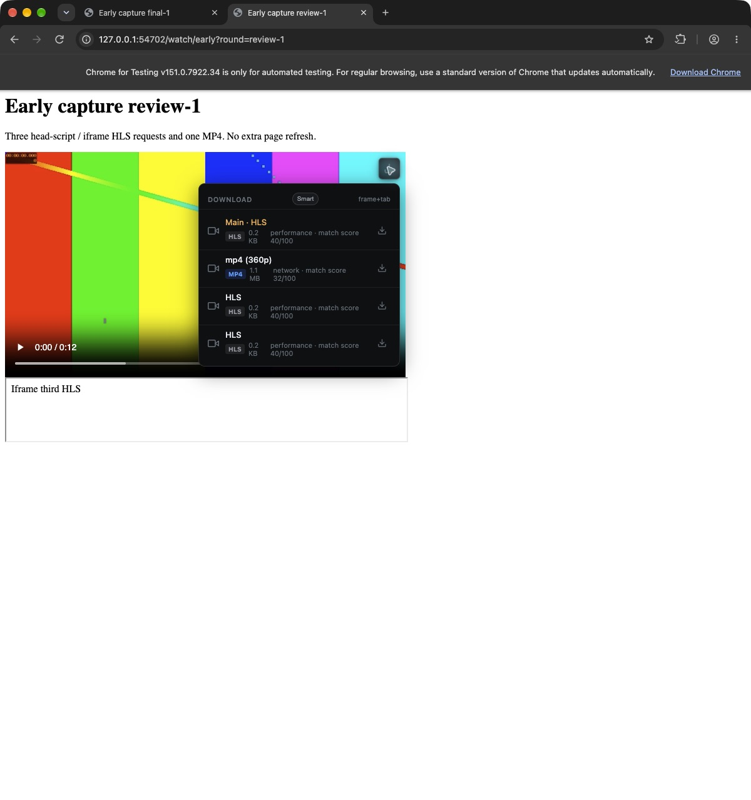

# 扩展首轮捕获与方案鉴权修复

> 历史记录，已归档。本文保留当时的基线、观察和验收范围；当前桌面状态见 [DESKTOP_STATUS](../../DESKTOP_STATUS.md)，网页版执行计划见 [web-download](../../plans/web-download.md)。旧优先级建议不自动成为当前待办。

> 2026-10-16 整理：独立研究目录已删除，仍被报告引用的证据已归档。正文中的原测试路径保留为历史条件；详见 [归档说明](research-archive-2026-10-16.md)。

日期：2026-10-15（America/Los_Angeles）。本批修复上一份数据正确性报告留下的两项问题；保留此前工作区改动，未替换已安装应用。

## 结果

| 问题 | 修复 | 实际验证 |
|---|---|---|
| 开发扩展重载后漏掉页面早期媒体请求 | 在 `document_start` 为各 frame 安装 Resource Timing 观测，缓冲并向 Worker 补报可识别的媒体 URL；原网络捕获继续工作。 | 重载后直接导航，首次页面出现 3 HLS + MP4 共 4 项，无需再刷新。受控屏蔽三条 HLS 的网络事件后，三条均以 `performance` 来源出现，iframe HLS 下载完成。 |
| 方案 GET 被错误拒绝 | 扩展改用只读 `POST /download-plans`，复用下载请求的 Origin + capability 校验与失效凭据刷新。保留原 GET。 | 真实 Chrome 的旧 GET 没有 Origin、返回 403；新 POST 带 Origin、返回 200。轮换研究实例凭据后，观察到 `query 403 → pair 200 → query 200`。 |

## 生产边界与兼容性

- 新收集器使用浏览器资源时序，不重新请求媒体，不拦截页面 fetch，不读取响应正文、Cookie 或认证头。收集范围沿用既有站点权限；没有增加 manifest 权限。
- 补报保留原始 URL，来源标记为 `performance`。它不声明未知 MIME/响应头；浏览器未开放的状态和大小保持未知。相同 URL 与文档的完整网络观测优先，避免晚到补报覆盖已有响应事实。
- Worker 查询**当前 frame**，再核对 document ID、URL、顶层页面和导航 revision；拒绝已缓存或已替换的文档。候选继续走统一去重、评分、提交、方案解析与持久化链路。
- 每次发送最多 32 项，待发与去重集合有边界，暂时失败最多额外重试 3 次。页面离开会释放资源；BFCache 恢复后只观察新请求。晚注入不把历史 SPA 请求归到当前页面。
- `POST /download-plans` 只接受空对象，不修改方案库。现有 GET 及 JSON 响应形状保持；两个方法均要求原有鉴权。新扩展需配套支持该 POST 的桌面构建，部署时应同步更新。
- 浏览器 session 缓存增加可选导航 epoch，Worker 重启后保留候选身份。旧读取器会忽略该非 frame 字段；没有数据库或设置迁移。
- 新脚本随现有整目录扩展资源打包；无需新增发布文件白名单。

实现入口：[启动收集器](../../../extension/content-media-capture.js)、[Worker](../../../extension/background.js)、[观测合并策略](../../../extension/media-patterns.js)、[本地方案查询](../../../src/main/localServer.ts)。

## 端到端证据

使用独立 Chrome for Testing 151.0.7922.34、Electron 43.7.5 研究实例、独立配置和随机 loopback 端口。测试服务端对媒体请求严格检查原始查询串和完整顶层/iframe Referer。样本均为 12 秒自有合成音视频。

| 场景 | 结果 |
|---|---|
| 基线真实弹窗 | 方案 GET 的 Origin 为 null，即使 capability 存在仍被拒绝；页面首轮显示无候选。[基线截图](assets/extension-startup-auth-2026-10-15/baseline-plan-auth.png) |
| 修复后普通重载 | 直接进入新页面，4 项可见；弹窗成功读取内建方案、选中 Compatible MP4，批量提交 4/4，4 个下载完成。[方案截图](assets/extension-startup-auth-2026-10-15/plan-query-fixed.png) |
| 受控漏事件 | 仅在研究副本中忽略指定 fixture 的 HLS `onBeforeRequest/onCompleted`；真实页面的三条 HLS 全部经资源时序补报。浮层提交 iframe HLS，原始查询串和完整 iframe Referer 通过服务端校验，输出完成。仓库代码没有漏事件测试钩子。 |
| 最终普通路径 | 移除漏事件钩子后重载并直接进入新页面，仍显示完整 4 项。[截图](assets/extension-startup-auth-2026-10-15/final-first-navigation.png) |
| 已保存方案 | 在研究实例保存自定义 360p/30 fps 方案，扩展取回并选中；重载后浮层下载携带相同 ID/revision，实际输出为 360p、H.264、30 fps。[方案读取截图](assets/extension-startup-auth-2026-10-15/saved-plan-read-after-repair.png) |
| 凭据失效 | 仅轮换研究实例凭据，真实扩展沿拒绝、重新配对、成功读取的顺序恢复。[浏览器 HTTP 证据](assets/research-archive-2026-10-16/extension-startup-auth-2026-10-15/browser-auth-proof.json) |
| 鉴权反例与兼容性 | 缺 Origin、外站 Origin、错误扩展、缺凭据、错凭据均为 403；有效旧 GET 为 200；企图修改方案库及数组查询为 400；方案库保持原值。共 9 项真实 HTTP 检查。[结果](assets/research-archive-2026-10-16/extension-startup-auth-2026-10-15/auth-verification.json) |
| 文件完成条件 | 共 6 个浏览器创建的下载全部 complete；逐项验证原始 URL、完整来源/Referer、方案快照、ffprobe 和完整解码。均为 12 秒 H.264 + AAC；自定义方案输出另核对 30 fps。[输出证据](assets/research-archive-2026-10-16/extension-startup-auth-2026-10-15/output-verification.json) |

原始日志：[扩展到桌面 HTTP 方法/Origin/状态](assets/research-archive-2026-10-16/extension-startup-auth-2026-10-15/http-requests.jsonl)、[媒体 URL 与 Referer](assets/research-archive-2026-10-16/extension-startup-auth-2026-10-15/fixtures/source-requests.jsonl)。HTTP 日志仅记录是否携带 capability，不记录凭据值。

## 自审与补修

以本批开始时的完整工作区副本为基线，自审差异见 [task-diff.patch](assets/research-archive-2026-10-16/extension-startup-auth-2026-10-15/task-diff.patch)。

1. **跨时钟比较误拒首轮请求。** 初版用导航事件时间截断全部资源时序；真实测试看到两个 head-script fetch 比导航时间早 1 ms，因此只补回一条清单。完整导航改由当前文档身份确认；同文档路由变化另行失效。补修后受控测试三条均恢复。[诊断记录](assets/research-archive-2026-10-16/extension-startup-auth-2026-10-15/fixtures/capture-debug.jsonl)
2. **晚到弱观测不能降级已知事实。** 将完整网络观测优先的选择规则放在候选生产者，缓存写入与公共合并都复用它，避免消费者各自修补。
3. **查到文档不代表当前 frame。** 改为按 frame 查询再比较 document ID，排除 BFCache 旧文档与 frame ID 复用；最终接收器另在真实浏览器漏事件场景确认 4 候选。
4. **恢复后不能重复或停止捕获。** 保留 session 缓存的导航 epoch；BFCache 暂停/恢复与最终 dispose 分开，恢复时不回放旧资源。对应边界有回归测试。
5. **只读查询契约要明确。** 新 POST 校验空对象并使用原有 body 大小限制，拒绝未知查询字段；继续保留 Origin、扩展白名单和 capability 三者的约束，没有为 GET 放宽鉴权。

验证：`npm test`、`npm run typecheck`、`npm run build`、`git diff --check` 通过。最终自审的文档身份与缓存补修后，另复跑全部扩展检查通过。新增测试涵盖缓冲补报、重试、原始 URL、坏批次、错误来源、旧 iframe、BFCache、frame 复用、路由失效、Worker 恢复及观测优先级。[扩展回归](../../../scripts/test-extension-early-capture.cjs)、[方案回归](../../../scripts/test-extension-plans.cjs)。

源码与构建身份：[final-identity.json](assets/research-archive-2026-10-16/extension-startup-auth-2026-10-15/final-identity.json)。测试日志、fixture 和复核脚本保存在同一外部研究目录。

研究 Chrome、Electron 与 fixture 已退出，研究端口关闭。原用户 V-Download PID 29928 及 18765/18766 监听保持运行；未替换安装包。[清理回执](assets/research-archive-2026-10-16/extension-startup-auth-2026-10-15/cleanup.json)

## 验证范围

首轮捕获和方案鉴权两个已复现问题均已关闭。资源时序补报只能识别 URL 所表达的媒体类型，不能恢复从未观测到的响应头、扩展加载之前的未知历史、已淘汰的资源时序、DRM 内容，或断言不透明 URL 是 HLS。跨站未开放的时序字段保持未知。本次结果描述所测场景，没有宣称全站发现率或所有竞态均已验证。

实现参考：[Chrome webRequest](https://developer.chrome.com/docs/extensions/reference/api/webRequest)、[PerformanceObserver buffered 语义](https://developer.mozilla.org/en-US/docs/Web/API/PerformanceObserver/observe)、[Resource Timing 状态可见性](https://developer.mozilla.org/en-US/docs/Web/API/PerformanceResourceTiming/responseStatus)。具体鉴权失败原因以本机真实请求为证据。
