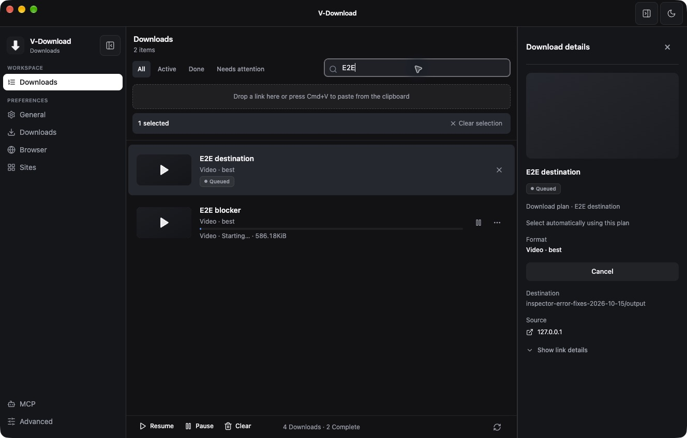
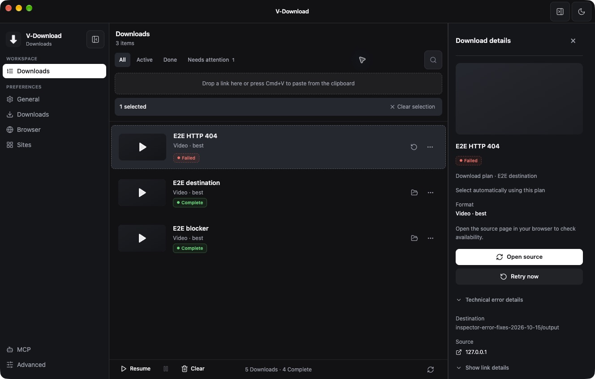
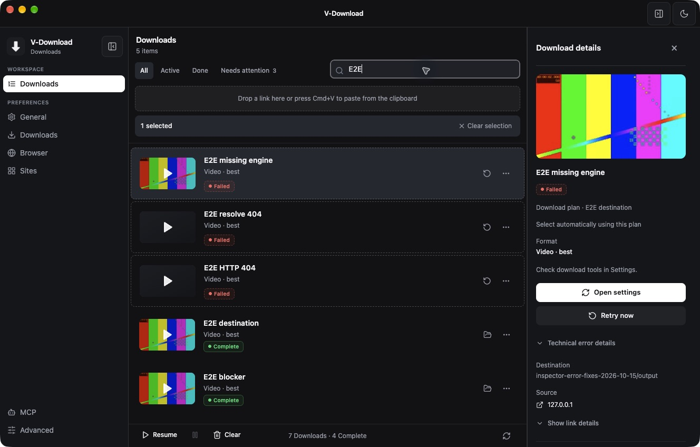

# 任务目录提示与 HTTP 404 分类修复

> 历史记录，已归档。本文保留当时的基线、观察和验收范围；当前桌面状态见 [DESKTOP_STATUS](../../DESKTOP_STATUS.md)，网页版执行计划见 [web-download](../../plans/web-download.md)。旧优先级建议不自动成为当前待办。

日期：2026-10-15，America/Los_Angeles。修复上轮安装版自审的两项问题，保留此前所有工作区改动，没有提交或推送。

## 结果与实现

| 问题 | 根因 | 修复 |
|---|---|---|
| 未完成任务显示全局默认目录 | Renderer 只收到文件路径，发布文件之前没有实际任务目录，详情栏退回了全局设置。 | 主进程复用下载 writer 的 `resolveTaskOutputDir`，读取已持久化输出根目录、冻结方案与任务覆盖、合集/作者目录等事实，将有效 `outputDir` 传入列表、新任务与状态事件。详情栏优先已发布文件路径，其次任务目录，旧消息仍兼容默认目录。 |
| HTTP 404 误报引擎缺失 | 通用 `not found` / `executable` 文案匹配把 HTTP “Not Found” 当作程序不可用。 | 分类集中到 `downloadError.ts`；HTTP 404/410 使用既有 `UNSUPPORTED` 码及“检查来源”动作，真正 spawn ENOENT 或明确的引擎启动诊断使用 `ENGINE_MISSING`。保留原始 Error 的 errno/syscall，分类后再脱敏并落库。 |

目录显示不在 Renderer 重新推导方案规则。已知发布文件仍是最终事实；无法读取的旧请求不会导致整份历史列表加载失败。普通进度 tick 不重复发送目录与完整任务 metadata。

源码入口：[目录生产者](../../../src/main/downloadManager.ts#L555)、[状态契约](../../../src/main/downloadProgress.ts)、[列表与进度接收](../../../src/renderer/src/hooks/useDownloads.ts)、[详情显示](../../../src/renderer/src/components/DownloadInspector.tsx#L186)、[错误分类与诊断保留](../../../src/main/downloadError.ts)。

## 最终安装包端到端验证

验证对象是正常启动的 `/Applications/V-Download.app`，不使用研究 Electron bootstrap、注入 IPC 桥或产品测试钩子。通过原有受鉴权的 loopback `/download` 创建任务，用真实界面检查目录和恢复动作，再检查 SQLite 与实际文件。

本地服务 `127.0.0.1:58538` 提供自有 4 秒 H.264/AAC 样本。专用输出为 `v-download-research/inspector-error-fixes-2026-10-15/output`，与用户默认 Downloads 明确不同。临时使用单并发及可释放的响应屏障，稳定形成排队/下载阶段；验证后还原所有原设置。

| 场景 | 最终包实际结果 |
|---|---|
| 排队 | A 占用下载槽，B 处于 Queued；B 详情立即显示专用任务目录。 |
| 下载中 | 释放 A，B 开始下载并等待受控响应；目录仍为实际方案目录。 |
| 完成 | B 成功发布到相同目录；界面显示文件名和目录，文件存在且完整可解码。 |
| 下载 404 | 真实缺失 MP4 返回 HTTP 404；记录 `UNSUPPORTED`，界面显示 Open source，失败状态仍显示方案目录。 |
| 解析 404 | 真实缺失网页走 `getVideoInfo → resolver → failInfoResolveTask`；同样为 `UNSUPPORTED`，没有 Open settings 误导。 |
| 重启恢复 | 重开最终包再选择 404 记录，任务目录与 Open source 均保持正确，验证的是重新加载数据库的列表路径。 |
| 真正引擎启动失败 | 临时配置任务专用可执行文件：版本探测成功后，其解释器变为不存在的测试路径。实际监督子进程返回 bad interpreter / No such file or directory；记录 `ENGINE_MISSING`，界面显示 Check download tools in Settings / Open settings。没有改动任何真实引擎文件。 |
| 文件完成条件 | 两个成功输出均经包内 ffprobe 检查为约 4 秒 H.264 视频 + AAC 音频，并通过 FFmpeg 完整解码。其余三个任务是有意制造的失败。 |

共 **5 个最终包任务**：2 个成功、2 个真实 404、1 个真实受监督启动故障，逐项符合预期。测试的 404 是受控公开样本，不代表所有站点会用相同状态码描述鉴权或下架。

证据：[最终任务与错误码](assets/inspector-error-fixes-2026-10-15/e2e-task-records.json)、[输出与完整解码](assets/inspector-error-fixes-2026-10-15/output-verification.json)、[排队 AX](assets/inspector-error-fixes-2026-10-15/queued.ax.txt)、[下载中 AX](assets/inspector-error-fixes-2026-10-15/downloading.ax.txt)、[完成 AX](assets/inspector-error-fixes-2026-10-15/complete.ax.txt)、[重启 AX](assets/inspector-error-fixes-2026-10-15/reloaded-details.ax.txt)、[真实缺失引擎 AX](assets/inspector-error-fixes-2026-10-15/missing-engine.ax.txt)、[服务端请求](assets/inspector-error-fixes-2026-10-15/fixture-requests.jsonl)。

## 自审与补修

首轮 404 与目录验证通过，但真实引擎对照暴露出 POSIX 监督路径的另一处问题：Node 成功启动的是 bash，无法执行内部引擎时可能只有退出码 126；下载管理器只保留 `ERROR:` 行，丢弃了 bash 的启动诊断。首轮因此错误落为 `UNSUPPORTED`，该结果没有当作通过。[首轮记录](assets/inspector-error-fixes-2026-10-15/first-pass-task-records.json)。

补修在失败消息的生产边界保留诊断：优先引擎 ERROR 行，否则保留最后 6 行、最多 4096 字符的 stderr，再分类明确的进程监督诊断。没有把所有 126/127 或普通 “not found” 一律归类为缺引擎。Windows 直接 spawn 的 errno 路径继续支持。

补修后重新构建、签名并安装，完整重跑上表五个任务。自审还检查了目录在首个新任务、全量列表、格式提升、进度状态与重启加载中的传递，以及历史 metadata 损坏保护、Windows/UNC 与 POSIX 路径显示、错误码入库和恢复按钮选择。移除了重复的主进程错误码联合定义，沿用共享契约。

检查结果：本次两项问题均已关闭，未发现阻断安装或数据保留的问题。目录与错误分类没有新增设置、数据库迁移、权限或错误码；IPC 仅增加可选 `outputDir`，旧 payload 的兼容路径保留。历史错误记录不批量重写；新失败及重试结果使用新分类。

## 自动验证与范围

- 首次实现后 `npm test` 全量通过。
- POSIX 诊断补修后，`test:terminal-error`（含真实直接 spawn 和真实 `spawnManagedProcess` 故障）、`test:download-progress`、全部 `test:presentation`、`npm run typecheck`、`npm run build`、`git diff --check` 通过。
- 路径格式测试覆盖 Windows 与 POSIX；没有声称完成 Windows 实机端到端验证。此次没有重跑所有站点、合集性能、登录站点或先前其他特性的完整研究。

[全量回归日志](assets/inspector-error-fixes-2026-10-15/tests.log) · [最终检查范围](assets/inspector-error-fixes-2026-10-15/validation.json) · [源码哈希](assets/inspector-error-fixes-2026-10-15/source-identity.json)。

## 本机安装与数据保留

最终为 **应用版本 1.1.7 / 本地构建号 1.1.9 / arm64**，安装于 `/Applications/V-Download.app`。构建号区分本次本机修订，没有发布新版本标签。bundle ID 仍为 `com.ytdownload.app`，沿用原 Apple Development 签名，`codesign --verify --deep --strict` 通过；本机开发包未公证。

打包的 7 个编译文件与 `app.asar` 逐文件一致，包内扩展与仓库副本一致。本批扩展实现没有变化，沿用现有扩展与配对契约。

安装器：V-Download 本地修订包（本机历史路径：`/Users/mingjie/Downloads/V-Download-1.1.7-local-20261015-r2-arm64.dmg`；不随仓库保存）。SHA-256：`8d4164b31f5e35583cf1a89f70199058d765232b43215d4e4c9f2c723cb3ba4e`。

安装前备份：`/Users/mingjie/Documents/V-Download Backups/2026-10-15-inspector-error-update/`（0700），包含原应用及原 userData。

还原与最终核验：

- 原有 **2 条记录的所有列值保持原样**，数据库完整性检查通过，原下载文件保留。
- `settings.json`、`cookies.txt`、`extension-pairing.secret`、`remote-jobs.json` 与安装前逐字节相同；原引擎、目录、并发与其他设置已恢复。
- 主界面 Local Storage / Session Storage 从本轮安装前备份恢复；离线核对 45 个登录及界面存储文件一致。
- 删除首轮及最终轮受控任务、临时方案、测试可执行文件和合成输出。保留少量证据、最终 DMG 和回滚备份；打包 staging、out、dist、测试缓存/日志已清理。
- 用还原后的原配置再次正常启动安装版，界面只显示原有两条完成记录，正常引擎设置及本地桥可用。测试服务已停止，58538 端口关闭；应用现在正常运行。

[包身份](assets/inspector-error-fixes-2026-10-15/package-identity.json) · [签名](assets/inspector-error-fixes-2026-10-15/signature.txt) · [打包日志](assets/inspector-error-fixes-2026-10-15/package.log) · [数据保留核验](assets/inspector-error-fixes-2026-10-15/data-preservation.json) · [清理回执](assets/inspector-error-fixes-2026-10-15/cleanup.json)。
