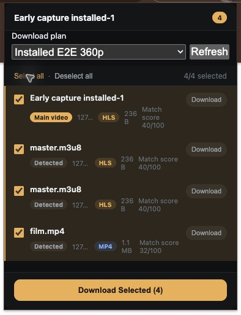
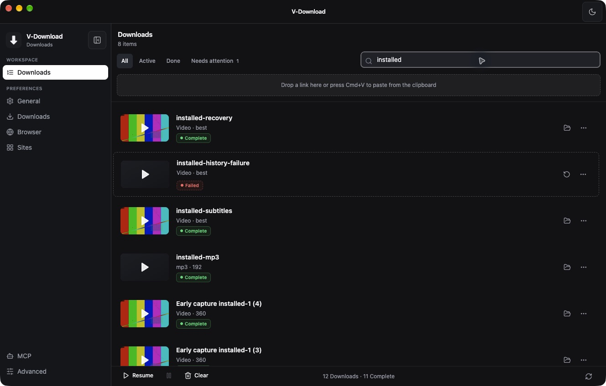

# 本机安装版验证与清理记录

> 历史记录，已归档。本文保留当时的基线、观察和验收范围；当前桌面状态见 [DESKTOP_STATUS](../../DESKTOP_STATUS.md)，网页版执行计划见 [web-download](../../plans/web-download.md)。旧优先级建议不自动成为当前待办。

日期：2026-10-15，America/Los_Angeles。此次范围为把当前工作区的全部既有修复打包、原地安装、同步 Chrome 扩展，验证实际安装版并清理本项目的缓存和调试环境。没有提交或推送代码。

## 安装结果与身份

| 项目 | 结果与证据性质 |
|---|---|
| 桌面应用 | **实际观察**：`/Applications/V-Download.app`，版本 **1.1.7**，本机构建 **1.1.7.20261015**，arm64。版本号没有另行发布升级；构建号及 SHA-256 区分这次工作区构建。 |
| 代码基线 | **静态事实**：HEAD `a3d0bfbb444045e034b0fdfc611e4f2a9888c464` 加此前完整工作区改动；保留全部既有源码与研究文档。记录了 71 个修改/新增代码文件的哈希。 |
| 归档匹配 | **静态事实**：逐文件比较 7 个 `out/` 编译文件与 `app.asar` 内容一致；整个扩展目录与包内副本一致。SQLite arm64 N-API prebuild 存在。 |
| 应用身份 | bundle ID 保持 `com.ytdownload.app`；沿用旧安装的本机 Apple Development 证书及 Team。安装前与安装后均保存身份；最终 `codesign --verify --deep --strict` 成功。 |
| 发布限制 | 本机开发包，没有公证。`spctl --assess --type execute` 返回 rejected；实际通过正常本机启动及 Chrome 协议唤起成功。没有关闭或绕过系统安全保护，也没有声称正式 `verify:release` 发布门禁通过。 |
| Chrome 扩展 | **实际观察**：Chrome Default 配置原地 Reload，继续使用仓库 `extension/`，ID `ggolokdmilobpagmcbebkdpmkbnjhmgb`，版本 1.1.7，启用状态及既有站点设置保持。没有卸载扩展。新增的 webNavigation 权限来自此前来源上下文修复。 |
| 内置引擎 | **实际执行**：yt-dlp 2026.07.04；FFmpeg / ffprobe 8.1.2。签名后文件哈希另存。保留用户原引擎设置，因此下载仍按原设置使用 userData 中的 yt-dlp 与 `/opt/homebrew/bin/ffmpeg`；独立输出核验使用安装包内 ffprobe / FFmpeg。 |
| 本机安装包 | 保留一份 `/Users/mingjie/Downloads/V-Download-1.1.7-local-20261015-arm64.dmg`。其他重复 zip、旧安装器、打包目录已清理。 |

DMG SHA-256：`1ed47d691d5e0547829886f729e11ac332dccd81e6208787d3052baf5c3bff86`。

[源码身份](assets/installed-release-2026-10-15/source-identity.json) · [包及引擎身份](assets/installed-release-2026-10-15/package-identity.json) · [签名输出](assets/installed-release-2026-10-15/signature.txt) · [打包验证日志](assets/installed-release-2026-10-15/package.log)。

## 数据保留

先正常退出旧版，备份完整 userData 和旧应用，再替换安装目录。备份放在权限 0700 的目录：

`/Users/mingjie/Documents/V-Download Backups/2026-10-15-local-update/`

为避免回滚备份继续占用大缓存，备份中的可再生缓存也已删除；原数据库、设置、Cookie、配对凭据、登录存储及旧应用仍可恢复。Chrome 原扩展 Local/Sync 存储另有安装前副本。没有导出凭据值到报告。

最终离线复核：

- 原有 **2 条下载记录**的全部旧字段逐项一致；数据库迁移到 schema 4，`integrity_check=ok`。原下载文件没有删除。
- `settings.json` 与安装前逐字节相同，原引擎、并发、目录、代理及其他偏好保留。
- `cookies.txt`、`extension-pairing.secret` 与原值逐字节相同；`remote-jobs.json` 也完全一致。
- 主界面 Local Storage / Session Storage 恢复安装前副本；46 个 Cookie、Local Storage、IndexedDB / WebStorage 数据文件与备份逐字节一致。LevelDB 的诊断文字 `LOG/LOG.old` 已清理，编号 `.log` 是数据库 WAL，保留。
- 本轮 10 条测试任务按记录 ID + 精确 loopback URL 删除；测试方案删除，扩展的测试方案选择改回 Follow app default。

[数据保留核验](assets/installed-release-2026-10-15/data-preservation.json)。

## 安装版端到端验证

使用**真实 `/Applications` 安装包**与用户已有 Chrome 扩展，未使用研究 Electron bootstrap 或注入 IPC 桥。测试服务仅监听 `127.0.0.1:50711`，媒体为本任务自有 12 秒合成视频。首次直接媒体冒烟产生的一个文件位于 Downloads，核验后按文件哈希删除；其他任务输出到独立研究目录。测试期间没有改动用户的默认下载目录。

| 验收项 | 方法与实际结果 |
|---|---|
| 安装包可用 | 正常启动，显示原有两条完成记录；本地桥服务正常，数据库迁移不丢记录。 |
| 精确 360p | 从桌面粘贴网页，选 360p，保存 Installed E2E 360p 方案，明确勾选 360p 源流。快照保存 `hls-798` 和方案 ID/revision，实际视频高度 360。 |
| 方案共享与持久化 | 桌面保存的方案立即出现在真实扩展弹窗；扩展批量提交使用相同 ID/revision。桌面退出重开后仍能读取，测试结束移除测试方案。 |
| 重载后早期捕获 | 扩展 Reload 后直接导航新页面，第一次弹窗显示 **3 HLS + 1 MP4**，没有额外刷新网页。含一个 iframe 来源。 |
| 独立候选与稳定评分 | Smart 列表显示全部四项；刷新弹窗后 HLS 保持 40/100、MP4 保持 32/100；没有重复累加评分。 |
| 真实扩展批量下载 | 全选四项，显示 Sent 4/4，四个任务全部 complete。三条 HLS 与 MP4 均输出 360p；这是扩展多候选批量路径。 |
| 原始 URL 和完整上下文 | 四个任务保留 `?token=a%2fb&label=hello%20world&utm_source=early`，顶层与 iframe 的完整 document URL、page URL、Referer 和 document ID 均持久化。服务端严格校验查询串及 Referer，下载成功。 |
| MP3 状态与输出 | 通过安装版现有受鉴权 `/download` 入口提交音频选择，真实界面显示 `mp3 · 192`、Complete；ffprobe 仅有 MP3 音频流，没有视频。未把此项描述成桌面 Audio 标签操作。 |
| 字幕与后处理 | 同一安装版入口提交带字幕 MP4 的 H.264 兼容转换。输出保留 **1 条英文 mov_text 字幕、3 个原章节**，音视频为 H.264/AAC。 |
| 退出重开与恢复边界 | 先制造独立 404 历史失败，再启动限速媒体，退出并确认 Quit。重开只提示 **1 条 interrupted**；点击恢复只恢复这一条，历史失败整行数据始终不变。 |
| 暂停与继续 | 恢复中的任务可暂停到 Paused，再从同一任务继续并最终完成；输出完整解码成功。 |
| 鉴权与旧接口 | 安装版实际 HTTP 的 9 个正反例通过：有效 POST / 旧 GET 200，缺 Origin、外站、错误扩展、缺/错 capability 403，非空对象与数组查询 400。没有轮换用户凭据。 |
| 文件完成条件 | **9 个成功输出全部**通过 ffprobe（12 秒、流类型/编码/高度/字幕/章节）及 FFmpeg 完整解码；另有 1 个刻意失败的 404 样本。 |
| 清理后冷启动 | 清理完成后在真实 Chrome 打开 `vdownload://wake` 并正常选择 Open V-Download，确认实际启动路径仍是 `/Applications/V-Download.app`；桥可达，记录仍为 2 条，设置逐字节相同。 |

[逐输出验证](assets/installed-release-2026-10-15/installed-output-verification.json) · [合成测试任务快照](assets/installed-release-2026-10-15/test-task-records.json) · [鉴权反例](assets/installed-release-2026-10-15/installed-auth.json) · [历史失败基线](assets/installed-release-2026-10-15/history-failure-before.json) · [冷启动结果](assets/installed-release-2026-10-15/after-clean-smoke.json) · [原始 URL / Referer 观测](assets/installed-release-2026-10-15/source-requests.jsonl) · [服务端请求结果](assets/installed-release-2026-10-15/server-requests.jsonl)。这些请求中的 token 是合成样本字段，没有用户认证凭据。

## 自审

检查了应用/扩展身份、归档与源码一致性、原配置迁移、引擎选择、输出所有权、恢复范围、鉴权反例及清理边界。此次没有额外修改产品实现；完整源码回归 `npm test`、`npm run typecheck`、构建及 `git diff --check` 通过。[全量回归日志](assets/installed-release-2026-10-15/tests.log)。

未发现阻断本机安装或数据保留的问题。发现两项需要后续改进的提示问题，**本次保留现状**：

1. **P2：任务完成前，详情目录显示默认目录。** 已保存方案的真实输出目录和任务快照正确，但 `DownloadInspector.tsx:185` 在没有 `file_path` 时回退到全局 `downloadDir`，没有采用任务方案的 outputDir。建议由任务自己的冻结输出根目录提供显示事实；验收为排队、下载、失败、完成四阶段都显示实际目录。
2. **P2：HTTP 404 被归类为引擎缺失。** 受控失败记录明确为 `HTTP Error 404: Not Found`，却得到 `ENGINE_MISSING`。`downloadManager.ts:795` 的通用 `not found` 正则先匹配了 HTTP 文案。建议在错误生产边界区分进程启动 ENOENT 与 HTTP 状态，前者引导配置工具，后者引导检查来源 URL；补两类端到端/生产边界反例。

验证脚本初次把样本章节数写成 2；直接复核源文件与输出均为 3 个相同章节后修正验收预期，再次完成全部输出核验。这个脚本断言错误没有导致产品改动。

没有在这次安装验证中额外重复真实网站合集、付费/登录站点、DRM、跨平台和完整性能基准；扩展多候选批量下载不等同于站点 playlist 提取。那些范围沿用此前研究结果，此次只声称表中实际完成的场景。

## 清理范围与最终状态

清理 **258 个路径，5.005 GiB 文件逻辑大小**。该统计包括先前安装副本、构建输出及新建回滚备份中的可再生缓存；不是依据文件系统空闲块变化测得的净腾空空间。

- 构建：旧/新重复 dist 安装产物、out、release staging、Vite/TypeScript 缓存、开发日志及本轮 `/tmp` 脚本和日志。
- 应用：主配置及 Douyin/Cloak 登录分区内的 HTTP、代码、GPU、Dawn、Service Worker 脚本/响应缓存；应用诊断日志和 LevelDB 诊断文字。Cookies、IndexedDB、Local Storage、数据库 WAL、引擎与登录存储保留。
- 研究：此前几轮专用 Chrome 配置、研究 Electron 配置/session、临时扩展副本、源码基线副本、合成输出、可再生媒体 fixture、Python 缓存和进程调试日志。
- 保留：全部源代码、扩展必需的生成运行时、共享包运行时、构建引擎输入、研究报告/截图/结构化与原始来源证据、一个 DMG，以及原应用/数据回滚备份。保留的研究证据不是继续运行的调试环境。
- 没有清理其他项目、系统或用户真实 Chrome 配置的共享缓存。历史报告中指向已清理临时进程日志/合成媒体的链接已明确标注移除。

最后一次冷启动验证后再次正常退出，再清除新生成缓存。因此**应用当前已退出**；18765、18766 和测试 50711 端口均关闭，已知应用缓存目录为零。下次打开 `/Applications/V-Download.app` 即是新构建，运行时会正常生成新的基础缓存。

[完整清理回执](assets/installed-release-2026-10-15/cleanup-receipt.json) · [清理前缓存清单](assets/installed-release-2026-10-15/cleanup-inventory.json)。

后续修复：本报告自审的目录提示和 404 分类两项问题，已在 [后续修复与安装验证](inspector-error-fixes-2026-10-15.md) 中完成；此处保留原轮次的历史记录。
