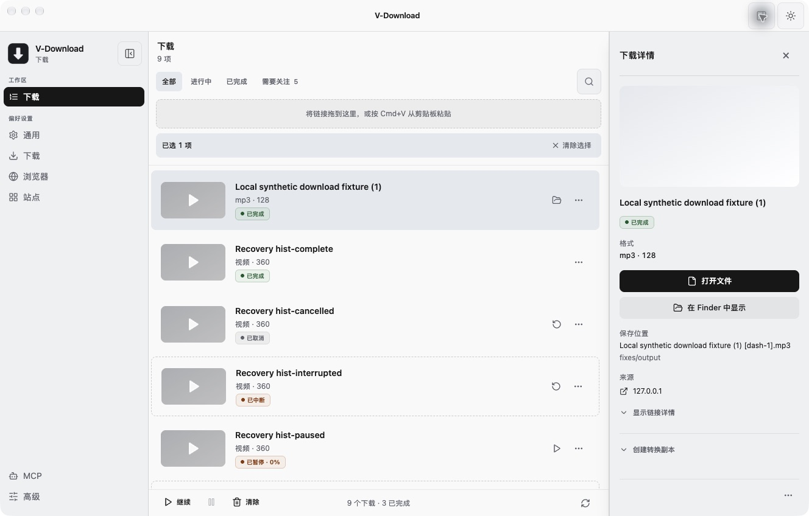

# v-download 四项已复现问题：修复、验收与自审

> 历史记录，已归档。本文保留当时的基线、观察和验收范围；当前桌面状态见 [DESKTOP_STATUS](../../DESKTOP_STATUS.md)，网页版执行计划见 [web-download](../../plans/web-download.md)。旧优先级建议不自动成为当前待办。

> 2026-10-16 整理：独立研究目录已删除，仍被报告引用的证据已归档。正文中的原测试路径保留为历史条件；详见 [归档说明](research-archive-2026-10-16.md)。

日期：2026-10-15。基于 `a3d0bfbb444045e034b0fdfc611e4f2a9888c464` / 1.1.7 的工作区修改；未提交、未发布、未替换 `/Applications/V-Download.app`。原始研究结论保留在 [Downie 比较报告](downie-comparison-2026-10-15.md)，此文记录后续修复。

四项已复现问题均通过本地回归。这里关闭的是四个具体缺陷；原报告 R1/R2/R3/R5 的完整路线图并未整体实现。

## 1. 修了什么

| 问题 | 产生边界与改动 | 可观察结果 |
|---|---|---|
| 360p 选择不生效 | yt-dlp 的 HLS 直链原先固定 `best`；普通页面 selector 末尾也存在不受高度限制的 fallback。统一 numeric height / `best` 语义，所有视频 selector 分支执行高度上限。Auto 的 DASH 也交给可执行选择的 yt-dlp；强制 FFmpeg 先探测清单，映射满足上限的一个视频及关联音轨。 | HLS/DASH 的 Auto、FFmpeg、yt-dlp 三模式全部输出 360p；`best` 输出样本最高 720p；无匹配的 240p 明确失败。 |
| MP3 状态错位 | placeholder promotion 已更新数据库，但瘦进度 payload 与 renderer patch 缺少 format/quality。将生产者与消费者提取为可直接测试的函数，语义变化发送 format/quality；renderer 立即合并，不等待普通进度节流。显式 null 清除旧文件路径、错误等事实，省略字段不覆盖已有值。 | 视频占位选择 MP3 后，原任务 ID 不变；列表、Inspector、主进程读取及 DB 都为 mp3/128，最终文件只有 MP3 音轨；无需刷新或重启。 |
| 字幕丢失 | progressive FFmpeg 原先依赖自动选流；`-c copy` 不代表自动包含字幕。明确映射输入的 A/V/subtitle 轨道，复制元数据与章节。HLS 不映射全部变体；强制 FFmpeg 使用先前选定的流索引。 | annotated 源的 eng/mov_text 和 3 个章节保留；双字幕 eng/zho 都保留；字幕文本与源一致。无法直接装入 MP4 的 SRT 不会被静默舍弃。 |
| 恢复操作误重试历史失败任务 | 横幅原先调用无作用域的 resumeAll。新增 `resume-session-interrupted(ids)`，验证列表、去重并在执行时重查 interrupted 状态；空列表不执行，非法输入拒绝。横幅仅在成功响应后刷新并关闭。 | 启动恢复提示的 1 个任务完成；3 个历史 error、paused、cancelled、历史 interrupted、complete 均未改变。全局 resumeAll 原有集合与行为保留。 |

关键实现：

- [质量归一化和 FFmpeg 选流](../../../src/main/downloadQuality.ts#L4)、[yt-dlp selector](../../../src/main/ytdlp.ts#L912)、[共享 adaptive 判断](../../../src/main/mediaResolver.ts#L40)。
- [调度器执行选择](../../../src/main/downloadManager.ts#L2423)、[FFmpeg 探测和映射](../../../src/main/ffmpegDownload.ts#L207)、[有界探测进程](../../../src/main/ffprobe.ts#L8)。
- [进度事件生产者](../../../src/main/downloadProgress.ts#L11)、[renderer 合并](../../../src/renderer/src/hooks/downloadProgress.ts#L4)、[语义变化立即刷新](../../../src/renderer/src/hooks/useDownloads.ts#L225)。
- [受限恢复](../../../src/main/downloadManager.ts#L4198)、[IPC 边界](../../../src/main/ipc/downloads.ts#L431)、[横幅调用](../../../src/renderer/src/App.tsx#L543)。

## 2. 实际验收

使用仓库 Electron 43.7.5 加载源码构建产物 `out/main/index.js`；原安装包只提供已核实的 yt-dlp/FFmpeg/ffprobe 引擎。所有任务使用研究专用 userData/sessionData/temp/logs/output，固定并发 1、fragments 1；输入是原报告生成的本地 12 秒合成媒体，无浏览器登录条件。研究进程未接管原 V 实例的 18765/18766 端口；端口冲突提示不计为此次缺陷。

实际工作流包含 UI、真实 IPC handler、SQLite、调度器、真实下载引擎、所有权暂存/发布，以及 ffprobe 和完整 A/V 解码。外部测试 bootstrap 仅在专用进程中记录原始事件、调用生产 handler，不修改产品源码来注入测试分支。它提供的研究用 loopback bridge 不属于产品 API，也没有被打进构建。

| 验收项 | 结果与边界 |
|---|---|
| HLS / DASH × Auto / FFmpeg / yt-dlp × 360 / best / 无匹配 240 | 18 个组合全部符合预期：360→360、best→720、240→error。成功样本用 ffprobe 核对唯一视频高度、音轨和时长，并完整解码。最终探测监督重构后又复测三模式 × 两种清单的 360p。 |
| MP3 promotion | 从实际格式弹窗选择 MP3/128；生产 queued 事件已携带 format/quality，后续瘦 tick 不抹除；在不重启的列表和 Inspector 中观察正确格式及 `.mp3` 路径。DB 与实际输出均核对。128 是现有任务选择字段，此次未把原来的 `--audio-quality 0` / VBR 策略改为 128 kbps CBR。 |
| 内嵌字幕 / 章节 | 三引擎模式的 annotated MP4 均有 eng/mov_text 与 3 章节；抽取的 SRT 文本与源完全一致。双字幕 MP4 经 FFmpeg 保留 eng/zho；无字幕 A/V 和 MP3 音频提取正常。 |
| 不兼容字幕容器 | Matroska/SRT → 强制 FFmpeg 的 MP4 copy 明确 error；Auto 回退后交付 `.mkv`，保留字幕并完整解码。不以丢字幕换取“成功”。 |
| 恢复横幅作用域 | 研究 DB 预置 1 downloading、3 error、1 paused、1 historical interrupted、1 cancelled、1 complete。启动只提示 downloading 转成的 interrupted；真实点击横幅后仅目标完成。 |
| 恢复边界 | 真正 IPC 对空列表、缺失 ID、已 complete/error/paused/cancelled 的 ID 都不恢复；null、字符串、数字、空 ID 拒绝。纯函数回归包含去重。 |
| FFmpeg 探测失败后的状态 | 无匹配 240p 时，DB 与实际发给 renderer 的事件都是 error。人为停住 manifest 响应，约 15.1 秒得到超时及 error 事件；取消中的探测保持 cancelled，没有后续 error/complete。队列下一项成功输出 360p 并完整解码。 |
| 暂停 / 重试与输出交付 | 限速 progressive FFmpeg 下载暂停后，原 ID 重试完成、12 秒内容完整解码。此项验证不宣称 FFmpeg 使用 byte resume。测试脚本最初 60 秒等待不足，后来核对同一任务正常完成；这次 harness 超时记录保留。 |
| 进程 / capture 边界 | 自动测试运行真实子进程，覆盖成功 JSON、malformed JSON、非零退出、64 KiB stdout 上限、预先取消及运行中取消；真实应用额外覆盖 15 秒 timeout 与取消后队列释放。 |

[恢复前截图](assets/fixes-recovery-before.png) · [恢复后截图](assets/fixes-recovery-after.png)。截图来自首轮实际 UI 验证；后续最终构建的额外界面检查有 AX 及生产事件佐证。界面工具在进程重开后曾返回过期截图，该截图未用于验收。

## 3. 自动检查与证据索引

通过：`npm test` 全量既有测试链；最终调整后重新执行 `npm run build`、`npm run typecheck`、`test:media-resolver`、`test:session-recover`、`test:download-progress`、`test:ytdlp-argv`、`test:ffprobe`。最后一处错误事件遗漏还用真实应用的负面场景验证，见下方 `probe-error-results.json`。

新增/扩展回归：

- [进度生产者→renderer 合同](../../../scripts/test-download-progress.ts)。
- [ffprobe 真实子进程边界](../../../scripts/test-ffprobe.ts)。
- [selector 与 HLS/DASH 流选择](../../../scripts/test-ytdlp-provider-argv.ts)。
- [恢复作用域解析](../../../scripts/test-session-recover.ts)、[adaptive MIME/URL 路由](../../../scripts/test-media-resolver.ts)。

保留的本机生产链证据：

| 文件 | 内容 |
|---|---|
| [media-results.json](assets/research-archive-2026-10-16/downie-2026-10-15/fixes/media-results.json) | 两轮媒体实测，包含三引擎清晰度矩阵及最终字幕/兼容性样本，记录 actual path、stream、chapter、duration 和完整解码结果；有重复组合，不作为独立成功率统计。 |
| [events.jsonl](assets/research-archive-2026-10-16/downie-2026-10-15/fixes/events.jsonl) | 原始生产 download-progress / session-interrupted 与研究调用日志，不含测试 bridge token。 |
| [recovery-result.json](assets/research-archive-2026-10-16/downie-2026-10-15/fixes/recovery-result.json) | 点击横幅后 8 个预置任务的实际 SQLite 状态。 |
| [scope-boundary-result.json](assets/research-archive-2026-10-16/downie-2026-10-15/fixes/scope-boundary-result.json) | 真正 IPC 空作用域、陈旧任务、非法参数验收。 |
| [progress-contract-result.json](assets/research-archive-2026-10-16/downie-2026-10-15/fixes/progress-contract-result.json) | 捕获的 MP3 queued 语义事件及瘦 tick 核查。 |
| [final-mp3-result.json](assets/research-archive-2026-10-16/downie-2026-10-15/fixes/final-mp3-result.json) | 后续 HLS 页 MP3 实际主进程记录和 ffprobe。 |
| [final-cancellation.json](assets/research-archive-2026-10-16/downie-2026-10-15/fixes/final-cancellation.json) | 同一 FFmpeg 任务暂停、重试、完成与完整解码。 |
| [probe-error-results.json](assets/research-archive-2026-10-16/downie-2026-10-15/fixes/probe-error-results.json) | 自审修正后的无匹配、取消、超时事件与队列下一项完成。 |
| [构建及引擎 SHA-256](assets/research-archive-2026-10-16/downie-2026-10-15/fixes/final-build-digests.json) | 最终 out/main、preload、renderer assets 与三引擎身份。 |
| [生产链测试脚本](assets/research-archive-2026-10-16/downie-2026-10-15/fixes/run_media.py) · [补测脚本](assets/research-archive-2026-10-16/downie-2026-10-15/fixes/run_final.py) · [负面验证脚本](assets/research-archive-2026-10-16/downie-2026-10-15/fixes/verify-probe-errors.py) | 依赖专用 bootstrap/fixture 的本机回放；不属于默认 CI，不应对用户真实 profile 运行。 |

研究 Electron、两个本地 fixture 服务及测试 bridge 已停止，专用 profile/产物保留。最后核对 3 个历史 error 和其他预置状态仍未改变，原用户 V 进程 PID 29928 继续运行。[清理回执](assets/research-archive-2026-10-16/downie-2026-10-15/fixes/cleanup-receipt.json)。

## 4. 自己 review 的结论

已审查 producer → IPC → renderer、调度/取消 → probe/engine → 暂存/发布，以及横幅 → scoped IPC → 当前状态检查三个完整路径。

自审发现并修正：

1. 原问题在强制 FFmpeg 的 adaptive 分支同样存在；补了选流，不让显式引擎选择失效。HLS 使用 program 内配套音轨，DASH 使用全局分离音轨，避免把所有清晰度一起输出。
2. 新增的“探测无匹配/失败”分支最初只写 DB、漏发进度事件；已补 `emitProgress`，真实缺失清晰度和 timeout 场景验证 renderer 收到 error。
3. 有界 capture/timeout/cancel 不能在进程 close 时抢先结束清理；共享 probe 由唯一 stop owner 等待进程组清理，避免取消后提前释放队列槽位。
4. preload 与 renderer 原有两份 WindowApi 声明使新增方法容易漂移。统一到 `src/preload/api.d.ts`，renderer 只导入类型；移除旧重复定义，相关 contract check 同步更新，构建和两侧类型检查通过。
5. 语义变更不应被普通进度节流延后；renderer 遇到 format/quality 立即合并，普通字节 tick 继续保持瘦 payload。遗漏、显式 null、连续 tick 的回归均已覆盖。

最终未发现这四项修复范围内尚未处理的阻塞问题。验证范围是本机 macOS arm64、固定引擎版本、合成 fixture 和相应 UI 流程；Windows/Linux、自适应直播/DRM、公网站点登录、复杂多音轨语言策略未验证。

兼容性：无数据库迁移或设置重命名；HTTP/MCP/扩展请求 schema 未改变。新增 scoped preload/IPC 方法及进度字段为加法变更，旧 progress 省略字段仍可消费。numeric 视频质量现在是高度上限，无匹配时失败；单一 progressive 文件维持原文件画质，不隐式转码到 360p。强制 FFmpeg 的 adaptive 路径新增一次至多 15 秒的 ffprobe 清单探测，取消会中止它；自定义 FFmpeg 路径仍需可用 sibling/PATH ffprobe。

未纳入此次修复：精确 format_id/codec/fps/HDR 的完整传递、外置 SRT/VTT 下载和字幕选择 UI、音频码率产品语义、关闭格式询问偏好、逐引擎强退恢复/字节续传的完整状态设计、typed HTTP/权限错误。不能把四个缺陷已修复等同于原报告整条路线图已完成。
