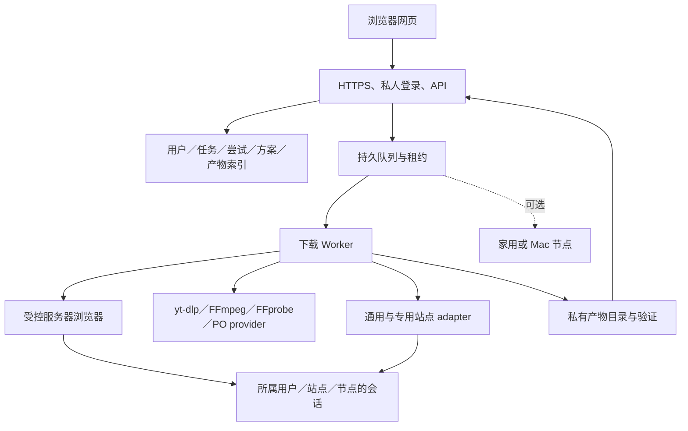

# V-Download 网页版实施计划

日期：2026-10-16（America/Los_Angeles）。状态：**计划已整理，产品实现尚未开始**。本文是网页版的执行入口；可行性、样本结果和外部资料见 [托管与认证研究](../research/web-hosting-auth-2026-10-16.md)，已有桌面交付见 [DESKTOP_STATUS](../DESKTOP_STATUS.md)。

## 1. 要交付的结果

你在电脑或手机打开私人网站，粘贴／拖入链接，选择下载方案、质量或合集条目，查看后台进度，完成后把文件保存到当前设备。下载执行在独立 Worker 上，关闭网页或个人 Mac 不终止已提交任务。

目标范围为 **Mac 版现有的全部下载能力类别**：通用 yt-dlp 站点、YouTube、B站、抖音／TikTok、小红书、X、Instagram、MP4／HLS／DASH、图集／文案／文字笔记、主页／合集、资源候选发现、下载方案、后处理和原任务恢复。对应清单以研究报告矩阵为准；安装引擎的 1,752 个注册 extractor 名称用于能力变化对照，不是网站数量或逐站成功承诺。

网页首先不依赖用户本机 Chrome。公开内容默认匿名；需要访客状态时在执行节点建立访客会话；确实需要账号权限时，由用户在服务器浏览器的原站页面登录。会话是否可用，以目标资源的访问结果为准。

“所有类别保留”不表示每个链接在任何网络都成功。目标云环境无法执行的类别必须保留原因和节点回退；不能把不支持的类别从清单静默删除，也不能把等待登录、部分输出或只有元数据当作完成。

## 2. 范围与默认决定

| 项目 | 默认决定 | 原因／影响 |
| --- | --- | --- |
| 用户范围 | 私人、自用、需登录的网站 | 先满足当前需求；公开注册、计费、多租户运营不在首版范围 |
| 独立执行 | 长期运行的 Linux Worker；提供容器部署方式 | 个人 Mac 可以退出；VM／容器服务具体厂商未选择 |
| 部署位置 | 接口允许云服务器或家用 Linux 设备 | 不假设已经有 NAS；先用实际候选环境验证网络可用性，再定部署位置 |
| 前端 | 从现有 React／TypeScript 组件和 shared 模型复用可移植部分 | 不把 Electron preload／IPC 注入网页，也不重写一份下载业务规则 |
| 后端 | Node／TypeScript；独立服务入口与明确 host adapters | 项目已有 Linux 桌面构建，但尚不是独立服务器 |
| 任务持久化 | 首版单机 SQLite + 有期限的领取／执行租约 | 避免过早引入 Redis／多服务；必须验证崩溃与重领 |
| 文件存储 | 单机私有磁盘，artifact ID 访问 | 后续可替换对象存储；不让网页提交任意服务器路径 |
| 浏览器 | 单独受控的 Chromium 执行节点，按用户／站点隔离 | 按需启动；登录与捕获会话留在实际执行节点 |
| Cookie 默认 | 显式 anonymous，禁止回退读取共享／个人 Chrome profile | 空配置不能隐式获取别人的登录状态 |
| 账号登录 | 服务器浏览器中的用户操作优先 | 不要求整份 Chrome Cookie 上传；扫码仅在站点实际提供时使用 |
| 文件交付 | 先完成下载／处理／校验，再提供可续传文件 | 任务和网页请求生命周期分开；不让前端缓存整段大文件 Blob |
| 扩展／Mac 节点 | 兼容现有本地协议；后期可选增强 | 普通网页使用不强制装扩展；不将本地 capability 开放给任意网站 |
| 应用发布 | 本计划不同时发布新 DMG 或改现有自动更新渠道 | 当前桌面能力继续可用，服务器独立交付／回滚 |

以下仍是部署前待落实的信息：实际执行机器与架构、域名／访问范围、磁盘配额和保留期、需要连接的真实站点账号、可用于验证的授权资源。这些不妨碍先做核心与受控端到端实现；没有对应条件时，真实部署／账号验收保持未验证。

## 3. 用户主流程

### 3.1 拖入链接到文件交付

1. 用户登录私人网站，粘贴或拖入一个／多个 URL；手机提供明确的粘贴与输入入口，不依赖拖放。
2. 服务端记录原输入，解析短链／页面，返回资源类别、候选、可用格式或合集分页事实。
3. 用户选择单条、图集、文字笔记或部分合集条目；选择已保存方案或本次覆盖项。
4. 服务端根据同一 selection 边界生成冻结请求。精确格式关联当前资源／解析条件；无法满足时明确报错，不悄悄选其他质量。
5. 创建持久化任务并返回 ID。解析、下载、合并／转码和校验展示各自状态；关闭页面后可重新进入任务。
6. 完成后展示实际产物及其类型、大小、媒体事实、保留期；用户下载单文件或图集／合集归档。
7. 输出落在服务器的受控目录；浏览器保存到当前设备的位置由浏览器决定。不能把“保存到服务器”与“已经保存到手机／电脑”混为一个成功状态。

### 3.2 需要会话或用户操作

1. 按失败事实区分 guest bootstrap、账号／权限、网页执行／播放触发、未知 403、过期源和网络错误。
2. 只缺访客 Cookie 时，节点自行建立访客会话，不要求用户账号。
3. 需要账号时打开属于该用户与站点的服务器浏览器。用户在原站页面登录、完成站点要求的交互。
4. 验证目标资源，记录时间、验证范围、可用质量与失败原因。“有 Cookie”只代表有存储状态。
5. 浏览器、解析器与下载器尽量留在同节点／出口；如授权请求必须在浏览器上下文执行，由对应 adapter 承担，不能假定 Cookie 导出即可跨请求栈使用。
6. 原任务进入新的执行尝试，保留任务 ID、方案和输出目标。会话过期后等待操作，不无限重试过期 URL。
7. 若仍受设备／网络条件限制，说明事实并提供可用节点选择。切节点不能被描述为字节级继续下载。

### 3.3 找到媒体但普通解析失败

1. 从现有任务详情进入“打开页面寻找资源”，打开绑定该任务的服务器浏览器。
2. 用户加载页面、登录／播放；后台发现候选，沿用已有候选详情、完整来源、评分和按需识别模型。
3. 展示 master／variant／音轨等已知关系，区分独立候选和未知关系，不因观察次数增加而抬高评分。
4. 用户明确选择一个候选继续原任务。捕获 session 绑定 owner、task revision、browser／worker 和有效期。
5. 普通策略任务保持原方案；旧 URL 的 exact format ID 不能套到新 URL。需要重选时先明确呈现差异，不静默降级；首版可以保留现有明确拒绝跨 URL exact 替换的行为。

## 4. 架构与责任边界

首版可以部署在同一台机器，但网站凭据、浏览器状态、任务执行和文件访问必须有不同的权限边界。不要把 Chromium 放进持有网站所有管理密钥／所有用户文件的无限权限进程。

| 拥有者 | 唯一负责的事实 | 应复用的现有模块／边界 |
| --- | --- | --- |
| shared 下载意图 | selection、plan revision、合集原位置、可复用方案与 exact 的区别 | `packages/shared/src/download-selection.ts`、`src/main/downloadRequestSnapshot.ts` |
| 请求策略 | 明确请求 > 方案 > 默认值；冻结输出意图 | `src/main/downloadPlans.ts`；移除对全局桌面设置的隐式依赖 |
| Resolver | 原输入到视频／图集／文本／合集；部分事实与失败原因 | `videoInfoResolver.ts`、`remoteResolveTask.ts`、专用站点 adapter |
| 会话服务 | 站点会话来源、owner、节点、版本、验证与撤销 | `nativeAuthModel.ts` 的可移植语义；Electron／safeStorage 留在 desktop adapter |
| Worker 调度 | 领取任务、租约、并发预算、取消、attempt 所有权 | 现有队列／managed process 能力；将 BrowserWindow 事件输出与 settings／DB 宿主拆开 |
| 浏览器捕获 | 页面、frame、候选、临时签名、来源上下文、捕获 session | `mediaInspection*`、`mediaCapture.ts`、shared media source context |
| 输出服务 | 暂存、合并／转换、验证、最终文件与清理 | `selectedOutput.ts`、FFprobe、现有输出所有权 |
| 网站网关 | 私人身份、任务／文件授权、API 版本、网站会话 | 可复用 `RemoteJobBackend` 的边界；不公开桌面长期 bearer |

不引入一个包揽所有行为的“Runtime”万能接口。按已有实际耦合拆分 Storage、Settings、Events、Process、Browser／Auth 等最小依赖，调用者消费拥有者已经解析的事实。

## 5. 数据模型与状态

以下字段为设计草案，不是已发布合同；实施时通过命名 TypeScript 合同、运行时校验和兼容性测试固定。

| 实体 | 必需表达的信息 | 约束 |
| --- | --- | --- |
| User／principal | 私人站点身份与可访问节点 | 首版即使只有一个用户，任务／会话／产物也有明确归属 |
| Worker | ID、平台／架构、引擎身份、能力、健康时间、出口标识 | “支持某 adapter”和“刚验证某资源成功”分别记录 |
| AuthContext | owner、site、mode、revision、worker／profile、验证范围、撤销／失效 | Cookie／存储内容不进入普通 Job JSON；默认 anonymous |
| Resolution | 原输入、实际页面、资源类型、候选／格式、上下文、认证／引擎版本 | 短期 CDN URL 有生命周期；来源上下文不授予账号权限 |
| Plan | 现有 selection + revision + 输出意图 | Mac `outputDir` 不能直接作为服务端路径；导入时映射或要求选择新目标 |
| Job／task | owner、冻结请求、destinationId、状态、子条目与原位置 | 幂等键只在所属用户／访问范围和意图内生效；不跨账号共享私密结果 |
| Attempt | task、序号、worker、auth revision、阶段、错误、暂存归属、租约 | 重试／换源／换节点建立新尝试；保留前次事实 |
| Artifact | owner、task、类型、名称、大小、摘要、媒体事实、状态、保留期 | 只有已验证的最终产物可标完成；部分产物单独表示 |
| CaptureSession | owner、task revision、browser／worker、有效期、确认／消费状态 | 一次性使用；过期、替代、取消和迟到请求不能改错任务 |

任务阶段沿用现有意义：排队、解析、下载、后处理／验证、完成、失败、暂停／中断／取消。等待登录／捕获／用户确认采用明确的等待事实与恢复动作；如果新增枚举，必须版本协商或对旧客户端映射。

错误至少携带阶段、原 HTTP 状态、站点原因、可否重试、建议动作。`AUTH_REQUIRED` 不足以表达账号与访客的区别，新增 reason／recoveryAction；未知 403 保留 ACCESS_DENIED。不能用错误文案包含 “cookies” 就认定需要账号。

租约到期后应先确认旧 attempt 已停止／失去写入资格，再重领。数据库 fencing revision 和独立 attempt staging 防止旧进程迟到覆盖结果。恢复查询只处理本服务拥有的 interrupted／待恢复任务，不全量重试历史失败。

## 6. API、设置与兼容性

### 6.1 保留的合同

- 现有桌面 `:18766` v1 API／MCP 继续接受原有 URL／include_note 合同，保持默认画质与既有拒绝未知字段的行为。
- 现有扩展 `:18765` 的 Origin + capability、方案查询、下载和捕获继续兼容；不加通配 CORS，不把网页认证当成本地扩展凭据。
- 现有 selection／plan version 1 与数据库老记录可读；新增事实对老记录使用未知，不伪造历史认证／引擎信息。
- 不更改 `/Applications/V-Download.app` 的用户数据根目录，也不让服务器直接打开正在使用的桌面 SQLite 文件。

### 6.2 新网站合同

建议在网站网关独立定义 `/api/v1`，与桌面 `/v1` 分开；路径名称在实施时确定。操作必须涵盖：

| 操作 | 输入／输出要求 | 验证 |
| --- | --- | --- |
| 解析页面 | 原 URL、所属执行节点／授权引用 → 类型、格式／候选、部分事实、解析版本 | 不返回会话凭据；无权引用其他用户 auth context |
| 分页／选集 | 资源／游标、原条目位置、hasMore／受限事实 | 不将受限分页当作完整；超过预算明确报错 |
| 读取／保存方案 | 现有 selection、revision、服务端目标映射 | 过期 revision、未知字段、跨资源 exact 有明确结果 |
| 创建任务 | 解析引用或原 URL、selection／plan、条目选择、destination、幂等键 | 同一策略入口；重发不重复创建，意图不同不误去重 |
| 查询任务／事件 | 阶段、进度、attempt、恢复动作、产物摘要 | 重新打开页面可重建状态；游标或快照处理事件间隙 |
| 取消／重试 | task revision、动作与请求身份 | 幂等、处理并发；不能复活已取消旧 attempt |
| 连接／撤销站点 | owner 范围内创建浏览器会话／认证引用 | 站点权限、session 有效期；不接受浏览器任意执行管理命令 |
| 捕获／续接 | task、browser session、candidate、显式确认 | 保持原方案／目标；迟到、跨页面／节点、重复提交被拒绝或幂等 |
| 文件／归档下载 | artifact ID 与授权 | 真实 Range 206／416、过期、撤销与文件版本一致 |

浏览器使用同源 HTTPS API。内部 Worker 凭据只在服务端使用；任何 Cookie／Authorization 都通过所属 auth context 由 adapter 按域／路径选择，不能由网页任意转发到任意地址。

### 6.3 数据与配置迁移

服务器使用独立数据根目录、schema 版本、配置版本、稳定存储卷；启动时验证权限和存储可用性。迁移可重复执行，有备份与失败回滚，升级前完成恢复演练。

桌面方案的可移植部分是 selection、命名模板与笔记策略；输出根目录和站点认证留在 host。导入显示差异并生成服务器 destination 映射，不能复制 Mac 路径或 Keychain 加密密文。旧桌面消费者维持其原表示，由边界 adapter 转换，不在多个消费者里各自猜测。

## 7. 站点与引擎工作包

| 工作包 | 实施要点 | 完成条件 |
| --- | --- | --- |
| 通用引擎 | 目标 Linux 架构的 yt-dlp／FFmpeg／FFprobe；版本、摘要、来源记录；有界 stdout／stderr | 受控 MP4／HLS／DASH 完整输出与取消／失败验证；登记提取器变化 |
| YouTube | JS runtime／EJS、对应平台 PO provider、健康检查、会话与视频绑定 | 公网完整视频＋音频／选定质量成功；字幕按当前承诺验证；元数据成功不计完成 |
| B站 | 显式匿名与账号模式、分 P／合集、按实际返回展示质量 | 匿名／授权质量对照；选集位置、实际输出与字幕条件可复查 |
| 抖音 | 短链、专用解析、会话 HTTP／浏览器 transport、图集、主页分页与回退 | 视频、图集、主页部分选择完整输出；受限／空列表区分；不依赖个人 Chrome |
| 小红书 | 原始分享参数、专用 video／gallery／text 解析、会话域规则 | 视频、图集、文本各有完整产物；不把 no formats 自动判账号缺失 |
| TikTok／X／Instagram | 通用提取器＋站点授权／浏览器回退；补完整站点账号入口 | 每站至少公开完整任务；需要账号的能力有授权验证或明确未验证 |
| 媒体捕获 | 服务端浏览器发现＋已有候选／识别模型 | 独立候选可见、评分稳定、完整 Referer／来源、清单关系与原任务续接 |
| 可选外部批量 | 独立声明工具／配置／依赖与输出归属；管理员配置 | 不开放任意脚本／路径；start／status／cancel 与产物映射有证据；不是内建主页功能替代 |
| 后处理／交付 | 沿用 MP3、转换、已有内嵌字幕／章节保留、命名与输出检查 | 媒体事实满足冻结意图；部分／失败不标完成；外置字幕新策略不自动扩进范围 |

代理／外部下载器属于节点管理员能力。对支持范围、运行依赖、网络出口和取消行为逐项声明，不让网页用户上传任意命令／脚本。原站 DRM 返回明确限制；标准 HLS 分片加密与 DRM 不能仅凭文件后缀混为一谈。

## 8. 服务边界、容量与生命周期

### 8.1 出口限制必须在真实请求处生效

URL 校验覆盖初始输入、重定向、DNS 变化和 IPv4／IPv6；HLS 子清单／分片／密钥、DASH 子资源、yt-dlp／FFmpeg／浏览器请求同样受限。禁止访问宿主回环、服务私网、链路本地和云 metadata。只做初始 URL 正则不算完成。

实现时选择实际可约束全部执行器的网络隔离／出口代理方案，并验证无法绕行；浏览器运行环境不得访问网站管理密钥或其他任务目录。若未来支持家庭内网源，另设节点私有能力与授权，不能放开公网下载器边界。

### 8.2 凭据、任务与文件

- 站点状态按 owner／site／node 保存、加密并限制文件权限；临时 Cookie 只在必要阶段创建，完成／取消后清理，清理失败保留可追踪归属。
- 会话验证只证明某资源／时刻可用；注销、账号切换和 auth revision 变化使旧捕获引用失效。
- Job／task／artifact ID 不是授权凭据；列表、事件、取消、捕获、文件和归档每条路径检查归属。
- 短期下载链接有范围和有效期；原始 URL／必要来源值保留，普通日志和导出不包含可重放凭据。
- HTML／Markdown 笔记作为下载附件或安全预览；不在网站同源直接执行任意页面内容。

### 8.3 预算与回收

配置并展示：下载并发、分片并发、浏览器会话数、转码并发、合集上限、单任务时间／重试、磁盘总量、产物保留期。私人首版先保守限制；用测量调整，不以“下载器支持线程”决定默认值。

磁盘预算包含分轨输入、临时合并、转码结果与最终文件；无足够空间时在明确阶段拒绝／等待。产物回收只删除归属可证明且不再被任务／文件读取引用的内容。取消覆盖进程家族、浏览器租约与网络请求；服务重启不依靠 PID 数字判断旧资源归属。

## 9. 里程碑与依赖

所有项目初始为待实施；研究报告中的实测不是以下里程碑已完成的证据。工作量为熟悉项目工程师的粗估有效工作日，站点环境可能改变结果。

| 里程碑 | 任务与主要改动 | 依赖 | 交付／退出条件 | 粗估 |
| --- | --- | --- | --- | --- |
| M0：环境可行性 | 固定候选 Linux 节点、架构／出口／引擎；验证最难站点与完整媒体；定义首版站点验收样本 | 有可用候选节点；真实账号验证需相应账号与授权样本 | 每类能力有结果、原因、限制；确认云浏览器／专用链路是否成立，必要时选择家用执行节点；不在未知条件下承诺等价 | 3–5 日 |
| M1：独立核心与基础网页 | 拆解 settings／DB／events／process host 耦合；持久任务／租约；解析、方案、合集、队列和 artifact API；基础网页 | M0 的可行节点；安全执行边界设计 | Mac 退出后任务运行；网页重开可恢复；单条／合集使用同一下载意图；受控输出通过 | 8–12 日 |
| M2：会话与完整能力 | 访客／账号状态、服务器浏览器、专用中文 adapter、捕获／原任务续接、其余站点与可选工具边界 | M1；浏览器／native 请求出口受控 | 第 7 节各工作包有对应完整任务证据；过期会话／候选与精确格式限制处理正确 | 8–15 日 |
| M3：部署与交付验收 | HTTPS／私人认证、文件 Range／TTL、容量／故障、浏览器与引擎出口负例、备份／回滚、移动端体验 | M1、M2；部署参数确定 | 全 E2E 清单结果可复查；无未解决的越权／数据破坏／假完成问题；真实服务可恢复 | 4–8 日 |
| M4：可选多节点增强 | 显式配对家用／Mac Worker、能力协商、同节点会话、受控产物传输 | 若 M0 证明必须回退，可提前其中必要部分 | 选节点、离线、撤销、换源／换节点差异明确；不要求所有网页用户装扩展 | 依实际边界另估，不混入 M0–M3 基本估计 |

M0–M3 合计约 23–40 工作日，仅是规划量级。M1 的公开内容可用版本可以做阶段演示，不能提前标成“全部 Mac 能力上线”。如果云节点无法满足复杂站点而 M4 回退成为必要条件，应重估并明确更新发布范围。

## 10. 每阶段的验证方法

每个用例记录：输入 URL／来源、账号模式（不记凭据值）、worker／浏览器／引擎版本及摘要、选择与方案 revision、输出要求、逐阶段结果、错误／限制、实际产物和测试时间。

受控样本用自有媒体、独立配置／目录和本地服务；公网样本固定 URL 但允许内容失效时明确替换并保留原因；账号样本仅由有权限的用户连接。云 IP、真实登录、平台验证或性能未测就保持未验证，不用 mock 或元数据替代。

### 10.1 核心与来源

| ID | 场景 | 验收 |
| --- | --- | --- |
| E01 | 干净 Worker，无浏览器资料 | 匿名公开视频完整下载；不会读取宿主个人 profile |
| E02 | 服务器设置访客 Cookie | 不登录账号即可完成；与裸 URL 负例形成对照 |
| E03 | 同一源的原始 query、完整 Referer、iframe document | 磁盘／任务保留原值；严格服务端校验后文件成功 |
| E04 | HLS／DASH 分轨／子清单 | 选择关系正确、必要 headers 作用于正确资源，最终音视频完整 |
| E05 | 多个独立候选与重复观察 | 独立候选不丢；刷新不加分；已知／未知关系有区别 |
| E06 | 过期签名／替代候选 | 不反复重试失效源；原任务确认新来源后继续，原请求与新源分别保存 |

### 10.2 意图、内容与输出

| ID | 场景 | 验收 |
| --- | --- | --- |
| E07 | 单条／合集／扩展／网页共用方案 | 同一 selection 策略、原条目索引、revision 与冻结快照；中途改默认值不改变旧任务 |
| E08 | 360p、编码／容器、精确格式 | ffprobe 满足选择；格式不存在返回明确原因，不静默升档／换源 |
| E09 | MP3 与 H.264 转换 | 状态／标签与实际媒体一致；MP3 无视频流；转换保留约定内容 |
| E10 | 已有内嵌字幕／章节 | 选定支持格式的字幕／章节不丢；明确区分外置字幕未纳入的情况 |
| E11 | 抖音视频／图集／主页分页 | 全部所选产物、顺序、文案与受限分页事实可复查 |
| E12 | 小红书 video／gallery／text | 三种输出正确；includeNote 与图集／纯文字条件一致 |
| E13 | YouTube、B站、TikTok、X、Instagram | 每站公开完整任务；必要账号条件分别记录，解析成功不计下载成功 |
| E14 | 通用 extractor 与可选外部工具 | 对比引擎能力清单；抽样回归；外部工具有执行依赖、取消与输出归属证据 |

### 10.3 会话与恢复

| ID | 场景 | 验收 |
| --- | --- | --- |
| E15 | 用户在服务器浏览器登录 | 不需要个人 Chrome Cookie；目标资源验证成功后继续 |
| E16 | Cookie 存在但会话无效／无内容权限 | 状态不虚报已登录可用；给正确的重新连接／权限原因 |
| E17 | 未知 403、明确 401、访客 Cookie、网页 challenge | 不混为同一种登录提示；保留阶段、原状态和恢复动作 |
| E18 | 会话到期／注销／切换账号 | 旧 revision／捕获失效；重新连接不改 task ID、方案或目标 |
| E19 | 回原任务、取消捕获、迟到提交 | owner／page／task revision／TTL 校验；取消和重发不会修改其他任务 |
| E20 | 跨 URL exact／跨 worker | 明确重选或拒绝；新 attempt 独立暂存，不复用不兼容 format ID／分片 |
| E21 | 原节点与云节点／UA／出口变化 | 相同输入／会话条件做对照；失败原因未知仍保留未知，不保证 Cookie 可迁移 |

### 10.4 生命周期、交付与服务边界

| ID | 场景 | 验收 |
| --- | --- | --- |
| E22 | 关闭网页／Mac 退出／Worker 重启 | 独立任务继续或安全恢复；租约与旧执行器不双写 |
| E23 | 暂停、取消、超时、历史失败任务 | 明确重下／续传能力；无孤儿进程；历史失败不误重试 |
| E24 | 磁盘满、权限失败、合并／转换失败 | 没有假完成；只清理当前 attempt；可保留可用输入与失败原因 |
| E25 | 文件／ZIP、Range、过期／撤销 | 206／416／Content-Length 正确；稳定 artifact 版本；未授权下载失败 |
| E26 | 手机／桌面：输入、方案、状态与文件保存 | 触屏和键盘均可完成；长列表／长标题可操作；服务端与客户端保存状态清楚 |
| E27 | 任意 URL 与所有执行器出口 | 重定向、嵌套流、DNS／IPv6、浏览器和 native 引擎均不能访问禁用地址；有真实连接证据 |
| E28 | 不同任务／用户／会话／节点 | 查询、事件、取消、去重、捕获、文件、归档与删除都不越权；负例在真实生产边界验证 |
| E29 | 升级、备份与回滚 | 数据卷／配置／任务可恢复；旧桌面／扩展 API 回归通过 |
| E30 | 成本与性能 | 代表任务至少重复 3 次；区分冷／热解析、传输、后处理、总耗时；记录 CPU／进程家族峰值内存／磁盘峰值／流量，注明未测部分 |

## 11. 完成定义与发布顺序

实现每个工作包后先跑对应源测试／生产边界集成，再跑相应真实端到端；只有 UI 或 mock 通过不算执行链路验证。现有桌面 `npm run typecheck`、`npm run build`、`npm test` 继续通过；新增 server／web 检查命令在实施时进入仓库正式脚本。

发布前必须具备：

- 从私人网站输入到完整文件的证据，且个人 Mac 关闭后独立运行。
- 第 7 节每类功能的支持／受限／未验证记录；关键类别未验证时不宣称全量等价。
- 当前支持的精确选择、方案、合集、已有字幕／章节和原任务恢复无已知回归。
- 未解决的越权、凭据泄漏、任意内网访问、错删数据、双写或假完成问题为零。
- 安装配置、升级／备份／回滚、磁盘清理、会话撤销和故障排查文档可用。
- 自审记录包含根因／结构修复／验证／未验证范围；运行证据能识别实际版本与节点。

上线按“本地受控完整链路 → 候选 Linux 节点 → 私人 HTTPS 试用 → 全类别验收”推进。扩大为公共服务、新账号体系、计费或新站点能力，需要单独计划；当前桌面剩余建议已经归档，不自动重新成为本项目待办。

## 12. 待实施清单

- [ ] M0 环境、全部能力类别样本与最难链路验证。
- [ ] 固定首版部署节点、域名／访问范围、资源和保留期配置。
- [ ] M1 host 边界、独立 Worker、持久任务／产物、新网站 API 与基础网页。
- [ ] M2 访客／账号会话、服务器浏览器、专用内容和原任务捕获恢复。
- [ ] M3 入口／出口隔离、文件交付、故障／移动端／升级回滚验收。
- [ ] 按 M0 结果决定是否需要 M4 的必要回退部分。
- [ ] E01–E30 逐项标记通过／受限／未验证，附对应证据与实际版本。
- [ ] 完成自审、部署说明与私人使用交付；再评估是否扩大用户范围。
