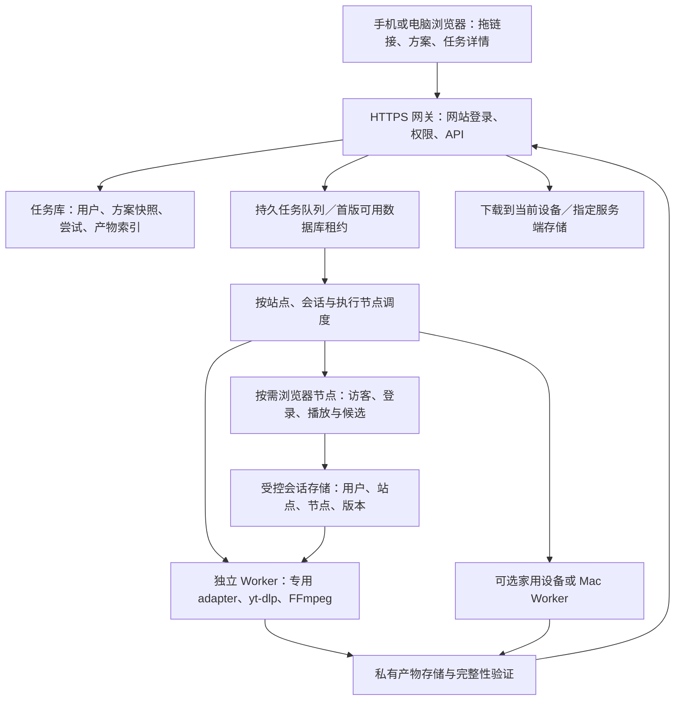

# V-Download 网页托管与无本机 Chrome 登录态研究

研究日期：2026-10-16（America/Los_Angeles）。目标是覆盖**现有 Mac 版的全部能力类别**，包括中文站点专用解析、图集／笔记、合集、资源捕获和下载方案。本轮交付研究与验证证据；没有部署网站或修改产品实现。

结论标记：**[实测]** 本轮直接观察；**[静态]** 当前源码事实；**[上游]** 官方文档或项目源码；**[判断]** 基于证据的设计建议；**[未验证]** 尚缺对应运行证据。源码中的支持入口不等于该站点所有链接当前都能成功。

## 1. 结论与建议

**可以做成网站，也可以不依赖用户本机 Chrome 的登录态。** 推荐采用“私人网站 + 独立下载 Worker + 按需打开的服务器浏览器”。公开内容先匿名处理，确实需要账号权限时，由用户在服务器的独立浏览器里登录相应站点。手机／其他电脑可以操作同一个网站，任务在 Worker 上运行，完成后下载到当前设备。[判断]

但“完全没有本机 Chrome 登录态”和“任何地方都不登录账号”是两个条件。前者可以成为产品设计目标；后者无法保证访问私密、会员、关注关系或其他账号限定内容。即使内容公开，也可能需要访客 Cookie、网页执行环境、PO token、同一网络出口或有效的临时签名。[上游＋实测，见第 3、7 节]

对当前项目最合适的路线：

1. **保留现有解析和下载语义，抽出可独立运行的 Worker。** 精确选择、方案快照、图集、笔记、合集、取消、失败恢复与产物审计继续共用，避免网页重新实现一套行为。
2. **默认匿名；访客会话与账号会话分开。** 不把“需要 Cookie”自动翻译成“请登录账号”。公开任务也不默认使用已登录账号。
3. **服务器浏览器是按需的能力。** 用于用户登录、播放触发、资源候选捕获；不能承诺它能通过每个站点的浏览器／网络检查。
4. **保留可选的家用设备／Mac Worker。** 某些任务若依赖原网络或设备环境，可继续在那个节点执行，再交付文件；单纯把本机 Cookie 上传到云端不保证解决问题。它是回退选择，不是要求每位网页用户安装扩展。
5. **按私人自用服务起步。** 先满足你自己的全部 Mac 能力类别，再决定是否做面向陌生用户的公共服务。两者在隔离、配额和账号管理上的工作量不同。

如果要求“个人 Mac 关闭后也能下载”，独立云服务器或家里常开的 NAS／小主机必须承担下载；仅给现有 Mac API 加网页界面，仍然要求 Mac 和 App 在线。[静态＋判断]

## 2. 研究基线与证据范围

| 项目 | 本轮基线 | 解释 |
| --- | --- | --- |
| 源码 | HEAD `a3d0bfbb444045e034b0fdfc611e4f2a9888c464` + 2026-10-16 工作区已有改动 | 前几轮功能尚包含在未提交工作区，不能只用 HEAD 表示当前实现；26 个相关文件记录 SHA-256 |
| 安装程序 | `/Applications/V-Download.app`，1.1.7 / build 1.1.10，arm64 | 读取安装元数据；本轮实际执行的是其中的引擎，不是完整安装版 UI |
| app.asar | `406d482231e4911c9c8704ad2a60124357970b5352a1f79ff3317ee3bb45309c` | 用于识别安装基线，不单凭此声称工作区与二进制完全一致 |
| yt-dlp | 安装引擎 `2026.07.04` | SHA-256 `ff7d4fc44b8fbf42da021c1bca950da0326cdb0cdb84992fdc7fb7ec215df435`；本轮没有更新 |
| 注册提取器 | 安装引擎列出 1,752 个 extractor 名称，禁用外部插件目录 | 名称包含不同页面／合集入口，不是 1,752 个网站或成功承诺；另有 V 的专用 adapter |
| 执行环境 | macOS 27.0.1、arm64、本机网络 | 不是 Linux／云服务器／其他地区 IP；系统网络出口未做归属推定 |
| 上游源码 | 查询时 yt-dlp HEAD `897341241f2bfb2439fe0367f4c7c9ccd29a3828`，提交时间 2026-10-10 | 上游当前能力与安装引擎版本不同，不能混为同一个运行基线 |
| 验证规模 | 10 个本地受控场景、9 个公网元数据样本、1 个公网完整 MP4 下载 | 每个场景一次，无统计成功率、无云端稳定性或性能承诺 |

可复核证据：[安装身份](assets/web-hosting-auth-2026-10-16/installation.json)、[源码身份](assets/web-hosting-auth-2026-10-16/source-index.json)、[主实验结果](assets/web-hosting-auth-2026-10-16/results.json)、[补充结果](assets/web-hosting-auth-2026-10-16/results-extra.json)。既有 Mac 功能状态以 [最近功能汇总](../archive/2026-10-desktop/next-priorities-2026-10-16.md) 和相关验收报告为背景；旧 Downie 报告的原始问题不能直接当作当前缺陷。

## 3. 没有 Chrome 登录态，具体缺少的是什么

| 条件 | 能否不使用本机 Chrome | 替代方式 | 不能据此保证的事情 |
| --- | --- | --- | --- |
| 公开直链、允许匿名的页面 | 可以 | Worker 直接访问站点 | 网站有解析入口不代表 CDN 下载一定成功 |
| 需要访客 Cookie | 可以 | Worker 自己访问页面获得匿名 Cookie；必要时启动独立浏览器 | 有 Cookie 不代表有账号，也不代表能看会员内容 |
| 需要 JS 执行／播放触发 | 可以尝试 | 服务器 Chromium 加载页面，用户触发播放后捕获请求 | 浏览器自动化可能被站点拒绝，不能保证全站可用 |
| 需要真实账号权限 | 可以不用本机 Chrome，但仍需账号会话 | 在服务器浏览器登录，或显式导入该站点的授权会话 | 登录普通账号不会增加会员／私密内容权限 |
| 校验 IP／设备／浏览器环境 | 不一定能纯云等价 | 浏览器和下载器留在同一节点／出口；必要时在原节点执行 | Cookie + UA 不是对真实设备或网络环境的完整复制 |
| 原站使用 DRM | 普通下载流程不能据此恢复可播放文件 | 返回明确的受保护状态 | 看到 m3u8／mpd 或有账号，不代表能够导出普通媒体文件 |

三个登录需要分开：**登录 V-Download 网站**，用于管理自己的任务；**登录目标站点**，用于取得其内容权限；**登录 Chrome／浏览器同步账号**，不等于前两个。网页能登录我们自己的账号，并不会自动获得用户在 YouTube、B站等站点的 Cookie。[判断]

普通网页无法调用 Chrome 扩展的 `cookies`、`webRequest` 权限接口，也无法靠 CORS 设置读取用户其他网站的登录信息。[Chrome cookies API](https://developer.chrome.com/docs/extensions/reference/api/cookies)、[Chrome webRequest API](https://developer.chrome.com/docs/extensions/reference/api/webRequest)、[MDN 同源策略](https://developer.mozilla.org/en-US/docs/Web/Security/Defenses/Same-origin_policy)

因此拖入一个链接，本质上只提供了输入 URL；它不自动附带原页面全部请求、Referer、登录状态和设备环境。部分公开直链可由浏览器直接下载；支持通用页面解析、分轨合并、HLS／DASH 和认证内容，仍需要后端执行能力。CORS 是网页读响应的约束，不是服务器下载器访问公开 URL 的禁令。[判断；[MDN CORS](https://developer.mozilla.org/en-US/docs/Web/HTTP/Guides/CORS)]

## 4. Mac 全部能力类别的迁移矩阵

下表的“可迁移”描述架构路径；公网样本结果仅代表本轮所测 URL。不能把一个样本扩展成所有同站内容，也没有遍历 yt-dlp 的所有站点。

为对应“Mac 上全部支持”的范围，本轮还保存了安装引擎完整的 [注册提取器清单](assets/web-hosting-auth-2026-10-16/engine-extractors.txt) 与 [身份／数量](assets/web-hosting-auth-2026-10-16/engine-extractors.json)。独立 Worker 应继承这类通用提取能力，并保留下面列出的专用链路；清单用于追踪迁移前后能力变化，不能当作逐站验收结果。

| 现有能力 | 当前 Mac 实现 | 不读取本机 Chrome 时的路径 | 网页版必须保留的内容 | 本轮覆盖／缺口 |
| --- | --- | --- | --- | --- |
| YouTube 单视频、音频、合集 | yt-dlp + JS runtime + PO provider；可选 Cookie | 公开内容匿名优先；需要账号权限时使用服务器会话；部署同平台 provider | 精确格式、音视频组合、字幕／章节处理、合集选择 | 匿名元数据成功；没有做公网完整视频、账号和云端验证 |
| B站单视频、分 P／合集 | yt-dlp；无显式 Cookie 时可能读取所选浏览器 | 显式匿名模式；需权限的清晰度／字幕再选择服务器账号 | 不把匿名可见格式当成全质量全集；保留选集位置与组合策略 | 一个旧 MP4 样本解析为 360p；不是 B站匿名画质上限测试 |
| 抖音视频、短链 | 专用 adapter + yt-dlp + 网页／浏览器／扩展回退 | 服务器访客上下文先尝试，必要时用户登录或切执行节点 | 短链原值、页面上下文、CDN 回退、有效会话和出口 | 裸 yt-dlp 报 fresh cookies；专用链路云端未验证 |
| 抖音图集／文案 | 专用数据结构、图片与笔记输出 | 移植专用 adapter，Cookie／浏览器能力由 host 提供 | 图片集合、顺序、文案 opt-in、失败／部分成功 | 代码确认；本轮未做真实图集验证 |
| 抖音主页／批量 | 签名 API、页面解析、浏览器恢复、选择器 | 独立站点 adapter + 浏览器节点 + 分页任务 | hasMore／受限分页事实、原顺序、去重、逐项错误 | 裸 yt-dlp 包装不能替代；Linux 未验证 |
| 可选抖音外部批量工具 | 配置 `run.py`／`config.yml` 后，由 Python 子进程运行 `douyin-downloader` | 服务器单独配置该工具、依赖与所属会话；保留可取消作业 | 这是可选外部工具契约，不等于内建主页选择链路；不接受网页上传任意可执行脚本路径 | 仅确认调用入口，没有确认本机配置或服务器可运行性 |
| 小红书视频 | yt-dlp 与专用页面解析协作 | 保留完整分享／explore 参数；服务器访客／账号会话按需 | `xsec_token` 等来源参数不随意裁剪；无格式原因保留未知 | 一个无签名参数旧样本报 no formats，不能据此归因为未登录 |
| 小红书图集／文字笔记 | 专用 adapter 支持 gallery／text | 迁移现有解析和下载逻辑，补显式 auth context | 原图列表、文案、文本-only 状态、下载方案适用性 | 静态确认；本轮未测真实图文输出 |
| TikTok | 通用 yt-dlp 路径，原生登录入口 | 匿名／服务器浏览器会话；私密关系内容需有权限的账号 | 保留原站错误，不把响应异常等同账号缺失 | 一个公开测试 URL 报 unexpected response；原因未定 |
| X／Twitter | yt-dlp + Cookie／登录入口 | 公开资源尝试访客路径；受限内容再选择账号 | 多视频、原始 URL、下载产物对应关系 | 一个公开帖元数据成功；账号及内容下载未验证 |
| Instagram | 通用 yt-dlp；扩展 Cookie 同步域包含此站 | 公开 Reel 匿名尝试；需要时服务器站点会话 | 应补齐账号管理入口，当前原生站点枚举不含 Instagram | 一个官方账号 Reel 解析成功；不证明个人页／私密内容可访问 |
| 其他 yt-dlp 站点 | 通用提取器 | 同版本 Linux 引擎 + 所需插件／运行时 | 动态报告实际解析／认证／浏览器能力，不承诺网站总数 | 本轮没有穷举，不存在“全部站点都验证成功”的证据 |
| 直链 MP4 | 原始 URL + 上下文／headers + 下载与校验 | 后端直接下载，按资源来源使用正确 headers | 完整 Referer、原始 query、文件可播放性 | 本地与一个公网 MP4 完整下载通过 |
| HLS／DASH | 候选识别、按需解析、FFmpeg／yt-dlp | 后端解析并下载所有必要子资源 | master／variant／音轨／字幕关系，分片／密钥请求权限 | 公网各一个元数据解析通过；本轮未完整下载公网流 |
| 扩展发现的通用媒体 | Chrome 的请求观察 + 页面捕获 + 候选详情 | 服务器浏览器资源发现，或用户自选扩展／本地节点 | 独立候选不能被误隐藏；评分纯计算；原来源与识别事实 | 普通网站无法直接复用扩展权限；替代捕获链路尚未实现 |
| 失败后重新捕获 | task ID、冻结方案／目录、capture TTL、显式确认 | 云端任务绑定服务器浏览器会话，再提交候选 | 同一任务续接、失效防护、隔离临时输出；精确选择不能静默降级 | 现有桌面语义可借鉴；云端会话／重启恢复需新增 |
| 下载方案、MP3、已有内嵌字幕／章节、命名 | shared selection + frozen request + 输出校验 | 核心策略复用，存储位置由 Worker 映射 | 不回退成网页仅支持 URL + 默认画质；外置字幕仍是另一个范围 | 前轮已验收能力；不在本轮重复声称公网全站字幕可用 |
| 任务／历史／文件管理 | 本地数据库、设置、队列、持久化输出 | 服务端任务库与 artifact 存储 | 取消、重启、历史失败作用域、完整产物审计 | 需要用户归属、节点归属和保留期；服务端目录不等于客户端目录 |
| 代理、速度／分片策略、可选外部下载器 | settings 与引擎参数／进程管理 | 管理员配置节点网络／引擎能力，沿用任务调度策略 | 不把桌面路径和任意代理／命令选项直接开放给网页；网络隔离仍需对 native 引擎生效 | 静态入口确认，具体第三方组件与目标环境未验证 |

本地主要入口：[统一解析](../../src/main/videoInfoResolver.ts#L149)、[解析结果到任务](../../src/main/remoteResolveTask.ts#L72)、[抖音 adapter](../../src/main/douyin.ts#L4)、[主页列表](../../src/main/douyinProfile.ts#L122)、[小红书 adapter](../../src/main/xiaohongshu.ts#L300)、[同步域](../../packages/shared/src/cookie-sync-domains.ts#L5)、[原生登录站点](../../src/main/nativeAuthModel.ts#L1)。

可选外部工具边界见 [Douyin bulk launcher](../../src/main/douyinBulk.ts#L16) 与 [作业管理](../../src/main/douyinBulkJobs.ts#L35)。Mac 的 Dock、菜单／快捷键、Finder 等原生交互不要求在网页逐个复刻；其任务状态、文件交付与输入作用应有网页等价入口。这里的“全部”针对现有下载能力与支持链路，不承诺保留所有操作系统 UI 形式。

上游证据补充：YouTube 官方提取器文档区分需要账号的内容，并说明 yt-dlp 的 YouTube OAuth 登录当前不可用；因此不能用“登录我们的 Google 账号按钮”替代目标站点会话。[yt-dlp Extractors](https://github.com/yt-dlp/yt-dlp/wiki/Extractors)

B站提取器根据站点返回处理可用格式、登录与字幕；Douyin 提取器明确存在“fresh cookies，未必已登录”的错误；X 实现包含 guest token 路径；Instagram 实现包含匿名访问与登录／限流处理。它们支持上述分层判断，**不构成我们所选云 IP 的成功保证**。[B站源码](https://github.com/yt-dlp/yt-dlp/blob/897341241f2bfb2439fe0367f4c7c9ccd29a3828/yt_dlp/extractor/bilibili.py)、[Douyin／TikTok 源码](https://github.com/yt-dlp/yt-dlp/blob/897341241f2bfb2439fe0367f4c7c9ccd29a3828/yt_dlp/extractor/tiktok.py)、[X 源码](https://github.com/yt-dlp/yt-dlp/blob/897341241f2bfb2439fe0367f4c7c9ccd29a3828/yt_dlp/extractor/twitter.py)、[Instagram 源码](https://github.com/yt-dlp/yt-dlp/blob/897341241f2bfb2439fe0367f4c7c9ccd29a3828/yt_dlp/extractor/instagram.py)

## 5. 无本机登录态的几种方案

| 方案 | 用户体验 | 优点 | 主要缺口 | 建议 |
| --- | --- | --- | --- | --- |
| 纯匿名 HTTP／yt-dlp | 拖链接即可 | 最少交互、最少账号依赖 | JS／访客验证／账号内容可能失败 | 默认第一步 |
| 服务器匿名浏览器 | 必要时打开网页并播放 | 可自行建立访客会话与发现资源 | 无账号权限；云 IP 或浏览器可能被拒绝 | 第二步，按需启动 |
| 用户在服务器浏览器登录 | 网站中打开独立浏览器画面，在原站登录／扫码 | 不依赖个人 Chrome 的现成会话，可由同节点下载 | 登录可能被站点限制；有维护与凭据保管成本 | 账号内容首选候选，必须实测 |
| 导入单站 Cookie | 高级设置导入／更新 | 对只需 Cookie 的流程简单 | 不包含所有存储／设备状态；过期、IP 变化可失效 | 可选回退，不做默认 onboarding |
| 可选 Chrome 扩展 | 原网页一键送到网站 | 复用现有发现能力与页面上下文 | 手机／无扩展环境不可用；跨节点 URL 可能失效 | 保留增强路径 |
| 家用设备／Mac Worker | 网站选择执行设备 | 可以把任务留在实际可访问的节点 | 该节点需在线；新设备仍需建立自己的会话 | 能力回退，适合私人自用 |
| 站点官方 API／OAuth | 授权后使用该 API | 在接口覆盖范围内清楚可靠 | 不普遍等于网页视频、图集、合集或媒体下载权限 | 逐站评估，不能做通用替代 |
| 第三方解析服务 | 后台转发 URL | 接入快 | 支持范围、源 URL／会话处理、费用、稳定性和上下文语义未知 | 不建议作为核心基础 |

### 5.1 推荐登录流程

1. 用户拖入目标页面，先用匿名上下文解析。
2. 如果只需访客会话，Worker 在同节点访问页面建立会话；没有证据要求账号时不弹登录。
3. 若站点明确要求登录／权限，显示“连接该站点账号”。打开属于该用户、该站点的服务器浏览器。
4. 用户直接在原站页面操作登录、站点提供的扫码、验证码或二次验证。我们不自动输入密码或代替完成验证，也不假设每个站点都有二维码。
5. 用目标资源验证“此会话此刻可访问什么”，再继续原任务。账号状态可显示“已保存／未验证／最近验证成功／需要更新”，不能仅用 Cookie 数量标成可用。
6. 登录浏览器与解析／下载执行器尽量保留在同一节点和出口；若站点对请求栈也有绑定，优先由该浏览器上下文执行授权请求，或明确返回当前下载器无法使用该会话。
7. 账号过期后任务进入等待操作，保留任务 ID、方案快照和服务器目标目录；重新登录后创建新尝试，不反复使用过期地址。

服务器浏览器在这里是远程画面和输入通道，网站没有因此获得用户本机其他 Chrome 标签页的访问权限。Playwright 提供上下文隔离和认证状态保存能力，但状态文件不是一个对所有站点通用的完整设备备份；Cookie、localStorage、IndexedDB、sessionStorage 等要按具体站点的需要处理。[Playwright 认证文档](https://playwright.dev/docs/auth)

### 5.2 为什么“上传 Cookie 就好了”不够

yt-dlp 的 FAQ 说明：提取和实际下载可能需要相同 IP、Cookie 和 headers／UA；`--cookies-from-browser` 读取的是**下载器所在机器**的浏览器资料，不是访问我们网站的用户电脑。它还明确指出整浏览器导出可能包括所有站点 Cookie，因此产品不应要求上传整个个人浏览器 Cookie 集合。[yt-dlp FAQ](https://github.com/yt-dlp/yt-dlp/wiki/FAQ)

Cloudflare 的当前说明进一步指出，clearance 与特定访客／设备关联，并可能在未到过期时间时因新行为信号被重新评估。因此“复制 Cookie + 设置同一个 UA”不能被宣传成完整会话迁移；本轮 UA 受控实验也只验证我们自己设定的检查。[Cloudflare clearance](https://developers.cloudflare.com/cloudflare-challenges/concepts/clearance/)

设计上应传递受控的**会话引用**，而不是让客户端把任意 Cookie／Authorization header 塞给任意 URL。是否允许某个 CDN 获得站点凭据，应由站点 adapter／Cookie 域路径规则决定，重定向时重新判断。[判断]

### 5.3 YouTube 的 PO token 与 JS runtime

PO token、JS challenge 运行时和账号 Cookie 解决不同的问题。PO token 可能用于媒体／播放器／字幕请求，并受客户端、会话或视频及有效期约束；不能用一个永久全局 token 供所有任务复用。[PO Token Guide](https://github.com/yt-dlp/yt-dlp/wiki/PO-Token-Guide)

Linux Worker 需要明确提供兼容的 JS runtime／EJS 组件，而不是因为服务器有 Node 就认为所有环节已经配置好。[EJS 官方说明](https://github.com/yt-dlp/yt-dlp/wiki/EJS)

当前 [PO provider 生命周期](../../src/main/poTokenServer.ts#L30) 按平台／架构查找二进制与插件。应为目标 Linux 架构准备并校验对应产物、健康检查和清理；不能复制 Mac 二进制作为 Linux 部署方案。本轮公网探测禁用了外部插件，没有启动 App 的 PO provider，因此不是完整 YouTube 下载链路测试。[静态＋实测边界]

## 6. 网站与 Downie 浏览器、现有扩展的关系

旧报告中 Downie UGE 的价值是：自动解析失败时，用户仍能在浏览器中加载页面、触发播放、查看媒体候选，再回到原下载任务。这种产品流程值得保留；旧研究没有建立其会话实现的全部细节，不能推断 Downie 会自动拥有 Chrome 的所有登录态。[既有研究](../archive/2026-10-desktop/downie-comparison-2026-10-15.md)

| 路径 | 页面在哪执行 | 最有价值的能力 | 网页版的对应设计 |
| --- | --- | --- | --- |
| Downie UGE | 用户 Mac 内的应用浏览器 | 用户操作网页与候选选择在同一流程 | 学习明确的“加载页面 → 播放 → 选资源 → 继续任务” |
| 当前 V 扩展 | 用户 Chrome | 能看到原浏览器请求、登录环境与完整来源 | 保留可选入口；继续使用既有候选模型与来源上下文 |
| 服务器浏览器 | Worker 所在机器 | 无扩展设备也能触发发现、独立登录 | 页面体验可相似，但 IP、设备、会话归属已经改变，需重新验证 |
| 家用／Mac Worker | 被选择的设备 | 下载执行留在可用环境中 | 网站负责控制与产物交付，节点负责自身会话 |

服务器浏览器不能只返回一个裸 m3u8。候选至少关联：原始 URL、类型、完整 Referer、页面／frame 来源、观察时间、所属会话／节点、已确认事实与过期状态。URL 中的签名不改写；普通任务视图避免暴露凭据／短期签名；下载需要的原始值留在受控执行上下文。[判断]

现有 [MediaSourceContext](../../packages/shared/src/media-source-context.ts#L1) 已表达页面／文档／观察时间，Referer 优先实际 document URL；它是来源数据，**不是账号授权**。网页输入和扩展输入需要汇入同一候选与任务逻辑，但来源的可信程度与会话使用权限要单独判断。

对于 `blob:`／MSE 播放，应尝试发现背后的 HTTP 媒体请求；不能把另一个浏览器中生成的 blob URL 当成云端可访问的文件地址。[判断；[MDN object URL](https://developer.mozilla.org/en-US/docs/Web/API/URL/createObjectURL_static)]

## 7. 本轮实验

### 7.1 方法与隔离

- 使用安装包内 yt-dlp／FFmpeg／FFprobe，独立临时目录和自建回环 HTTP 服务。
- 显式 `--ignore-config --no-cookies --no-cookies-from-browser --no-plugin-dirs --no-cache-dir`；显式空代理参数，JS runtime 指向已有 Node。没有加载个人浏览器资料。
- 本地账号正向样本只使用我们自己生成的 synthetic Cookie；`--cookies` 仅在对应场景显式指定。
- 公网按站点一次元数据探测，至多 3 个不同样本并发；无自动重试、7 秒 socket timeout、35 秒进程上限。
- 成功的本地文件与公网 MP4 均用 ffprobe 检查流和时长，并以 FFmpeg 完整解码。临时媒体、合成 Cookie 与服务随后删除／关闭；证据只保留身份、输入、结果和必要日志。

复现脚本：[主探测](assets/web-hosting-auth-2026-10-16/probe.py)、[补充探测](assets/web-hosting-auth-2026-10-16/probe-extra.py)。本地服务只验证本轮列出的认证／上下文差异，不是公网 HLS、Range 或服务端安全测试平台。

### 7.2 受控结果：10／10 符合预期

| 场景 | 结果 | 可建立的结论 |
| --- | --- | --- |
| 公开 MP4，无 Cookie | 成功，完整解码 | 匿名直链无需账号 |
| 直接请求要求访客 Cookie 的 MP4 | 403，无最终文件 | 裸 URL 缺少页面上下文会失败 |
| 先访问设置访客 Cookie 的 HTML，再提取视频 | 成功，完整解码 | 不读取 Chrome、不登录账号，也能由新访客会话完成下载 |
| 要求账号会话的 MP4，无 Cookie | 401，无最终文件 | 该测试资源不能匿名访问 |
| 同资源 + 合成授权 Cookie | 成功，完整解码 | 显式授权上下文可改变结果；不证明真实站点账号兼容 |
| 要求完整 Referer，无 Referer | 403 | URL 本身不足 |
| 同资源，仅站点 origin 作为 Referer | 403 | 域名级 Referer 不等于完整页面来源 |
| 同资源，完整路径与 query 的 Referer | 成功，完整解码 | 保留完整来源可解决这个明确条件 |
| 要求 Cookie + UA，仅 Cookie | 403 | Cookie 不自动包含所有请求条件 |
| 同资源，Cookie + 匹配 UA | 成功，完整解码 | 必须满足已知完整条件；未模拟真实设备／IP 指纹 |

5 个成功文件均为 663,601 字节、3.000 秒、640×360 H.264 + AAC，SHA-256 均等于源文件 `75e2deb9530ae58871272fad11387496e0fca83cc2d526dd1a5826d54b1589c3`；5 次完整解码均 exit 0。正反场景耗时约 0.44–0.66 秒，仅是本地功能探测时间，不能作为网站性能预算。

### 7.3 公网匿名元数据：9 个样本

| 类别 | 输入样本 | 观察结果 | 必须保留的限制 |
| --- | --- | --- | --- |
| YouTube | `YE7VzlLtp-4`，Big Buck Bunny | 成功；597 秒；27 个 format 条目，含人工字幕 en／fr 的元数据 | 条目包含非普通视频格式；没有验证 CDN 下载、字幕获取或最终封装 |
| B站 | `BV1nx411u79K` | 成功；80.384 秒；一个 360p format | 这是旧 MP4 样本，不能证明匿名最高画质或登录后的差异 |
| 抖音 | `6953975910773099811` | 失败；web detail JSON 403；fresh cookies 提示 | 错误明确说未必需要登录；没有执行 V 的专用浏览器／扩展回退 |
| 小红书 | `6411cf99000000001300b6d9` | 失败；无 video formats | 使用不带 xsec_token 的旧样本；未区分内容变更、签名、页面验证或解析器变化 |
| Instagram | 官方账号 Reel `Chunk8-jurw` | 成功；9 个 formats；duration 未知 | 只证明可获取这些元数据，没有完整视频验证 |
| X | 帖子 `1577855540407197696` | 成功；30.03 秒；9 个 formats | 展示 ID 与视频 ID 不同；未验证下载和账号内容 |
| TikTok | `6742501081818877190` | 失败；unexpected webpage response | 不能据此认定必须登录或当前内容仍有效 |
| HLS | Mux `x36xhzz` 测试 master | 成功；634 秒；5 个 formats | 只解析清单，无全量分片／密钥／字幕请求验证 |
| DASH | Akamai `bbb_30fps` 测试 MPD | 成功；11 个 formats；duration 未知 | 通用提取器结果，不是完整组合／解码验证 |

6 个元数据探测成功、3 个失败只是所测样本计数，**不是 67% 站点覆盖率**。单样本耗时约 0.64–3.06 秒；并发、远端缓存、内容差异与本机网络都没有被控制为性能基准。安装引擎全部提示版本已超过 90 天；版本升级值得做对照实验，但本轮没有升级，也没有把旧版本认定为所有失败的根因。

完整 URL、每次 exit／stderr 和各样本耗时见结果 JSON。样本来自上游提取器测试、既有研究与公开测试流；其仍可访问性以本次结果为准，不预设内容永久存在。

### 7.4 公网完整下载

MDN 的 [公开花朵 MP4](https://interactive-examples.mdn.mozilla.net/media/cc0-videos/flower.mp4) 在同样不加载浏览器 Cookie 的条件下，1.417 秒完成 yt-dlp 下载；1,128,375 字节，5.055 秒，960×540 H.264 + AAC，ffprobe／完整解码均 exit 0。SHA-256：`0cd83d944a6ca7822b4a8306cecc60a36e859b041f6702c6a1ad9ead78924451`。[实测]

本轮没有使用真实站点账号、导出个人 Chrome Cookie、创建服务器浏览器、租用云服务器、测云 IP、验证多用户隔离、DRM、账号限定内容或持续稳定性。没有测 CPU 时间／进程家族峰值内存，也没有运行冷／热启动基准。它们继续是明确未验证项。

## 8. 推荐部署架构

首版私人单用户可让 API、数据库、队列、Worker 在一台机器上，SQLite + 任务租约即可起步；不必先引入 Redis、Kubernetes 或独立对象存储。进程／模块边界仍要清楚，浏览器和下载子进程要受监督，之后才能换执行节点。[判断]

### 8.1 任务与会话的数据边界

建议增加概念，名字不是已发布 API 承诺：

- **执行节点**：`workerId`、平台／引擎身份、站点能力、可用会话、网络出口身份与最近健康状态。
- **授权引用**：`authContextId`、owner、site、mode（anonymous／guest／account）、revision、worker／browser profile 归属、验证时间／范围、撤销和失效信息。Cookie 内容不进入常规 Job JSON。
- **解析快照**：原输入 URL、实际页面 URL、source context、选择事实与所属解析／认证版本。精确 format ID 绑定资源和解析条件，换节点后不可凭旧 ID 静默选择其他格式。
- **执行尝试**：job／task ID 下的独立 attempt，保留失败阶段、HTTP 状态、站点原因与临时目录归属。切节点重建尝试，不能承诺跨引擎字节级续传。
- **产物**：artifact ID、归属、类型、大小、摘要、媒体事实、完成／部分／过期。客户端只见可授权的下载地址，不接收任意服务端文件路径。

已选择的方案保持冻结；账号失效时更新执行上下文，不自动改画质／格式。选择本身不再满足时明确要求重选。网站的 `destinationId` 应映射到服务端受控目录／存储；浏览器最终保存位置由当前设备的下载行为决定，不能拿 Mac 方案里的 `/Users/...` 当云端路径。[判断]

### 8.2 失败后的行为

| 观察到的失败 | 推荐动作 | 避免的错误结论 |
| --- | --- | --- |
| 明确账号／权限要求 | 用户连接正确站点账号，再验证目标资源 | 有 Cookie 就一定有访问权限 |
| 明确 fresh guest cookies／访客状态缺失 | 建立或刷新访客会话 | 一律要求用户登录 |
| CAPTCHA／JS／浏览器验证 | 打开所属服务器浏览器，由用户操作；失败保留原原因 | 自动反复重试就一定能通过 |
| 403，原因未知 | 保留 ACCESS_DENIED；检查来源、过期、账号、环境证据 | 所有 403 都是账号或 PO token 问题 |
| 临时源 URL 过期 | 在所属会话／节点重新解析或捕获，继续同一任务 | 无限重试已失效的媒体地址 |
| 会话只能在原节点使用 | 提示选择原节点执行 | 上传 Cookie 后云端必然能下载 |
| DRM／不支持的输出 | 清楚返回限制和已观察证据 | 把不可播放分片标成成功 |
| 服务端存储满／输出失败 | 保留任务与可恢复事实，先修复存储 | 换浏览器或重登可以解决所有失败 |

状态机可保留 queued／resolving／downloading／processing／completed 等现有阶段，新增“等待用户处理”事实与 `recoveryAction`。旧 API／扩展若不认识新状态，需要兼容映射或版本协商，不能直接改变已发布枚举而假定所有客户端能理解。[判断]

## 9. 当前代码能复用什么，还缺什么

项目已经有 macOS／Ubuntu 桌面打包与平台路径设计，不能说 Linux 从零不受支持；但“Linux 桌面 App 能打包”不等于“已有无 Electron 的服务器后端”。[现有说明](../../README.md#L54) 支撑桌面定位，本轮没有运行 Linux 产物。Linux Electron + 虚拟显示可以作为探索性运行方式评估，长期 Worker 仍建议抽离宿主，避免网站生命周期依赖 GUI、全局桌面 profile 和界面副作用。[静态＋判断]

| 部分 | 复用点 | 必需调整与兼容性 |
| --- | --- | --- |
| shared selection／download plans | 已有统一质量、编码、容器、精确格式、方案 revision、请求快照 | [策略入口](../../src/main/downloadPlans.ts#L12) 目前读全局 settings；注入用户／host 配置。保留现有 version 1 读取，新增存储目标映射；旧绝对目录不可直接导入云端 |
| Resolver 与专用站点 adapter | 统一页面到视频／图集／文本／合集的数据模型 | [入口](../../src/main/videoInfoResolver.ts#L149) 依赖全局 Cookie 和设置；注入明确的任务级执行上下文；模块内 `lastError` 等全局可变事实也需检查并发归属 |
| Browser／auth | 已有原生登录、Cookie、抖音 hydrate 与 Chromium 下载 | [原生登录](../../src/main/nativeAuth.ts#L243) 与 [抖音请求](../../src/main/douyinBrowserFetch.ts#L673) 绑定 Electron；实现服务器 host adapter，保留同会话请求语义。Mac safeStorage 加密文件不是 Linux 可直接解密的会话格式 |
| Cookie 选择 | 当前优先原生 Cookie；抖音、B站有浏览器回退 | [yt-dlp 参数边界](../../src/main/ytdlp.ts#L341) 与 [默认浏览器](../../src/main/cookiesBrowser.ts#L17) 不能原样作为服务器默认：匿名要显式，不能因空配置自动读取共享 Chrome profile |
| Queue／download manager | 任务、取消、子进程、临时文件、输出验证 | [manager](../../src/main/downloadManager.ts#L7) 直接引用 BrowserWindow；把事件输出／存储／设置／进程宿主抽为明确依赖，桌面和服务器接同一核心，避免整文件复制 |
| 数据库与设置 | 已有持久化和 migration | [数据库](../../src/main/database.ts#L9) 取 Electron userData；[设置](../../src/main/settings.ts#L220) 绑定桌面路径及 UI 副作用。独立 server data root，不覆盖本机用户数据；用户／节点归属单独建模 |
| Remote API dispatcher／HTTP | backend 接口、任务列表／取消／文件／ZIP，具有复用边界 | [Backend](../../src/main/remoteApiHandler.ts#L22) 只接 URL／includeNote。新增网站契约来表达 selection／plan／auth／destination；旧 v1 继续按既有语义运行，不能直接向旧 parser 加字段 |
| Remote Job backend | 路由专用解析、合集、任务索引与产物 | [service](../../src/main/remoteJobService.ts#L4) 仍绑定全局 settings／数据库／manager。当前 API 合集上限 50，网页先清楚展示或经新契约调整，不能默默截断 |
| 媒体候选与失败捕获 | 已有详情、按需识别、完整来源、task revision 与确认机制 | [捕获 session](../../src/main/mediaCapture.ts#L7) 是进程内 Map、10 分钟 TTL、64 个。服务端需 owner／worker／browser session、重启／过期语义，保留旧扩展契约 |
| Artifact 交付 | 既有任务产物所有权、文件和 ZIP | 复用归属索引，增加用户鉴权、真实 Range／过期策略；不暴露服务端任意路径；ZIP 不被当作可无限重放的持久对象 |

### 9.1 三个迁移前必须看见的具体缺口

**API 不是现成的网站后端。** 当前创建任务只接受 URL 与可选 `include_note`，画质来自偏好；不接收逐任务 selection／plan／auth context。它运行在 Electron App 内；默认回环监听，可选 `0.0.0.0`，没有 TLS／按客户端 ACL。网站应由同源 HTTPS 网关承接浏览器请求，再访问内部服务，不把桌面的长期 bearer token 写到公开网页 JS。[当前文档](../REMOTE_JOB_API.md#L78)、[限制说明](../REMOTE_JOB_API.md#L552)

**错误分类仍未区分访客与账号要求。** 当前 [分类器](../../src/main/downloadError.ts#L18) 把 `fresh cookies`／`cookies needed` 纳入 AUTH_REQUIRED，而且排在未知 403 之前。本轮 Douyin 日志明确包含“not necessarily logged in”。这里的结构性问题是缺少“需要哪种会话／下一步做什么”的事实，网页版应增加 reason／recoveryAction，而不是只继续堆登录提示正则。本轮为静态发现，没有修改已安装产品。

**文件响应声明与续传实现有差别。** 当前 [MP4 响应头](../../src/main/remoteApiHandler.ts#L215) 声明 `Accept-Ranges: bytes`，但 [文件发送分支](../../src/main/remoteApiHttp.ts#L91) 直接发送整个文件，没有 Range 区间处理。不能据此宣称网页下载已支持断点续传。可以让验证后的文件服务器／对象存储负责 Range，或实现并测试 206／416 与稳定产物版本；这是静态事实，未在本轮重新启动桌面 API 验证。

## 10. 托管选择、资源与成本

| 形态 | 个人 Mac 能否关闭 | 能力优势 | 维护／限制 | 适合的情况 |
| --- | --- | --- | --- | --- |
| 网站控制现有 Mac | 不能 | 最快复用当前安装环境 | 仍依赖 Mac 在线；私人网络接入和网站网关要做好 | 先验证跨设备入口价值 |
| 家里 NAS／小主机独立 Worker | 可以 | 常用家庭网络出口、数据可本地保存 | 设备性能、上传带宽、远程可达性；会话仍需在该节点建立 | 私人自用、已有常开设备时值得优先考虑 |
| 云服务器独立 Worker | 可以 | 部署集中、跨设备访问直接 | 云 IP／地区差异；浏览器账号维护；存储与出站流量 | 希望减少家庭设备依赖 |
| 云网站 + 家用／云 Worker 可选 | 可以，若不选择个人 Mac 节点 | 将 UI 与实际下载环境分开 | 节点配对、能力协商、产物传输工作更多 | 需要覆盖复杂站点时的长期结构 |

网页静态资源可以放静态托管；下载任务需要能运行 yt-dlp／FFmpeg／浏览器、保持任务生命周期并保存文件的执行环境。可用长期 VM 或具备相应能力的容器服务，不能只上传 React 页面就得到完整下载器。这里不把任何厂商的所有产品笼统判成“不支持”；本轮没有选云厂商或查询套餐报价。[判断]

**私人单用户的起始资源建议，未实测：** 可以先用 2–4 vCPU、4–8 GB RAM、约 50 GB 受控数据盘做部署验证，限制同时 1 个浏览器上下文、1 个转码任务、少量下载。它不是最低要求或性能保证；高分辨率转码、浏览器与分片并发的实际峰值必须测量后再调整。[判断]

容量按保留的输入、分轨临时文件、最终文件、转码输出分别计。示例：源分轨总计 1 GB，合并成品 1 GB，随后另存转码成品 1 GB，若删除时机较晚，单任务可能同时占约 3 GB；实际取决于工作流，不能固定用最终大小估峰值。

成本模型：主机 + 保留存储 + 备份 + 出站传输 + 浏览器／转码 CPU。一个约 1 GB 的最终文件，通常存在“源站 → Worker”和“Worker → 当前设备”两段传输；分轨、重试和转码会改变字节量。**网络经过两段不等于账单固定收两倍**，入站／出站定价和执行节点不同。家用 Worker 则主要受家庭上行带宽和设备资源影响。

建议先“下载完成后提供文件”，进度通过事件／轮询；不要让浏览器 HTTP 请求一直等待整段解析和转码，也不要让关闭网页等于取消 Worker 任务。大文件流式交付不应在前端 JS 里先读成整个 Blob 再保存。[判断]

## 11. 从本地工具到联网服务必须增加的边界

以下是任意 URL 下载服务自身的工程要求，不是新增用户功能清单。

1. **下载网络权限。** 仅在 API 检查初始 URL 不够。重定向、DNS 变化、HLS 子清单／分片／密钥、DASH 子资源、FFmpeg／yt-dlp／浏览器发起的连接都必须经过实际生效的出口限制。禁止到宿主 loopback、私网／链路本地、云 metadata 和服务内网的访问；家用 Worker 的私人资源若将来允许，需要单独受控模式，不能混进公网入口。使用网络命名空间／出口代理等边界时，也要验证引擎不能绕行。
2. **账号与页面隔离。** Cookie／profile 按 owner、site 和节点保存；浏览器不和 API 密钥、云 metadata、其他任务文件处于可读的同一信任范围。即使首版仅你自己使用，至少隔离服务机密和站点浏览器。会话加密、短期权限、撤销、受控临时文件；保存状态不等于通过权限验证。
3. **任务与产物权限。** task／artifact ID 不是访问凭证；每次查询、取消、重新捕获、文件下载均检查归属。禁止跨用户缓存复用账号内容；去重键包含相应用户／访问范围与下载意图。HTML／Markdown 笔记作为附件或经清理的预览，不在网站同源任意执行。
4. **资源预算。** 限制任务数、合集大小、并发、单文件／总磁盘、执行时间与重试。引擎进程组要可终止；崩溃、租约过期和取消后的文件清理只处理可证明属于该 attempt 的资源。
5. **网站入口。** HTTPS、网站认证、会话／CSRF 保护、任务操作权限；Worker 配对采用独立可撤销凭据。扩展已有 origin + capability 的本地协议不能被改成任意网站可调用的通配权限。
6. **持久化与可观测性。** 服务重启能恢复队列归属，但历史失败不能被全量重试；记录引擎身份、尝试阶段与原因，不将 Cookie、Authorization、浏览器 profile 或可重放签名直接发进普通日志／任务导出。

## 12. 实施顺序与验收

以下是工作量粗估，单位为熟悉项目的工程师工作日，包含相应验证，不是已批准排期或完成承诺。站点登录／网络环境的真实结果可能改变方案。

| 顺序 | 工作包 | 具体范围 | 验收条件 | 粗估 |
| --- | --- | --- | --- | --- |
| P0 | 目标环境与完整能力验证 | 临时独立 Worker 环境，固定引擎／出口，匿名、访客、必要账号；按第 4 节全部能力类别建立样本 | 每类都有实际结果／失败原因；优先证明抖音与小红书专用链路、YouTube 完整媒体／字幕、浏览器发现；验证不依赖个人 Chrome | 3–5 日 |
| P1 | 独立 Worker 与网站基础 | host seams、持久队列、job／attempt／artifact，网页拖入、解析、选择、方案、合集与状态 | 个人 Mac 退出后 Worker 任务继续；单条／合集／网页／扩展使用同一 selection；并发用户或任务不串数据 | 8–12 日 |
| P2 | 按需浏览器与全部专用能力 | 服务器站点会话、用户远程操作、资源候选详情与原任务续接；迁移抖音主页／图集、小红书图文及各站账号入口 | 访客要求不强迫账号；真实会话过期能恢复；图文输出完整；源 URL／Referer／方案／目标不丢；不静默降级 | 8–15 日 |
| P3 | 文件交付、隔离与部署验收 | Range／产物 TTL、磁盘配额、入口与所有引擎出口限制、取消／重启、备份、可选节点 | 手机／桌面可下载；206／416 正确；子资源不能访问内网；取消无孤儿；数据与会话归属正确 | 4–8 日 |

独立服务器路线合计约 **23–40 工作日**的量级判断，主要不确定性是现有 Electron 依赖与站点浏览器链路。可并行的工作会影响日历时间。若仅做“私人网页控制在线 Mac”的窄范围，约 2–4 日可作为入口原型估算，但不满足 Mac 关闭后独立运行的目标。

P1 可以先验证常见公开内容，**不能把它当作你要求的“全部 Mac 能力已完成”**。最终发布范围要同时覆盖图集／笔记、主页／合集、浏览器发现和原任务续接。无法在目标云环境运行的类别，必须显示受限事实及可用节点，不能悄悄从支持范围移除。

### 12.1 发布前的端到端验收表

| 类别 | 必须验证的行为 | 当前状态 |
| --- | --- | --- |
| 匿名 | 全新环境无个人 profile；公开视频、MP4、HLS／DASH，完整可播放输出 | 本轮仅部分：完整公网 MP4；其余见第 7 节 |
| 访客 | 页面自动建立访客 Cookie 后成功；不要求账号；过期可刷新 | 受控通过；真实站点未验证 |
| 账号 | 用户在服务器原站登录；私密／权限样本由正确账号访问；注销撤销生效 | 未验证 |
| 会话绑定 | 同会话／同节点成功后更换出口、UA、节点做对照，保留原因 | 仅合成 UA 条件通过；真实 IP／设备未验证 |
| 专用内容 | 抖音图集／主页、小红书视频／图文／纯文本、TikTok、X、Instagram | 当前代码入口确认；云端完整输出未验证 |
| 质量与字幕 | 360p 约束、精确格式、MP3、音轨、已有内嵌字幕／章节保持正确 | 既有桌面已验证部分；云端需重验；外置字幕按明确支持范围另测 |
| 方案与合集 | 同一方案跨入口、原始条目位置、过期 revision、取消单项／整组 | 桌面能力可复用；新 API／Worker 未实现 |
| 候选 | 完整来源、独立候选、HLS 关系、按需识别、签名原值保留 | 桌面已实现；服务器浏览器未实现 |
| 恢复 | 登录过期／临时 URL 过期／网页再捕获后仍为原任务、冻结方案及目标 | 桌面语义已建立；云端未实现 |
| 文件 | Range／大文件、ZIP／图集、文本附件、过期链接、完整解码／必要字幕检查 | 静态发现现 API Range 缺口；新交付链路未实现 |
| 生命周期 | 关闭网页、Mac 关机、Worker 重启、磁盘满、权限失败、超时与取消 | 未验证 |
| 网络隔离 | 初始 URL、重定向、嵌套流、IPv4／IPv6、DNS 变化、浏览器与 native 引擎请求 | 未验证 |
| 数据隔离 | 不同 owner／任务／会话／节点不串凭据、文件、去重或删除权限 | 未实现服务端归属模型 |
| 性能／成本 | 冷／热解析、传输、转码、总时间、CPU、进程家族内存、磁盘／流量 | 未测；资源建议为估算 |

## 13. 研究清单与自审

| 问题 | 状态 | 结论／缺口 |
| --- | --- | --- |
| 能否拖链接到网站下载 | 已回答 | 需要网站入口、下载执行端与产物交付；现有 Mac API 可做入口原型 |
| 不依赖本机 Chrome 能否工作 | 已回答 | 匿名／服务器访客／服务器账号会话可分层实现；不等于全程无账号权限 |
| 是否覆盖“Mac 所支持的全部” | 部分回答 | 全能力类别已逐项映射；所有 yt-dlp 站点和云端可用性未穷举验证 |
| 各站是否必须登录 | 部分回答 | 不能按网站二分；要看具体资源、质量、访客状态与权限；9 个匿名元数据样本已记录 |
| Downie 浏览器体验能否借鉴 | 已回答 | 学习失败后的浏览／播放／选源／续接；云端网络与会话归属需要独立处理 |
| 服务器浏览器是否可靠通过登录／检查 | 未验证 | 没有真实账号与目标部署节点证据，Playwright 能保存状态不证明站点接受 |
| 当前代码迁移成本与契约影响 | 已回答到设计层 | 已定位 Electron／settings／auth／API／文件交付边界；尚未实施与验证 |
| 云 IP 与家庭节点的差异 | 未验证 | 已提出同样输入／会话条件的验证方法；未测任何云 IP |
| 选什么主机、每月多少钱 | 部分回答 | 给出部署形态和成本模型；没有假设已有 NAS 或选定付费套餐 |
| 账号／Cookie／缓存隔离 | 设计已回答，执行未验证 | 独立 owner／site／node；默认匿名；完整服务边界待实现 |

自审回查：

- 将“元数据成功”“媒体完整下载”“桌面完整链路”“云端部署成功”四种结论分开；本轮没有把前者升级为后者。
- 没有将 fresh cookies 解释成必需账号，也没有把 no formats／unexpected response 断定为认证失败。
- 没有把一个 B站旧 MP4 的 360p 当成匿名普遍上限，没有把 YouTube storyboard 的尺寸当成视频清晰度。
- 没有宣称服务器浏览器拥有个人 Chrome 会话，或 Cookie／UA 能复制真实设备环境。
- 保留了图集／笔记、主页／合集、候选恢复与下载方案的范围，指出外置字幕原本仍另计。
- 没有修改产品代码、App、扩展、设置、个人 Cookie 或数据库；仅新增本报告、复现脚本与小型证据。临时文件／实验监听已清理，没有重建已删除的独立 research 工作目录。

## 14. 资料索引

官方／上游资料访问日期均为 2026-10-16；Wiki／在线文档可能继续变化。上游提取器源码的固定提交链接见第 4 节；它比安装引擎新，不能反推旧版本全部实现。

| 资料 | 支撑范围 |
| --- | --- |
| [yt-dlp FAQ](https://github.com/yt-dlp/yt-dlp/wiki/FAQ) | IP／Cookie／headers 条件、浏览器 Cookie 所在机器、导出范围 |
| [YouTube Extractors](https://github.com/yt-dlp/yt-dlp/wiki/Extractors) | 账号限定内容与 OAuth 限制 |
| [PO Token Guide](https://github.com/yt-dlp/yt-dlp/wiki/PO-Token-Guide) | token 的职责、绑定与 provider；不代表账号权限 |
| [EJS](https://github.com/yt-dlp/yt-dlp/wiki/EJS) | 外部 JS runtime／组件部署职责 |
| [Playwright authentication](https://playwright.dev/docs/auth) | 浏览器上下文认证状态与保存边界 |
| [Chrome cookies API](https://developer.chrome.com/docs/extensions/reference/api/cookies) | 扩展 Cookie 权限与分区属性 |
| [Chrome webRequest API](https://developer.chrome.com/docs/extensions/reference/api/webRequest) | 请求观察需要扩展／host 权限 |
| [MDN 同源策略](https://developer.mozilla.org/en-US/docs/Web/Security/Defenses/Same-origin_policy)／[CORS](https://developer.mozilla.org/en-US/docs/Web/HTTP/Guides/CORS) | 普通网页跨站读取边界 |
| [MDN object URL](https://developer.mozilla.org/en-US/docs/Web/API/URL/createObjectURL_static) | blob URL 与对象／浏览器生命周期 |
| [Cloudflare clearance](https://developers.cloudflare.com/cloudflare-challenges/concepts/clearance/) | 访客／设备关联及持续评估 |
| [固定上游提交](https://github.com/yt-dlp/yt-dlp/commit/897341241f2bfb2439fe0367f4c7c9ccd29a3828) | 查询到的上游 HEAD 身份 |
| [本轮证据目录](assets/web-hosting-auth-2026-10-16) | 安装／源码摘要、实验脚本、原始结果 |
